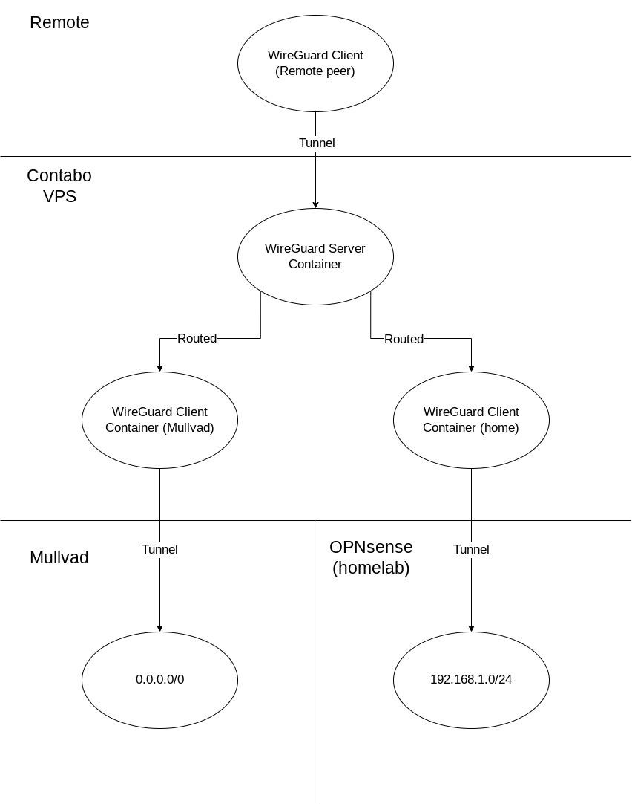

## Introduction

WireGuard at this point needs no introduction as it became quite ubiquitous especially within the homelab community due to its ease of use and high performance. We previously showcased several ways to route host and container traffic through [our WireGuard docker container](https://github.com/linuxserver/docker-wireguard) in a [prior blog article](/blog/routing-docker-host-and-container-traffic-through-wireguard/). In this article, we will showcase a more complex setup utilizing multiple WireGuard containers on a VPS to achieve split tunneling so we can send outgoing connections through a commercial VPN while maintaining access to homelab when remote.


## Background/Motivation

The setup showcased in this article was born out of my specific need to a) tunnel my outgoing connections through a VPN provider like Mullvad for privacy, b) have access to my homelab, and c) maintain as fast of a connection as possible, while on the go (ie. on public wifi at a hotel or a coffeeshop). Needs a) and b) would be easily achieved with a WireGuard server and a client running on my home router (OPNsense), which I already have. However, my cable internet provider's anemic upload speeds translate into a low download speed when connected to my home router remotely. To achieve c), I had to rely on a VPS with a faster connection and split the tunneling between Mullvad and my home. Alternatively, I could split the tunnel on each client's WireGuard config, but that is a lot more work, and each client would use up a separate private key, which becomes an issue with commercial VPNs (Mullvad allows up to 5 keys).

In this article, we will set up 3 WireGuard containers, one in server mode and 2 in client modes, on a [Contabo](https://contabo.com/en) VPS server. One client will connect to [Mullvad](https://mullvad.net/) for most outgoing connections, and the other will connect to my [OPNsense](https://opnsense.org/) router at home for access to my homelab.

Before we start, I should add that while having other containers use the WireGuard container's network (ie. `network_mode: service:wireguard`) seems like the simplest approach, it has some major drawbacks:
- If the WireGuard container is recreated (or in some cases restarted), the other containers also need to be restarted or recreated (depending on the setup).
- Multiple apps using the same WireGuard container's network may have port clashes.
- With our current implementation, a WireGuard container (ie. server) cannot use another WireGuard container's (ie. client) network due to interface clash (`wg0` is hardcoded).

The last point listed becomes a deal breaker for this exercise. Therefore we will rely on routing tables to direct connections between and through WireGuard containers.

** DISCLAIMER: This article is not meant to be a step by step guide, but instead a showcase for what can be achieved with our WireGuard image. We do not officially provide support for routing whole or partial traffic through our WireGuard container (aka split tunneling) as it can be very complex and require specific customization to fit your network setup and your VPN provider's. But you can always seek community support on [our Discord server](https://discord.gg/YWrKVTn?target=_blank)'s #other-support channel. **

## Setup

Here's a bird's eye view of our topology involving the three WireGuard containers:



Let's set up our compose yaml for the three containers:
```yaml
networks:
  default:
    ipam:
      config:
        - subnet: 172.20.0.0/24

services:
  wireguard-home:
    image: lscr.io/linuxserver/wireguard
    container_name: wireguard-home
    cap_add:
      - NET_ADMIN
    environment:
      - PUID=1000
      - PGID=1000
      - TZ=America/New_York
    volumes:
      - /home/aptalca/appdata/wireguard-home:/config
    restart: unless-stopped
    sysctls:
      - net.ipv4.conf.all.src_valid_mark=1
    networks:
      default:
        ipv4_address: 172.20.0.100

  wireguard-mullvad:
    image: lscr.io/linuxserver/wireguard
    container_name: wireguard-mullvad
    cap_add:
      - NET_ADMIN
    environment:
      - PUID=1000
      - PGID=1000
      - TZ=America/New_York
    volumes:
      - /home/aptalca/appdata/wireguard-mullvad:/config
    restart: unless-stopped
    sysctls:
      - net.ipv4.conf.all.src_valid_mark=1
    networks:
      default:
        ipv4_address: 172.20.0.101

  wireguard-server:
    image: lscr.io/linuxserver/wireguard
    container_name: wireguard-server
    cap_add:
      - NET_ADMIN
    environment:
      - PUID=1000
      - PGID=1000
      - TZ=America/New_York
      - PEERS=slate
    ports:
      - 51820:51820/udp
    volumes:
      - /home/aptalca/appdata/wireguard-server:/config
    restart: unless-stopped
    sysctls:
      - net.ipv4.conf.all.src_valid_mark=1
```

As described in the [prior article](/blog/routing-docker-host-and-container-traffic-through-wireguard/), we set static IPs for the two containers that are running in client mode so we can set up the routes through the container IPs. Keep in mind that these are static IPs within the `user defined bridge network` that docker compose creates and not macvlan. The container tunneled to my home server is `172.20.0.100` and the container tunneled to Mullvad is `172.20.0.101`.

We'll drop the following `wg0.conf` files into the config folders of the respective containers:

Tunnel to home:
```
[Interface]
PrivateKey = XXXXXXXXXXXXXXXXXXXXXXX
Address = 10.1.13.12/32
PostUp = iptables -t nat -A POSTROUTING -o wg+ -j MASQUERADE
PreDown = iptables -t nat -D POSTROUTING -o wg+ -j MASQUERADE

[Peer]
PublicKey = XXXXXXXXXXXXXXXXXXXXXXXXX
AllowedIPs = 0.0.0.0/0
Endpoint = my.home.server.domain.url:53
PersistentKeepalive = 25
```

Tunnel to Mullvad:
```
[Interface]
PrivateKey = XXXXXXXXXXXXXXXXXXXXXXXXXXXXXXXXXXX
Address = 10.63.35.56/32
DNS = 193.138.218.74
PostUp = iptables -t nat -A POSTROUTING -o wg+ -j MASQUERADE
PreDown = iptables -t nat -D POSTROUTING -o wg+ -j MASQUERADE

[Peer]
# us-chi-wg-101.relays.mullvad.net Chicago Quadranet
PublicKey = P1Y04kVMViwZrMhjcX8fDmuVWoKl3xm2Hv/aQOmPWH0=
AllowedIPs = 0.0.0.0/0
Endpoint = 66.63.167.114:51820
```
Notes:
- I expose my home WireGuard server at port 51820 as well as 53, because some public wifi block outgoing connections to certain ports including 51820, however they often don't block connections to 53/udp as that's the default DNS port and blocking it would cause a lot issues for clients utilizing external DNS.
- The `PostUp` and `PreDown` settings are there to allow the WireGuard containers to properly route packets coming in from outside of the container, such as from another container.
- Both client containers have `AllowedIPs` set to `0.0.0.0/0` because we will be routing the packets within the server container and not the client containers.

At this point we should have two WireGuard containers set up in client mode, with tunnels established to Mullvad and home, and a server container set up with a single peer named `slate`. Let's test the tunnel connections via the following:
- On the VPS, running `docker exec wireguard-mullvad curl https://am.i.mullvad.net/connected` should return the Mullvad connection status.
- On the VPS, running `docker exec wireguard-home ping 192.168.1.1` should return a successful ping of my OPNsense router from inside my home LAN.
- Using any client device to connect to the server and running `ping 172.20.0.100` and `ping 172.20.0.101` should successfully ping the two client containers on the VPS through the tunnel. Running `curl icanhazip.com` should return the VPS server's public IP as we did not yet set up the routing rules for the server container; therefore the outgoing connections go through the default networking stack of the VPS.

Note: I only have one peer set up for the server container on the VPS, named `slate`, because I prefer to use a [travel router](https://www.gl-inet.com/products/gl-ar750s/) that I carry with me whenever I travel. At a hotel or any other public hotspot, I connect the router via ethernet, if available, or WISP, if not. If there is a captive portal, I only have to go through it once and don't have to worry about restrictions on the number of devices as all personal devices like phones, tablets, laptops and even a streamer like a FireTV stick connect through this one device. The router is set up to route all connections through WireGuard (except for the streamer as a lot of streaming services refuse to work over commercial VPNs) and automatically connects to the VPS WireGuard server container.

Now let's set up the routing rules for the WireGuard server container so our connections are properly routed through the two WireGuard client containers.
We'll go ahead and edit the file `/home/aptalca/appdata/wireguard-server/templates/server.conf` to add custom `PostUp` and `PreDown` rules to establish the routes:
```
[Interface]
Address = ${INTERFACE}.1
ListenPort = 51820
PrivateKey = $(cat /config/server/privatekey-server)
PostUp = iptables -A FORWARD -i %i -j ACCEPT; iptables -A FORWARD -o %i -j ACCEPT; iptables -t nat -A POSTROUTING -o eth0 -j MASQUERADE
PostUp = wg set wg0 fwmark 51820
PostUp = ip -4 route add 0.0.0.0/0 via 172.20.0.101 table 51820
PostUp = ip -4 rule add not fwmark 51820 table 51820
PostUp = ip -4 rule add table main suppress_prefixlength 0
PostUp = ip route add 192.168.1.0/24 via 172.20.0.100
PostDown = iptables -D FORWARD -i %i -j ACCEPT; iptables -D FORWARD -o %i -j ACCEPT; iptables -t nat -D POSTROUTING -o eth0 -j MASQUERADE; ip route del 192.168.1.0/24 via 172.20.0.100
```
Let's dissect these rules:
- `iptables -A FORWARD -i %i -j ACCEPT; iptables -A FORWARD -o %i -j ACCEPT; iptables -t nat -A POSTROUTING -o eth0 -j MASQUERADE` these are the default rules that come with the template and allow for routing packets through the server tunnel. We leave them as is.
- `wg set wg0 fwmark 51820` tells WireGuard to mark the packets going through the tunnel so we can set other rules based on the existence of fwmark (this is automatically done for the client containers by the `wg-quick` script as seen in their logs, but we have to manually define it for the server container).
- `ip -4 rule add not fwmark 51820 table 51820` is the special rule that allows the server container to be able to distinguish between packets meant for the WireGuard tunnel going back to the remote peer (my travel router in this case) and the packets meant for outgoing connections through the two client containers. We told WireGuard to mark all packets meant for the tunnel with fwmark 51820 in the previous rule. Here, we make sure that any packet not marked (meaning packets meant for the client containers) are handled via the rules listed on routing table 51820. Any marked packet will be handled via the routes listed on the default routing table.
- `ip -4 route add 0.0.0.0/0 via 172.20.0.101 table 51820` adds a rule to routing table 51820 for routing all packets through the WireGuard client container connected to Mullvad.
- `ip -4 rule add table main suppress_prefixlength 0` is to respect all manual routes that we added to the main table. This is set automatically by `wg-quick` in the client container but we need to manually set it for the server container.
- `ip route add 192.168.1.0/24 via 172.20.0.100` is to route packets meant for my home LAN through the WireGuard client container tunneled to my home. We could set this on the routing table 51820 like the Mullvad one, however, since this is a specific rule (rather than a wide `0.0.0.0/0` like we set for Mullvad), it can reside on the main routing table. The peers connected to the server should not be in the `192.168.1.0/24` range so there shouldn't be any clashes but YMMV.

Now we can force the regeneration of the server container's `wg0.conf` by deleting it and restarting the container. A new `wg0.conf` should be created reflecting the updated `PostUp` and `PreDown` rules from the template.

Let's check the rules and the routing tables:
```bash
$ docker exec wireguard-server ip rule
0:      from all lookup local
32764:  from all lookup main suppress_prefixlength 0
32765:  not from all fwmark 0xca6c lookup 51820
32766:  from all lookup main
32767:  from all lookup default
```
```bash
$ docker exec wireguard-server ip route show table main
default via 172.20.0.1 dev eth0 
10.13.13.2 dev wg0 scope link 
172.20.0.0/24 dev eth0 proto kernel scope link src 172.20.0.10 
192.168.1.0/24 via 172.20.0.100 dev eth0
```
```bash
$ docker exec wireguard-server ip route show table 51820
default via 172.20.0.101 dev eth0
```
We can see above that our new routing table 51820 was successfully created, our rule for table 51820 lookups added, as well as the rules for `0.0.0.0/0` and `192.168.1.0/24` IP ranges in the correct tables. 

According to these rules and routing tables, when a packet comes in from the peer `slate` through the tunnel, if it's destined for `192.168.1.10`, it will match the last route in the main table `192.168.1.0/24 via 172.20.0.100 dev eth0` and will be sent to the WireGuard client connected to home, and will be marked with the fwmark and sent through the tunnel to home. When the response comes back from home, the packet will go back through the tunnel and hit the WireGuard client container connected to home. The container will then route the packet to the WireGuard server container. The server container will see the destination as `10.13.13.2`, which is `slate`'s tunnel IP, so it will mark it with the fwmark 51820, and it will be sent through the tunnel to `slate` (or rather `slate`'s public IP as an encrypted packet).

When a packet comes in from the peer `slate` through the tunnel and it's destined for `142.251.40.174` (google.com), the packet not being marked, it will match the rule `32765:  not from all fwmark 0xca6c lookup 51820` and then will match the default rule in table 51820, `default via 172.20.0.101 dev eth0`, which will route it to the WireGuard client container tunneled to Mullvad. The packet coming back from Mullvad through the tunnel will be routed by the WireGuard client container to the WireGuard server container and being destined for `slate`, it will be marked and sent through the tunnel.

Now we can check the routes via the remote client (`slate`).
- `curl https://am.i.mullvad.net/connected` should return that it is indeed connected to the Mullvad server in Chicago.
- `ping 192.168.1.1` should ping the home OPNsense router successfully.

Now that the routes are all working properly, we can focus on the DNS. By default, with the above settings, the remote client's DNS will be set to the tunnel IP of the WireGuard server container and the DNS server connected will be Coredns running inside that container. By default, Coredns is set up to forward all requests to `/etc/resolv.conf`, which should contain the Docker bridge DNS resolver address, `127.0.0.11`, which in turn forwards to the host's default DNS server set. In short, our remote client will be able to resolve other container names in the same user defined docker bridge on the VPS, however no resolution will be done for any hostnames in our home LAN.

Some alternatives include:
- Setting the DNS on the remote client's `wg0.conf` to Mullvad's DNS address. All DNS requests will go through the Mullvad client container, but no resolution will be made for other containers on the VPS, or home LAN hostnames.
- Setting the DNS on the remote client's `wg0.conf` to the homelab's OPNsense address `192.168.1.1` so home LAN hostnames can be resolved. With that setting, all DNS requests will go through the tunnel to home, but the other containers on the VPS will not be resolved by hostname.
- Leaving the DNS setting in `wg0.conf` default as defined above, but modifying Coredns settings will allow for both container name resolution, and resolving homelab addresses by manually defining them. The following `Corefile` and the custom config file result in Coredns resolving my personal domain and all subdomains to the LAN IP of my homelab running SWAG, which in turn reverse proxies all services, all going through the tunnel:

Corefile:
```
. {
    file my.personal.domain.com my.personal.domain.com
    loop
    forward . /etc/resolv.conf
}
```
`my.personal.domain.com` config file:
```
$ORIGIN my.personal.domain.com.
@       3600 IN SOA sns.dns.icann.org. noc.dns.icann.org. 2017042745 7200 3600 1209600 3600
        3600 IN NS a.iana-servers.net.
        3600 IN NS b.iana-servers.net.
        IN A 192.168.1.10

*       IN CNAME my.personal.domain.com.
```

## Further Reading

As you can see, very complicated split tunnels can be created and handled by multiple WireGuard containers and routing tables set up via PostUp arguments. No `host networking` (not supported for our WireGuard image) and no `network_mode: service:wireguard`. I much prefer routing tables over having containers use another container's network stack, because with routing tables you can freely restart or recreate the containers and the connections are automatically reestablished. If you need more info on WireGuard, routing, or split tunnels via the clients' confs, check out the articles listed below.
- [https://www.linuxserver.io/blog/routing-docker-host-and-container-traffic-through-wireguard](/blog/routing-docker-host-and-container-traffic-through-wireguard/)
- [https://spad.uk/wireguard-as-a-vpn-client-in-docker-using-pia/](https://spad.uk/wireguard-as-a-vpn-client-in-docker-using-pia/)
- [https://virtualize.link/vpn/](https://virtualize.link/vpn/)
- [https://virtualize.link/split/](https://virtualize.link/split/)
