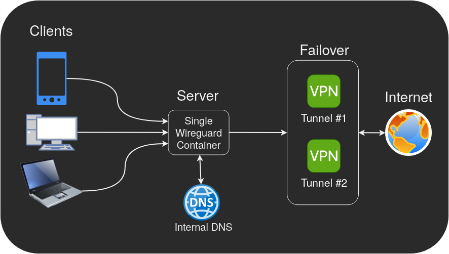

In a couple of prior articles ([**here**](/blog/routing-docker-host-and-container-traffic-through-wireguard/) and [**here**](/blog/advanced-wireguard-container-routing/)) we showcased the capabilities of [our WireGuard Docker container](https://github.com/linuxserver/docker-wireguard) with some real world examples. At the time, our WireGuard container only supported one active tunnel at a time so the second article resorted to using multiple WireGuard containers running on the same host and using the host's routing tables to do advanced routing between and through them.

In October 2023, our WireGuard container received a [major update](https://github.com/linuxserver/docker-wireguard#versions) and started supporting multiple WireGuard tunnels at a time, which made it much more versatile than before. In this article we'll take advantage of this new capability and showcase a setup that involves a single container that acts as both a server and a client that tunnels peers through multiple redundant VPN connections while maintaining access to the LAN.

Many VPN providers have a limit on the number of devices (or tunnels). This setup will allow you to have an unlimited amount of devices tunneled through a single VPN connection while also supporting a fail-over backup connection!

DISCLAIMER: This article is not meant to be a step by step guide, but instead a showcase for what can be achieved with our WireGuard image. We do not officially provide support for routing whole or partial traffic through our WireGuard container (aka split tunneling) as it can be very complex and require specific customization to fit your network setup and your VPN provider's. But you can always seek community support on our [Discord server](https://discord.gg/YWrKVTn)'s #other-support channel. 

Tested on Ubuntu 23.04, Docker 24.0.5, Docker Compose 2.20.2, with Mullvad.


## Requirements

- A working instance of our [Wireguard container](https://github.com/linuxserver/docker-wireguard) in server mode.

## Initial WireGuard Server Configuration

Configure a standard WireGuard server according to the [WireGuard documentation](https://github.com/linuxserver/docker-wireguard).

```yaml
  wireguard:
    image: lscr.io/linuxserver/wireguard:latest
    container_name: wireguard
    cap_add:
      - NET_ADMIN
      - SYS_MODULE
    environment:
      - PUID=1000
      - PGID=1000
      - TZ=Etc/UTC
      - SERVERURL=wireguard.domain.com
      - SERVERPORT=51820
      - PEERS=1
      - PEERDNS=auto
      - INTERNAL_SUBNET=10.13.13.0
    volumes:
      - /path/to/appdata/config:/config
      - /lib/modules:/lib/modules
    ports:
      - 51820:51820/udp
    sysctls:
      - net.ipv4.conf.all.src_valid_mark=1
    restart: unless-stopped
```

Start the container and validate that `docker logs wireguard` contains no errors, and validate that the server is working properly by connecting a client to it.

## VPN Client Tunnels Configuration

Copy the 2 WireGuard configs that you get from your VPN providers into files under `/config/wg_confs/wg1.conf` and `/config/wg_confs/wg2.conf`.

### Example wg1.conf

Make the following changes:

- Add `Table = 55111` to distinguish rules for this interface.
- Add `PostUp` and `PreDown` rules to nat and firewall the traffic.
- Add `PersistentKeepalive = 25` to keep the tunnel alive.
- Make sure you're using the `PrivateKey`, `Address`, `PublicKey`, and `Endpoint` that you got from your VPN provider (below is just an example).

```lua
[Interface]
PrivateKey = ...
Address = 10.65.156.233/32
Table = 55111

PostUp = iptables -I FORWARD -i wg0 -o %i -j ACCEPT
PostUp = iptables -t nat -A POSTROUTING -o %i -j MASQUERADE
PostUp = ip rule add pref 10001 from 10.13.13.0/24 lookup 55111
PreDown = ip rule del from 10.13.13.0/24 lookup 55111
PreDown = iptables -t nat -D POSTROUTING -o %i -j MASQUERADE
PreDown = iptables -D FORWARD -i wg0 -o %i -j ACCEPT

[Peer]
PublicKey = ...
AllowedIPs = 0.0.0.0/0
Endpoint = 169.150.217.215:51820
PersistentKeepalive = 25
```

### Example wg2.conf

Make the following changes:

- Add `Table = 55112` to distinguish rules for this interface.
- Add `PostUp` and `PreDown` rules to nat and firewall the traffic.
- Add `PersistentKeepalive = 25` to keep the tunnel alive.
- Make sure you're using the `PrivateKey`, `Address`, `PublicKey`, and `Endpoint` that you got from your VPN provider (below is just an example).

```lua
[Interface]
PrivateKey = ...
Address = 10.67.126.217/32
Table = 55112

PostUp = iptables -I FORWARD -i wg0 -o %i -j ACCEPT
PostUp = iptables -t nat -A POSTROUTING -o %i -j MASQUERADE
PostUp = ip rule add pref 10002 from 10.13.13.0/24 lookup 55112
PreDown = ip rule del from 10.13.13.0/24 lookup 55112
PreDown = iptables -t nat -D POSTROUTING -o %i -j MASQUERADE
PreDown = iptables -D FORWARD -i wg0 -o %i -j ACCEPT

[Peer]
PublicKey = ...
AllowedIPs = 0.0.0.0/0
Endpoint = 169.150.217.232:51820
PersistentKeepalive = 25
```

Save the changes and restart the container with `docker restart wireguard`, validate that `docker logs wireguard` contains no errors.

Perform the following validations to check that the VPN tunnels works:

- Check that you have connectivity on wg1 by running `docker exec wireguard ping -c4 -I wg1 1.1.1.1`.
- Check that you have connectivity on wg2 by running `docker exec wireguard ping -c4 -I wg2 1.1.1.1`.
- Check the details of your VPN tunnel on wg1 by running `docker exec wireguard curl --interface wg1 -s https://am.i.mullvad.net/json`, you should get an IP that is different from your WAN IP.
- Check the details of your VPN tunnel on wg2 by running `docker exec wireguard curl --interface wg2 -s https://am.i.mullvad.net/json`, you should get an IP that is different from your WAN IP.

## Failover Script

Place the following fail-over script under `/config/wg_failover.sh`, the defaults match the examples but you can read the comments explaining each parameter and modify them.

```bash
#!/bin/bash

# Ping targets to check connectivity, the default is cloudflare and google DNS addresses
TARGETS=("1.1.1.1" "1.0.0.1" "8.8.8.8" "8.8.4.4")
# How many failed pings are allowed before failover
FAILOVER_LIMIT=2
# The subnets that should be tunneled through wireguard
LOCAL_RANGES=("10.13.13.0/24")
# An array of tunnel details corresponding to the tunnel conf: <tunnel-name>;<table-number>;<rule-priority>
TUNNELS=("wg1;55111;10001" "wg2;55112;10002")
# Connectivity check interval in seconds
PING_INTERVAL=20
LOG_FILE="/config/wg_failover.log"

apply_rules () {
	for LOCAL_RANGE in "${LOCAL_RANGES[@]}"
	do
		ip rule del from ${LOCAL_RANGE} lookup $1
		ip rule add pref $2 from ${LOCAL_RANGE} lookup $1
	done
}

FAILED=()
INDEX=0
while sleep $PING_INTERVAL
do
	COUNTER=1
	IFS=";" read -r -a TUNNEL <<< "${TUNNELS[INDEX]}"
	TUNNEL_NAME="${TUNNEL[0]}"
	TUNNEL_TABLE=${TUNNEL[1]}
	TUNNEL_PRIORITY=${TUNNEL[2]}
	wg-quick up "${TUNNEL_NAME}" > /dev/null 2>&1

	for TARGET in "${TARGETS[@]}"
	do
		if ! ping -c1 -w10 -I "${TUNNEL_NAME}" "${TARGET}" > /dev/null 2>&1; then
		  (( COUNTER++ ))
		fi
	done
	if [[ "$COUNTER" -gt "$FAILOVER_LIMIT" ]] && [[ ! "${FAILED[*]}" =~ "${TUNNEL_NAME}" ]]; then
		echo "$(date +'%Y-%m-%d %T') - ${TUNNEL_NAME} failed ${COUNTER} pings" >> $LOG_FILE
		apply_rules "${TUNNEL_TABLE}" "$(( TUNNEL_PRIORITY+1000 ))"
		FAILED+=(${TUNNEL_NAME})
	elif [[ "$COUNTER" -le "$FAILOVER_LIMIT" ]] && [[ "${FAILED[*]}" =~ "${TUNNEL_NAME}" ]]; then
		echo "$(date +'%Y-%m-%d %T') - ${TUNNEL_NAME} restored" >> $LOG_FILE
		apply_rules "${TUNNEL_TABLE}" "$(( TUNNEL_PRIORITY ))"
		FAILED=( "${FAILED[@]/$TUNNEL_NAME}" )
	elif [[ "$COUNTER" -gt "$FAILOVER_LIMIT" ]] && [[ "${FAILED[*]}" =~ "${TUNNEL_NAME}" ]]; then
		wg-quick down "${TUNNEL_NAME}" > /dev/null 2>&1
	fi
	(( INDEX++ ))
	if [[ $INDEX+1 > ${#TUNNELS[@]} ]]; then
		INDEX=0
	fi
done

```

## WireGuard Server Configuration Changes
Edit `/config/templates/server.conf`, replace the PostUp/PreDown rules with the rules listed below, these rules are required for the server to forward traffic to the VPN client tunnels and activate the fail-over script.

Replace `192.168.10.0/24` with your LAN subnet.

```lua
PostUp = ip rule add pref 100 to 192.168.10.0/24 lookup main
PostUp = ip rule add pref 100 to 10.13.13.0/24 lookup main
PostUp = iptables -I FORWARD -i %i -d 10.0.0.0/8 -j ACCEPT
PostUp = iptables -I FORWARD -i %i -d 172.16.0.0/12 -j ACCEPT
PostUp = iptables -I FORWARD -i %i -d 192.168.0.0/16 -j ACCEPT
PostUp = iptables -I FORWARD -o %i -m state --state RELATED,ESTABLISHED -j ACCEPT
PostUp = iptables -A FORWARD -j REJECT
PostUp = iptables -t nat -A POSTROUTING -o eth0 -j MASQUERADE
PostUp = /config/wg_failover.sh &
PreDown = iptables -t nat -D POSTROUTING -o eth0 -j MASQUERADE
PreDown = iptables -D FORWARD -j REJECT
PreDown = iptables -D FORWARD -o %i -m state --state RELATED,ESTABLISHED -j ACCEPT
PreDown = iptables -D FORWARD -i %i -d 10.0.0.0/8 -j ACCEPT
PreDown = iptables -D FORWARD -i %i -d 172.16.0.0/12 -j ACCEPT
PreDown = iptables -D FORWARD -i %i -d 192.168.0.0/16 -j ACCEPT
PreDown = ip rule del to 10.13.13.0/24 lookup main
PreDown = ip rule del to 192.168.10.0/24 lookup main
```

Save the changes and delete `/config/wg_confs/wg0.conf` so it would be generated again, restart the container with `docker restart wireguard`, validate that `docker logs wireguard` contains no errors.

Try navigating to `https://am.i.mullvad.net/json` on one of your client devices and verify that the WireGuard server is working properly and that you're tunneled through one the VPN tunnels.
