If you're like me (you run a home server with varying levels of personal data on it, but you're a bit lazy) you'll probably want to set up some kind of backup routine to ensure your data has an acceptable level of redundancy. Let's ignore RAID solutions for now (which is of course a valid first port of call) and instead consider how to go about backing up your data.

Let's first go over what this post **isn't**: this is not an explanation on best practice for scheduling routines, security, or structure. This is meant to be a (hopefully) reasonably quick and to the point set-up guide on how to go from having no backup solution in place, to having something reasonably simple available, but configurable at a later date.

Now, the tools I've opted for are:

* [restic](https://restic.net), a tool which has gained popularity for its configurablilty and performance. This manages the physical backups, including snapshots, ecnryption and file change detection.
* [Backrest](https://github.com/garethgeorge/backrest), a Web UI which orchestrates calls to restic, and allows for scheduled backup configuration.

restic itself is a CLI tool which has no built-in scheduling support. To allow for daily/weekly/monthly backups of your data, you'd be required to set this up yourself; traditionally using something like `cron`. Backrest makes this easier to mantain via its web UI.

## Set up Backrest

For the sake of ease (and because this is LinuxServer), I'll be recommending the Backrest Docker image. This allows you to set up which directories you wish to be backed up, and also ensure you can obtain regular updates to the software through Docker Hub (hopefully the developer heeds recent requests for the image to be mirrored on GHCR as well).

Backrest provides their own image, which we'll be using. I've omitted some optional params to keep things as simple as possible.

```yaml
version: "3.8"
services:
  backrest:
    image: garethgeorge/backrest:latest
    container_name: backrest
    hostname: backrest
    volumes:
      - /opt/appdata/backrest/data:/data
      - /opt/appdata/backrest/config:/config
      - /opt/appdata/backrest/cache:/cache
      - /opt/appdata/backrest/tmp:/tmp
      - /storage/userdata:/userdata
    environment:
      - BACKREST_DATA=/data
      - BACKREST_CONFIG=/config/config.json
      - XDG_CACHE_HOME=/cache
      - TMPDIR=/tmp
      - TZ=Europe/London
    ports:
      - "9898:9898"
    restart: unless-stopped
```

I generally keep container configuration in the `/opt/appdata` directory (in this case, for this container `/opt/appdata/backrest`). Yours may vary, but ensure you map those to wherever your appdata directory is. I keep my personal documents/photos etc in `/storage/useradata` (in various subdirectories, but this is the root for those), so have mounted this to the `/userdata` volume mount point.

You may also wish to configure your `TZ` environment variable depending on your local time zone.

## Set up Backrest

One of the nice things about Backrest is it can manage its own copy of restic, rather than relying on you to download and install a version of it yourself. It will run a basic `PATH` check at startup, see if restic is on it, and if not, will download a copy of it and place it in its internal data path. One benefit of this is it will always use a version of restic it knows it is compatible with.

Start up the Backrest container and navigate to **http://your_host_ip:9898**.

### Set up an instance ID and user

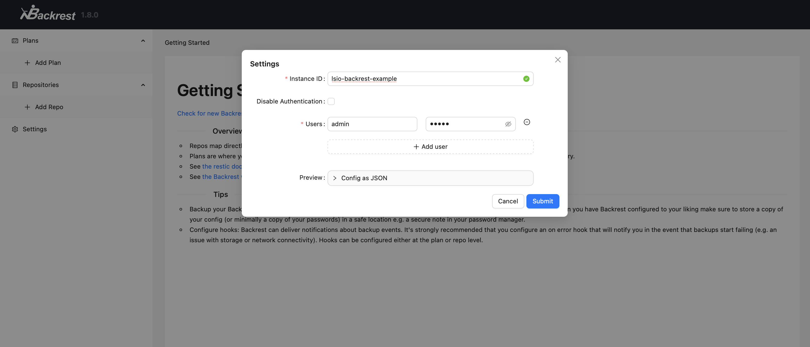

When Backrest starts up for the first time, you will be prompted to set up and instance ID, and a set of users. For this example I've just created the classic admin:admin account (please, _please_ use a strong password). The **instance ID** is required, and identifies this instance of backrest, I believe to help it create unique identifiers for restic plans etc.

### Create a Backblaze B2 bucket

restic (and by extension Backrest) supports a [large number of source repositories](https://restic.readthedocs.io/en/stable/030_preparing_a_new_repo.html) but this example will be using [Backblaze's B2 cloud storage](https://www.backblaze.com/cloud-storage), an S3-compatible object storage solution which I've found to be a bit cheaper to use than AWS S3. You are of course welcome to use any of the other source repository types.

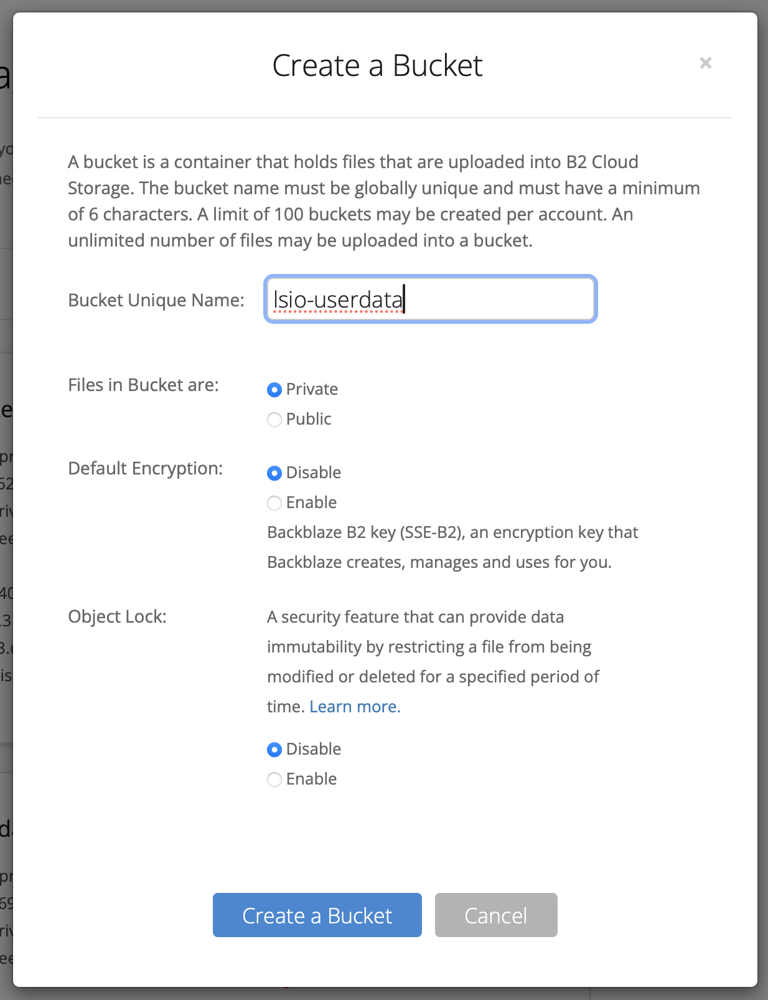

In the admin panel of your account, create a new bucket: give it a name, and keep it private. This will be where your backups are stored.

- Files in bucket are: **Private**
- Default Encryption: **Disable** (we will let restic deal with encryption)
- Object Lock: **Disable**

#### Create an application key

Restic has [openly admitted that its B2 connector doesn't work very well](https://restic.readthedocs.io/en/stable/030_preparing_a_new_repo.html#backblaze-b2), and as such recommends you use its S3 connector instead. B2 is S3 compliant, meaning any S3 client may use a B2 bucket as if it were actually S3. With that in mind, we need to create some S3-compatible API keys. Under the **Application keys** menu, add a new key:

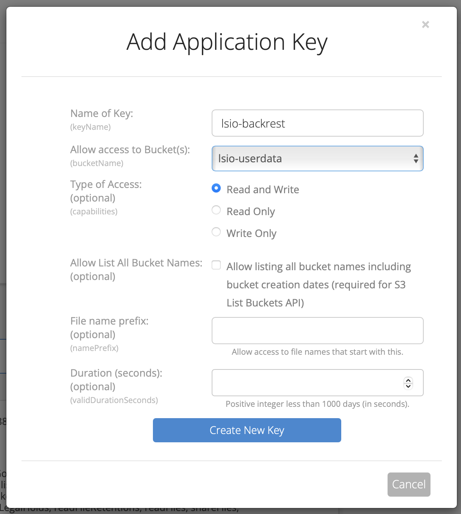

**Note**: as I mentioned, this post is not an article on best practices for S3 access rights. Creating an application key through this web UI will give it a large number of access rights to your selected bucket (or all buckets). That's not necessarily a bad thing, but a diligent user may be able to fine-tune these further with a bit more time and effort.

- Allow access to Bucket(s): either left blank for all bucket access, or your bucket
- Type of Access: **Read and Write**
- Everything else left blank

Creation of this new key will create three values: **keyID**, **keyName** and **applicationKey**. You will need to save keyID and keyName, as these represent your S3 access_key_id and secret_access_key, respectively. 

### Create a restic repository

Now, back to Backrest. You've got somewhere for backups to go, so now we need to tell restic how to connect to it. This is achieved through the Repository system. Click on **Add Repo** in Backrest, and fill in the following:

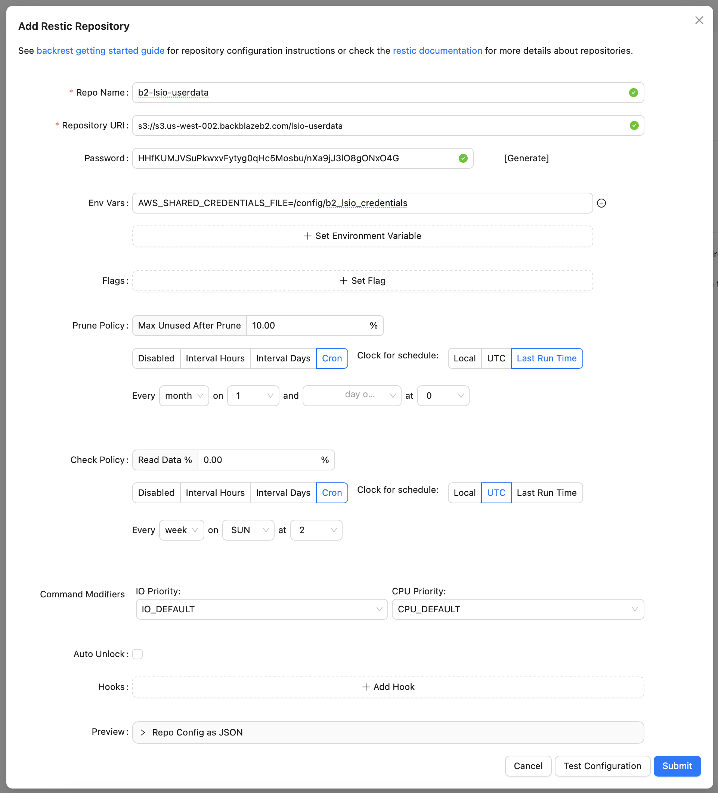

* Repo name: whatever you want, but I _personally_ name mine based on type and purpose, so for me **b2-lsio-userdata**
* Repository URI: **s3://s3.[YOUR_REGION].backblazeb2.com/[YOUR_BUCKET_NAME]**. B2's URI for your buckets will be defined on the web portal where your buckets are listed. You need to use this as the base URI, with a suffix of your bucket name.
* Password: [Generate], this will create a seed for data encryption. It is worth saving this somewhere in case you ever need to decrypt your data from another restic instance.
* Env vars: **Set Environment Variable**
  * `AWS_SHARED_CREDENTIALS_FILE=/config/b2_repository_credentials`
* Prune Policy: I've set to once a month
* Check Policy: I've set to run every Sunday

Leave everything else blank/unchanged.

#### b2_repository_credentials

You'll probably have noticed that the environment variable for your credentials references a file that doesn't exist yet. Connecting to S3 requires env variables referencing your key ID and secret key, but I prefer to put these in an external file to avoid leaking the details in the environment.

Make a new file in `/opt/appdata/backrest/config` called `b2_repository_credentials`
```
[default]
aws_access_key_id=<B2_KEY_ID>
aws_secret_access_key=<B2_KEY_NAME>
```

Hit **Test Configuration** and you should see a confirmation message at the top of the screen:

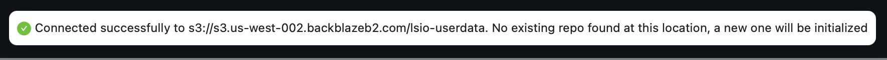

If you don't see this, double-check the file permissions on your credentials file, and that it's in the right directory. Remember that paths referenced in Backrest are relative to the container-side mount path (hence `/config/b2_repository_credentials`).

**Save** your repository, and you should see it in the left-hand menu.

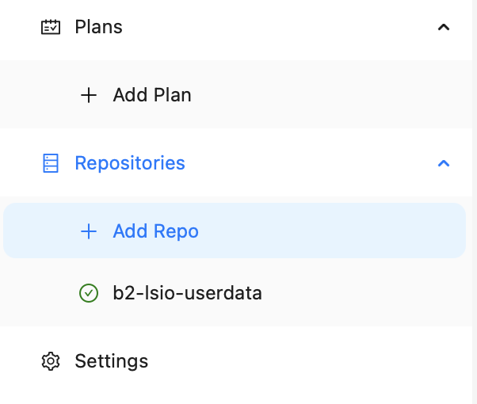

### Create a backup plan

Plans are the specific details over what is being backed up, when, and where it is stored. Let's assume you have a user directory you want to back up.

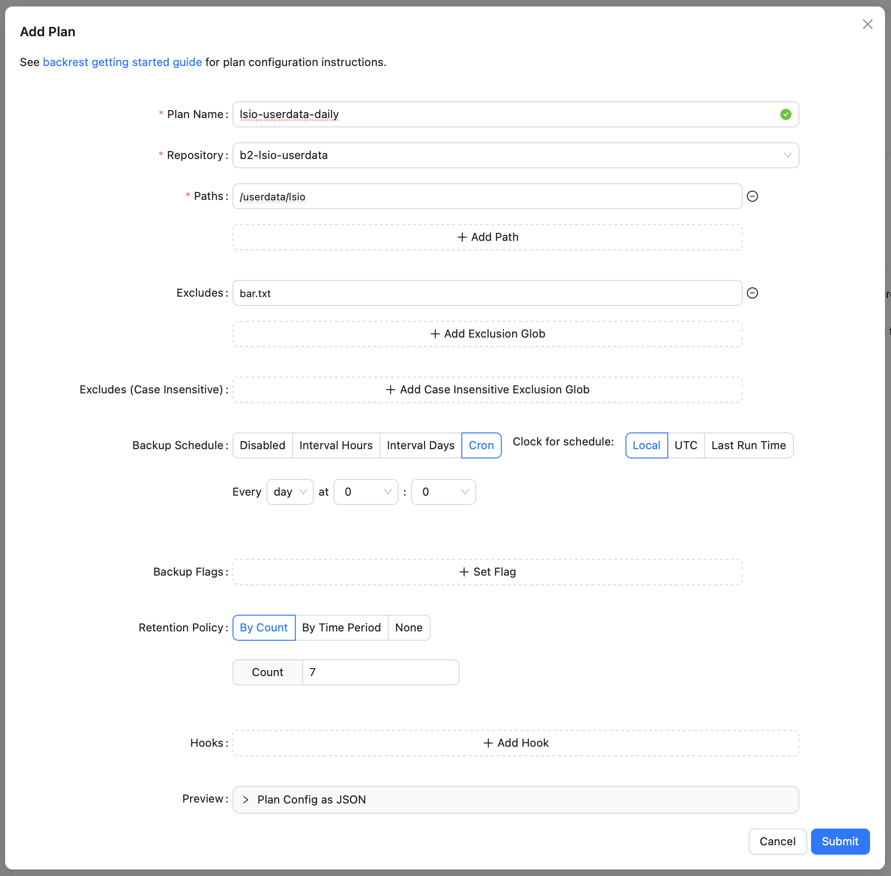

* Plan name: something descriptive over what is being backed up. I personally like to put in what is backed up, and how often (again, this is a completely personal choice, and how you name yours is entirely up to you).
* Repository: the repository you just created
* Paths: the directory(ies) you wish to back up. Keep it simple; I tend to back up one root directory with everything in it, with some possible exclusions. Remember, the path is container-relative, so it'll be within `/useradata`, in my case I have a directory `/userdata/lsio` I want to back up
* Excludes: names of files or directories which you **don't** want backed up. Useful if you want to partially back up a directory. My example shows I do not want `bar.txt` backed up.
* Backup schedule: Lets you define how often this backup will run. I find **Cron** to be the most flexible (because you can define times)
* Retention policy: up to you, but I tend to opt for **n-last** backups retained in case i need to restore a non-latest snapshot. The more you retain, the more storage is needed in the repository.

Hit **Submit**, and you should now have a new plan configured.

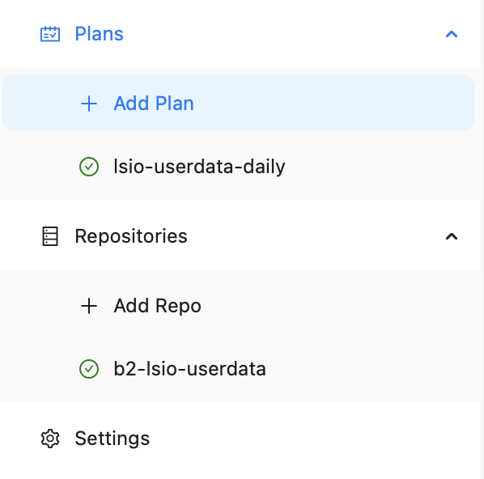

## Running backups

The plan is set up to run on a schedule, but you may still manually run plans whenever you want (often useful for testing connectivity etc). Click on the plan you've just created and you'll be shown its upcoming schedule:

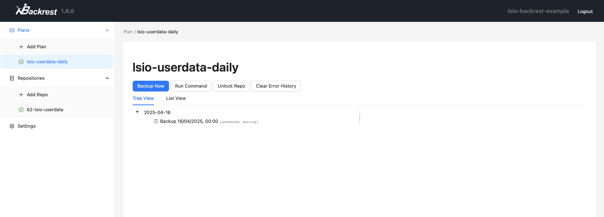

Click on **Backup Now**, which will trigger a manual run of the plan. Assuming everything's run OK, you'll be provided with the outcome of the execution:

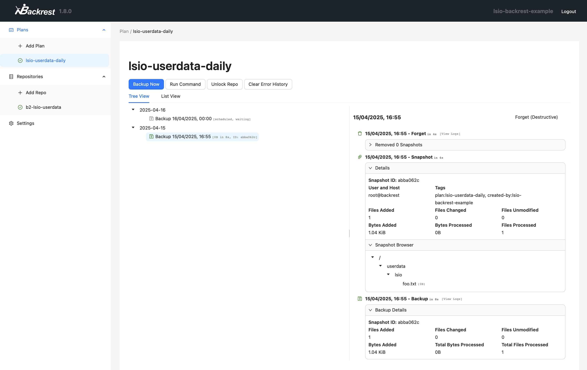

You'll see the snapshot creation was successful, and included a single file `foo.txt` (note that `bar.txt` was excluded), stored in the B2 bucket. The contents of your backups are stored in a restic-owned directory structure in your bucket, encrypted using the seed password you provided in your repository configuration.

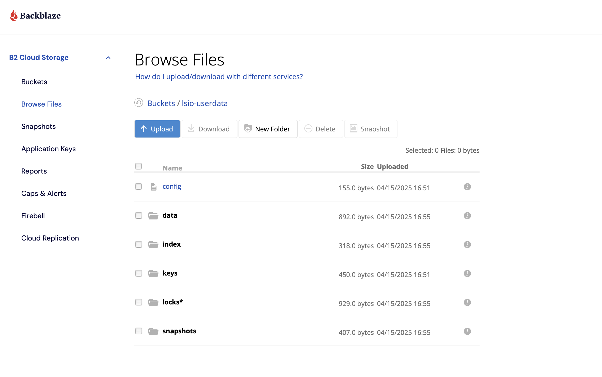

## And that's about it!

restic is an incredibly powerful backup tool, but it can be a little intimidating given its high configurability and lack of GUI (yes, some people do prefer buttons). The developers behind Backrest have made this tool even more accessible via its slick UI, so they should be extremely proud with what they've accomplished. I would certainly recommend you head over to their [GitHub page](https://github.com/garethgeorge/backrest) and share some love.

Finally, this guide is non-exhaustive. I've defined an incredibly basic plan structure, which should meet the majority of a simple use-case's needs (i.e. I have a directory, I want it backed up somewhere, preferably once a day or so). There are so many other options for configuration, schedules, and repository types. You could also set up multiple plans to back up the same directory to multiple repositories. I'd recommend having a play once you're comfortable with what Backrest and restic can do. 

One thing I would recommend is ensuring you run reasonably regular checks on your snapshots using the built-in `check` command, and the scheduled checks in your repository config, alluded to above, and also running occasional restorations on a couple of files in your backups to ensure everything is as it should be. Don't worry about doing this often; one or two every now and again would suffice for peace of mind.
