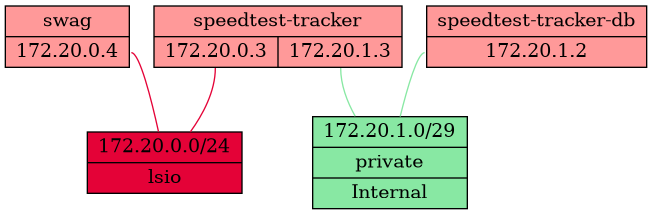

Many years ago we wrote a blog post on [Docker networks](/blog/2017-10-17-using-docker-networks-for-better-inter-container-communication/) and how to use them, but that was 2017 and this is now so surely everything has changed?

Well, not really, *but* at lot of this stuff is abstracted away by management interfaces and people don't understand what's going on behind the scenes so they make bad decisions that come back to haunt them 6 months down the line. With that in mind we're going to try present a clear idea of what good practice looks like for Docker networking so you can properly plan out your infrastructure and avoid the pain of having to rip everything out again when you run into problems.

### Docker Network Types

There are lots of different types of Docker network available to you:

* None - As you'd expect, no networking at all
* Host - Attach the container directly to the host's network interface
* Macvlan - A virtual host sub-interface with its own IP and MAC addresses on your LAN
* IPvlan - A virtual layer 2 host sub-interface with its own IP addresses on your LAN, or virtual layer 3 interface
* Overlay - A distributed network between multiple Docker Swarm nodes
* (Default) Bridge - The built-in (and [very limited](https://docs.docker.com/engine/network/drivers/bridge/#differences-between-user-defined-bridges-and-the-default-bridge)) bridge network. Docker will NAT traffic to/from the host interface
* (User-defined) Bridge - A custom bridge network. Docker will NAT traffic to/from the host interface

For our purposes today we only care about user-defined bridge networks; there are use cases for Macvlan/IPvlan but they're outside the scope of this post as 99% of the time they're the wrong choice. You can think of a bridge network as its own mini-LAN, with Docker passing traffic in and out via NAT the same way you would with your router.

### Inter-Container Communication

The most important feature of a user-defined bridge network is that it enables DNS name resolution and communication between its containers; if you have your `speedtest-tracker` container and your `speedtest-tracker-db` Postgres container on the `lsio` bridge network you can tell Speedtest Tracker to use `speedtest-tracker-db:5432` as the database host rather than having to use the host IP, and having to expose ports. You can also control the size of the network, and whether or not it can communicate with your wider LAN/WAN networks. One of the side effects of this is that you no longer have to worry about port conflicts. You can have 50 containers all on the same bridge network, all using port 80, and it doesn't matter. Your reverse proxy is the only thing that needs to expose port 80 (and 443) to the host.

You can create bridge networks with the Docker `docker network create` CLI command, but Docker Compose will do all the heavy lifting for you, so let's work with that for our examples.

#### Compose Networking Basics

If you don't define any networks in your compose project then it will automatically create a `<compose project>_default` network with default settings and attach all containers in the project to it, but if you want to move beyond the default networks, you can do something like this:

```yaml
services:
  speedtest-tracker:
    image: lscr.io/linuxserver/speedtest-tracker:latest
    container_name: speedtest-tracker
    [...]
    networks:
      - lsio
      - private

  speedtest-tracker-db:
    image: docker.io/postgres:15-alpine
    container_name: speedtest-tracker-db
    [...]
    networks:
      - private

  swag:
    image: lscr.io/linuxserver/swag:latest
    container_name: swag
    [...]
    networks:
      - lsio
    ports:
      - 443:443
      - 80:80

networks:
  lsio:
    name: lsio
    ipam:
      config:
        - subnet: 172.20.0.0/24
  private:
    name: private
    internal: true
    ipam:
      config:
        - subnet: 172.20.1.0/29
```

What we've got here is one container that needs to talk to all the others (`speedtest-tracker`), one that doesn't need to make any kind of outbound connections (`speedtest-tracker-db`), and one that needs to be exposed to the host (`swag`). `speedtest-tracker` is connected to the `lsio` network, which also contains our `swag` reverse proxy, and to our `private` network which also contains our `speedtest-tracker-db` Postgres database. You'll notice that only the `swag` container has any ports exposed, because all other communication is over the bridge networks. We have flagged the `private` network as `internal`, which means no traffic can route in or out of that network, so even if you were to expose ports on the `speedtest-tracker-db` container you couldn't reach it from the host/LAN. We've also assigned a subnet to each network; a /24 (254 usable addresses) for the `lsio` network as we don't know how many containers we might end up needing to reverse proxy, and a /29 (6 usable addresses) for the `private` network. We've done this because the default subnet allocation for a bridge network is a /16 (65,534 usable addresses), which is overkill in almost 100% of cases and can lead to address pool exhaustion. If you don't care about that, you can omit everything except the `name:` and everything else will use the defaults.

If it helps you to visualise it, here's a Graphviz output showing the networks we've created and the links between them:


If you want to add a container to both the `default` network *and* another custom network you must specify both, e.g.

```yaml
  swag:
    image: lscr.io/linuxserver/swag:latest
    container_name: swag
    [...]
    networks:
      - default
      - lsio
    ports:
      - 443:443
      - 80:80
```

If nothing in your compose project is connected to the default network, it will not be created.

> [!NOTE]
> If you don't specify a `name:` then compose will prefix the name of the compose project to the name of the network. i.e. if your compose project folder is called `homelab` then it would create a Docker network called `homelab_lsio`, but you can still refer to it as `lsio` in this compose project. From *other* compose projects you would have to refer to it as `homelab_lsio`.

```yaml
networks:
  lsio:							<-- This bit is the reference name of the network in this compose project
    name: lsio					<-- This bit is the "real" name of the underlying network that Docker will create
```
Note that you can't communicate between containers on *different* bridge networks, as I said they're like their own little LAN networks, and while it *is* possible to achieve with some creative iptables rules, DNS won't work so there's little benefit to doing it.

#### Default Address Pools

A quick aside: You can change the default subnet allocation for Docker in its daemon.json options file (`/etc/docker/daemon.json` on most hosts), for example:

```json
{
  "default-address-pools":
  [
    {"scope":"local","base":"172.20.0.0/16","size":24}
  ]
}
```

Here we’re telling Docker to use `/24` network blocks from the `172.20.0.0/16` range, which gives us 256 networks of 254 usable addresses to work with, which is probably enough for most people. Obviously this won’t affect any existing networks you’ve created and you can always override it when creating a new network. You can create more than one allocation block if you want to, and you need to restart the Docker service after changing the config file for it to take effect.

Out of the box Docker will assign `172.17.0.0/16` to the default Bridge network and then start allocating /16 address blocks from 172.18.0.0 onwards until it runs out of space in the 172.16.0.0/12 range, at which point it will move on to allocating /24 blocks from 192.168.0.0/16. It reserves 10.0.0.0/8 for Overlay networks with Docker Swarm.

### So Now What?

OK, so you've got these fancy bridge networks, now what? Well first up we can run some tests from the `speedtest-tracker` container to confirm everything is working:

```shell
$ docker exec -it speedtest-tracker bash
root@2a1154aff874:/> ping speedtest-tracker-db
PING speedtest-tracker-db (172.20.1.2): 56 data bytes
64 bytes from 172.20.1.2: seq=0 ttl=64 time=0.080 ms

root@2a1154aff874:/> ping swag
PING swag (172.20.0.4): 56 data bytes
64 bytes from 172.20.0.4: seq=0 ttl=64 time=0.261 ms

root@2a1154aff874:/> ping google.com
PING google.com (142.250.180.14): 56 data bytes
64 bytes from 142.250.180.14: seq=0 ttl=117 time=7.417 ms
```

And from the `speedtest-tracker-db` container:

```shell
$ docker exec -it speedtest-tracker-db bash
57c7d2873c43:/> ping speedtest-tracker
PING speedtest-tracker (172.20.1.3): 56 data bytes
64 bytes from 172.20.1.3: seq=0 ttl=64 time=0.054 ms

57c7d2873c43:/> ping swag
ping: bad address 'swag'

57c7d2873c43:/> ping google.com
ping: bad address 'google.com'
```

As you can see the `speedtest-tracker-db` container, on its `private` network, can't reach swag (because it's not attached to the network) and can't reach Google (because the network is `internal`), whereas the `speedtest-tracker` container can reach all three, and specifically it can reach its database and swag without having to leave the docker network.

> [!NOTE]
> If you play around you'll discover that each network has its own DNS suffix that is the name of that network, so for example `swag` can be addressed from `speedtest-tracker` as `swag.lsio` and `speedtest-tracker-db` as `speedtest-tracker-db.private`. This rarely matters, but is occasionally useful.

### In Practice

The end goal here is to minimise the "distance" your containers have to travel to talk to each other. If you take the classic approach of exposing your database container to the host and then connecting to it from another container using the host IP address and port, then your traffic is going from the source container, being NAT'd out to the host interface, then NAT'd back into the Docker network to reach the database container, and then the same in reverse for the return traffic. That's obviously horribly ineffecient when the containers are effectively sitting right next to each other.

Now you may decide you don't care about isolating containers on their own internal networks and you just want to keep everything as simple as possible, in which case you can just put everything onto one big `lsio` network and call it a day. Alternatively you might decide that you want *every* service on its own little network and use your reverse proxy to connect between them (I wouldn't advise it though, the management overhead is not worth it). If you have multiple compose projects you'll probably need to share networks between them, which can be done by defining them as `external` in any additional projects, which tells compose that it doesn't need to create or manage them because that's already being handled:

```yaml
networks:
  lsio:
    external: true
```

This also applies if you've created a docker network using the CLI (`docker network create`) rather than with compose.

If you're using a platform that configures Docker for you, such as a Synology/QNAP/Asustor NAS or Unraid, you'll wanted to be doubly careful planning out your networking as they can often make weird choices that differ from the normal defaults, and if you're using Ubuntu make sure you haven't accidentally installed Docker as a Snap, because that will also cause you weird issues due to its sandboxing.

It's easy when starting out to just bang out something quickly with the default settings on the basis that it's only a couple of containers and you can always sort it out later if you need to, but if you take a few minutes to plan your networking out a little bit you can save yourself a lot of hassle (and downtime) later when you're having to rip everything out to get it into the state you want. Remember that you can't change the configuration of a docker network without destroying and recreating it, and you can't do *that* without stopping and deleting every container that's connected to it.
