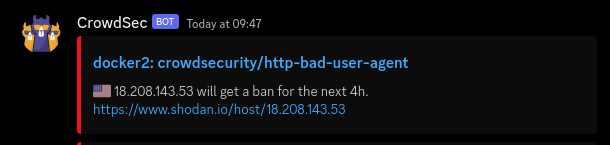
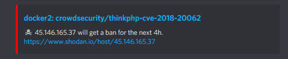

[CrowdSec](https://crowdsec.net) is a free, open-source and collaborative IPS; it's like Fail2Ban but you share your bans with all of the other users to try and pre-emptively block malicious hosts. We recently published a [docker mod](https://github.com/linuxserver/docker-mods/tree/swag-crowdsec) to add the CrowdSec nginx bouncer to our swag and nginx containers so it seemed a good opportunity to take a quick look at how you can get started with it.

Unlike fail2ban, which uses a single service for detection and blocking of malicious traffic, CrowdSec is modular, allowing you to detect and block across multiple hosts and to easily integrate with different services. The basic building blocks are the CrowdSec agent which parses your logs and detects malicious behaviour, one or more Bouncers which do the actual blocking, the Central API which is hosted by CrowdSec themselves and allows you to push and pull community blocks, and the Local API which acts as a central coordinator on your network for all the other parts.

## Getting Started
The first thing we need is the Local API and Agent, which co-exist in the official container.
```yaml
version: "2.1"
services:
  crowdsec:
    image: docker.io/crowdsecurity/crowdsec:latest
    container_name: crowdsec
    environment:
      - GID=1000
      - COLLECTIONS=crowdsecurity/nginx crowdsecurity/http-cve crowdsecurity/whitelist-good-actors
      - CUSTOM_HOSTNAME=myserver
    volumes:
      - /opt/appdata/crowdsec/config:/etc/crowdsec:rw
      - /opt/appdata/crowdsec/data:/var/lib/crowdsec/data:rw
      - /opt/appdata/swag/log/nginx:/var/log/swag:ro
      - /var/log:/var/log/host:ro      
    networks:
      - lsio
    restart: unless-stopped
    security_opt:
      - no-new-privileges=true
    
networks:
  lsio:
    external: true
```
The setup is fairly simple: make sure the `GID` matches a group that can read all your logs and set `CUSTOM_HOSTNAME` to something that identifies your server. The `COLLECTIONS` env allows us to pre-install collections from the [CrowdSec Hub](https://hub.crowdsec.net/browse/#collections). Collections are bundles of parsers and scenarios that make it easy to set things up for popular services. By default the container ships with the Linux collection which handles syslog and ssh logs and we're going to add the nginx collection (for swag), the http-cve collection, which covers a bunch of currently active CVEs, and the whitelist-good-actors collection which mostly covers CDNs like Cloudflare to make sure you don't accidentally block them and cut yourself off from large swathes of the internet.

For your volumes you need to mount the two paths CrowdSec requires plus the paths of any logs you want it to be able to parse. If you want to parse docker *container* logs there's a direct [provider](https://docs.crowdsec.net/docs/data_sources/docker/) but we can get to that later. Where you map your logs to in the container doesn't really matter, but I've chosen subfolders of `/var/log`. The container is attached to a `lsio` network, which will also have swag attached to it, along with anything else you want to interact with crowdsec.

Because this is a security-oriented setup, we're also setting the `no-new-privileges` security opt, which prevents the container user from having its permissions elevated by, for example, suid. Finally, we're using the built-in sqlite database but it [does also support](https://docs.crowdsec.net/docs/local_api/database/) mysql/mariadb and postgres as backends if you prefer.

At this point we want to spin the container up, let it run through its startup, watch the container logs for `msg="Starting processing data"`, then shut it down again. This will create all the config files and databases we need to configure. Go find `acquis.yaml` in your config mount and edit it. Here you need to label your logs so CrowdSec knows what it's looking at. Something like:
```yaml
filenames:
  - /var/log/host/auth.log*
labels:
  type: syslog
---
filenames: 
  - /var/log/swag/*
labels:
  type: nginx
```
Anything that's logging to syslog (such as sshd, by default) should use the `syslog` type. Anything using its native logging mechanism should use the type that matches the parser you're using, such as `nginx`, `sshd`, `traefik`, etc.

All interaction with CrowdSec is via the `cscli` CLI. To make life easier working with cscli inside a container we're going to create an alias in our shell profile:
```bash
alias cscli="docker exec -t crowdsec cscli"
```
Now we can just copy all the command examples from the docs without having to mess around. The `-t` is important as if we don't allocate a TTY it'll screw up the formatting of a lot of the output.

At this point we can start the container up again and watch the container logs with a `docker logs -f crowdsec`. You should see something along the lines of:
```
time="21-03-2022 19:35:55" level=info msg="loading acquisition file : /etc/crowdsec/acquis.yaml"
time="21-03-2022 19:35:55" level=info msg="Adding file /var/log/swag/access.log to datasources" type=file
time="21-03-2022 19:35:55" level=info msg="Adding file /var/log/swag/error.log to datasources" type=file
time="21-03-2022 19:35:55" level=info msg="Adding file /var/log/swag/unauthorized.log to datasources" type=file
```
Which means that CrowdSec is now parsing your swag logs. You can confirm this by running `cscli metrics` which will show you a snapshot of the current state of affairs and will look something like:
```
INFO[21-03-2022 08:12:00 PM] Buckets Metrics:                             
+--------------------------------------+---------------+-----------+--------------+--------+---------+
|                BUCKET                | CURRENT COUNT | OVERFLOWS | INSTANCIATED | POURED | EXPIRED |
+--------------------------------------+---------------+-----------+--------------+--------+---------+
| crowdsecurity/http-crawl-non_statics |             2 | -         |          169 |    184 |     167 |
| crowdsecurity/http-probing           | -             | -         |            4 |     10 |       4 |
| crowdsecurity/http-sensitive-files   | -             |         1 |            2 |      7 |       1 |
+--------------------------------------+---------------+-----------+--------------+--------+---------+
INFO[21-03-2022 08:12:00 PM] Acquisition Metrics:                         
+----------------------------------+------------+--------------+----------------+------------------------+
|              SOURCE              | LINES READ | LINES PARSED | LINES UNPARSED | LINES POURED TO BUCKET |
+----------------------------------+------------+--------------+----------------+------------------------+
| file:/var/log/swag/access.log    |        320 |          160 |            160 |                     46 |
+----------------------------------+------------+--------------+----------------+------------------------+
```
If you don't see any buckets or acquisitions then it might just be that nothing has generated any swag log entries yet, which you can obviously generate yourself if you want to speed things up. CrowdSec uses a [leaky bucket](https://en.wikipedia.org/wiki/Leaky_bucket) system for making decisions; once a bucket overflows, it triggers a decision. This decision is typically a ban, but it could also be something else, like requiring a CAPTCHA for that IP address.

You can see active local decisions with `cscli decisions list` or, if you really want to see ~10,000 of them, all decisions with `cscli decisions list --all`.
```
+---------+----------+-------------------+---------------------------------------+--------+---------+---------------------------+--------+--------------------+----------+
|   ID    |  SOURCE  |    SCOPE:VALUE    |                REASON                 | ACTION | COUNTRY |            AS             | EVENTS |     EXPIRATION     | ALERT ID |
+---------+----------+-------------------+---------------------------------------+--------+---------+---------------------------+--------+--------------------+----------+
| 5756354 | crowdsec | Ip:3.65.27.28     | crowdsecurity/http-sensitive-files    | ban    | US      |                        0  |      6 | 3h29m0.043466576s  |     1712 |
| 5743921 | crowdsec | Ip:45.146.165.37  | crowdsecurity/thinkphp-cve-2018-20062 | ban    |         |                        0  |      1 | 1h42m25.112096091s |     1709 |
+---------+----------+-------------------+---------------------------------------+--------+---------+---------------------------+--------+--------------------+----------+
```
If you want to see the details of a given decision, you can run `cscli alerts inspect <alert id>` which will output something like:
```
################################################################################################

 - ID         : 1712
 - Date       : 2022-03-21T19:52:57Z
 - Machine    : myserver
 - Simulation : false
 - Reason     : crowdsecurity/http-sensitive-files
 - Events Count : 6
 - Scope:Value: Ip:3.65.27.28
 - Country    : US
 - AS         : 
 - Begin      : 2022-03-21 19:52:50.927255 +0000 UTC
 - End        : 2022-03-21 19:52:57.451941 +0000 UTC

 - Active Decisions  :
+---------+---------------+--------+--------------------+----------------------+
|   ID    |  SCOPE:VALUE  | ACTION |     EXPIRATION     |      CREATED AT      |
+---------+---------------+--------+--------------------+----------------------+
| 5756354 | Ip:3.65.27.28 | ban    | 3h22m32.410183717s | 2022-03-21T19:52:57Z |
+---------+---------------+--------+--------------------+----------------------+
```

## If Your Name's Not Down
OK, so CrowdSec is reading your logs and adding suspect IPs to its ban list. Cool. But that's not actually doing anything to stop them connecting at this point. CrowdSec uses Bouncers to do this. There are lots of them, but right now we're interested in the nginx one.

Let's add swag to our compose.
```yaml
  swag:
    image: lscr.io/linuxserver/swag:latest
    container_name: swag
    environment:
      - PUID=1000
      - PGID=1000
      - TZ=Europe/London
      - URL=example.uk
      - SUBDOMAINS=wildcard
      - VALIDATION=dns
      - DNSPLUGIN=cloudflare
      - EMAIL=swag@example.uk
      - DOCKER_MODS=ghcr.io/linuxserver/mods:swag-crowdsec
      - CROWDSEC_API_KEY=${CROWDSEC_API_KEY}
      - CROWDSEC_LAPI_URL=http://crowdsec:8080
    networks:
      - lsio
    volumes:
      - /opt/appdata/swag:/config
    ports:
      - 80:80
      - 443:443
    restart: unless-stopped
    security_opt:
      - no-new-privileges=true
```
This is a very vanilla swag compose with the addition of three environment variables
```yaml
      - DOCKER_MODS=ghcr.io/linuxserver/mods:swag-crowdsec
      - CROWDSEC_API_KEY=${CROWDSEC_API_KEY}
      - CROWDSEC_LAPI_URL=http://crowdsec:8080
```
The first installs our CrowdSec bouncer mod, and the other two configure it. Now I've currently got an [open PR](https://github.com/crowdsecurity/crowdsec/pull/1341) to allow registration of bouncers with CrowdSec via environment variable but until that's merged you've got to do it the "hard" way. `cscli bouncers add swag`. Take the API key that command outputs and add it to your swag compose. Because swag is on the same network as the CrowdSec container we can connect the two using the container name and we don't mind that it's doing it over http.

The nginx bouncer also supports the [CAPTCHA](https://doc.crowdsec.net/docs/bouncers/nginx/#setup-captcha) decision type, which we support in our mod using the optional `CROWDSEC_SITE_KEY` and `CROWDSEC_SECRET_KEY` environment variables.

(Re-)create your swag container, wait for it to start up, and if all is well your swag container logs should show `nginx: [alert] [lua] init_by_lua:8: [Crowdsec] Initialisation done` at the end, and running `cscli bouncers list` should show a Last API Pull time for the `swag` bouncer. Note that for bouncers such as the nginx one which query one IP at a time by default, the Last API Pull time won't (currently) update after the initial connection.

At this point every time a connection is made to swag, the bouncer will lookup the IP address against the CrowdSec LAPI and return a 403 Forbidden for anyone on the ban list. If you want to test everything out, you can manually add a ban decision with `cscli decisions add --ip 1.2.3.4 --type ban --duration 10m` and then try connecting to swag from that address. Once you're done you can remove the ban with `cscli decisions delete --ip 1.2.3.4`. Note that manually added decisions will never be pushed up to the Central API so you don't need to worry about accidentally blacklisting yourself.

## Notifications
CrowdSec can send you notifications whenever it bans someone. There are a few built-in options for Slack, email, etc. but for our setup we're going to use a Discord webhook, which means rolling our own notification template.

First up, create a `discord.yaml` in the `notifications` subdirectory of your CrowdSec config directory. This will define your notification template and here's a basic example:

```yaml
type: http

name: discord

log_level: info

format: |
  {
    "content": null,
    "embeds": [
      {{range . -}}
      {{$alert := . -}}
      {{range .Decisions -}}
      {{if $alert.Source.Cn -}}
      {
        "title": "{{$alert.MachineID}}: {{.Scenario}}",
        "description": ":flag_{{ $alert.Source.Cn | lower }}: {{$alert.Source.IP}} will get a {{.Type}} for the next {{.Duration}}. <https://www.shodan.io/host/{{$alert.Source.IP}}>",
        "url": "https://db-ip.com/{{$alert.Source.IP}}",
        "color": "16711680"
      }
      {{end}}
      {{if not $alert.Source.Cn -}}
      {
        "title": "{{$alert.MachineID}}: {{.Scenario}}",
        "description": ":pirate_flag: {{$alert.Source.IP}} will get a {{.Type}} for the next {{.Duration}}. <https://www.shodan.io/host/{{$alert.Source.IP}}>",
        "url": "https://db-ip.com/{{$alert.Source.IP}}",
        "color": "16711680"
      }
      {{end}}
      {{end -}}
      {{end -}}
    ]
  }

url: https://discord.com/api/webhooks/<DISCORD_WEBHOOK_KEY>

method: POST

headers:
  Content-Type: application/json
```

The alerts use Go templating which can be a bit of a steep learning curve if you're not used to it, though they do helpfully [document their Alert model](https://pkg.go.dev/github.com/crowdsecurity/crowdsec@master/pkg/models#Alert) to help you out.

This original template above used the MapQuest API to generate maps against the GeoIP information associated with the banned address. Unfortunately since then MapQuest have changed their API pricing from 15k free hits a month to 15k free hits a month *and then we start charging you per hit*, so I've removed it from the post.

Beyond that all you *need* to do is add your Discord webhook URL. Once the template is saved, open up `profiles.yaml` in your CrowdSec config directory, uncomment `notifications:` and underneath it add `- discord` so that it looks like this:
```yaml
name: default_ip_remediation
filters:
 - Alert.Remediation == true && Alert.GetScope() == "Ip"
decisions:
 - type: ban
   duration: 4h
notifications:
 - discord
```
Then restart the CrowdSec container so it reloads its config. The alerts will look like this:



Or, if there's no GeoIP data available for an address, like this:



## Going Further
Depending on your setup and your needs there are a ton of different options for extending what CrowdSec does and how. For example if you use the Cloudflare proxying service you'll probably want to look at the [Cloudflare Bouncer](https://docs.crowdsec.net/docs/bouncers/cloudflare/), if you want to block malicious hosts from making SSH connections you'll probably want to look at the [Firewall Bouncer](https://doc.crowdsec.net/docs/bouncers/firewall/). You can also look at parsing the logs of your other applications such as [Wordpress](https://hub.crowdsec.net/author/crowdsecurity/collections/wordpress), [Home Assistant](https://hub.crowdsec.net/author/crowdsecurity/collections/home-assistant) or [Authelia](https://hub.crowdsec.net/author/LePresidente/collections/authelia).

All in all CrowdSec takes a slightly different approach to things compared to fail2ban but in doing so makes itself a lot more flexible. You can run agents and bouncers on multiple hosts on your LAN, including in-development versions for Windows and Synology NAS units, and block connections at both the application and network layers to suit your needs.

One word of warning: We don't recommend running CrowdSec *and* fail2ban in parallel in a production environment, because you may end up with things falling through the cracks as they fight each other to block malicious connections.
