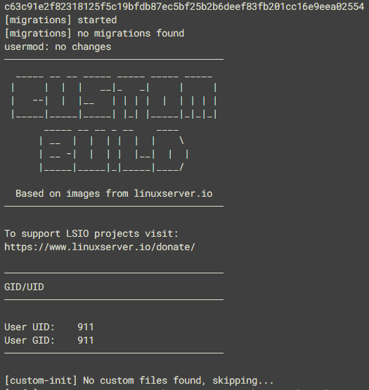

**You can find the live version of this document on our docs pages [here](https://docs.linuxserver.io/general/container-branding/)**

If you use our base images for your own projects, or fork our downstream images to modify them, you're probably aware that we ask you to change the branding that appears in the container init logs to make it clear that your image is not associated with us. This is for your benefit as much as ours: we aren't well-equipped to provide your users with support, and you don't want them crediting us for your work.

As part of some recent changes, we realised that the current approach doesn't work very well. Most people don't bother, or realise they need, to change the branding, and for those who do it's a bit of a pain. So we've changed things around.

From today, if you build from one of our modernised base images and don't change anything, your init logs will look something like this:

If you want to add your own branding, when using our base images *or* a forked downstream one, just place a file called `branding` containing the text you want to use into the `/etc/s6-overlay/s6-rc.d/init-adduser` folder of your image. The branding file will replace the highlighted section of the init:

On start-up, the base image will automatically load the branding into its init, allowing you to inflict whatever ASCII art you like on your users:

The affected bases are:

* Alpine 3.16, 3.17, Edge
* Ubuntu Focal, Jammy
* Arch
* Fedora 37

As well as any derivative base images that use them, such as our nginx and rdesktop bases. We'll be slowly phasing out our older base images over the next few months.

Hopefully this makes it simpler for everyone to manage the branding of your images when using our bases.

A final note: if you're already overriding the adduser init to do custom branding, it'll keep working, but we'd recommend switching to the new approach so that you don't miss out on any future changes to that init step.
