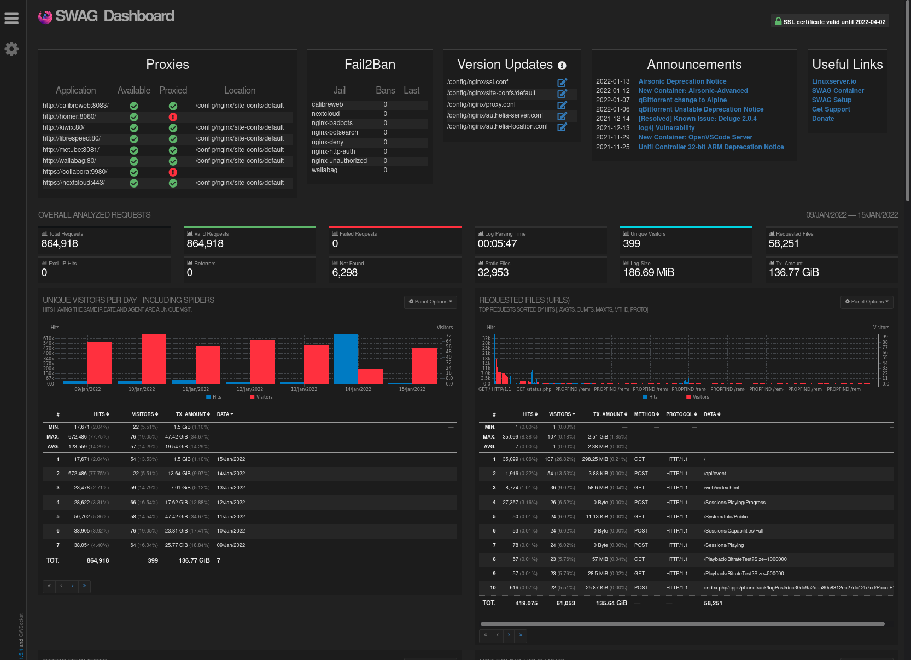

[SWAG Dashboard](https://github.com/linuxserver/docker-mods/tree/swag-dashboard) is a mod powered by [GoAccess](https://goaccess.io/) that provides a comprehensive overview of SWAG's operation.

## Setup

Follow latest the instructions on [the mod's readme](https://github.com/linuxserver/docker-mods/tree/swag-dashboard) to set it up.

Navigate to `dashboard.yourdomain.com` from your LAN to view the dashboard.

Note that the dashboard only allows LAN access by default, to expose it (on a VPS for example) you would need to remove the allow/deny in `/config/nginx/proxy-confs/dashboard.subdomain.conf` and instead protect it some other way (like Authelia for example).



## Sections 

### SSL

Shows whether the SSL certificate is valid and when it expires.

### Proxies

Searches for available apps on SWAG's network and for proxy configs that have been enabled.

It works best when the proxy confs have a structure that resembles the samples:

```nginx
  set $upstream_app <container/address>;
  set $upstream_port <port>;
  set $upstream_proto <protocol>;
  proxy_pass $upstream_proto://$upstream_app:$upstream_port;
```

### Fail2ban

Shows active fail2ban jails, amount of bans each jail has, and the last banned IPs.

### Version Updates

Shows config files that have version updates and links to the latest versions where you can see the changes.

### Announcements

Shows the latest linuxserver.io announcements which include new containers, deprecated containers, and important changes that may concern you.

### Graphs

[GoAccess](https://goaccess.io/) is a tool that analyzes the logs and aggregates logged requests into graphs which are useful for finding issues and security concerns.

#### Unique Visitors Per Day

Shows a breakdown of unique visitors, page hits, and amount of data transferred per day where you can spot concerning amounts of data transfers on specific days.

#### Requested Files

Shows the most requested URLs, where you can spot concerning amounts of requests being made to specific URLs.

#### Static Requests

Shows the most requested static files, where you can spot concerting amounts of hits/visitors requesting specific static files.

#### Not Found URLs

Shows requests to missing URLs, where you can spot concerning amounts of requests to URLs that should not exist.

#### Visitor Hostnames and IPs

Shows the visitors with the most hits and their country of origin, where you can spot concerning amounts of hits from unknown visitors.

#### Operating Systems

Shows a breakdown of the operating systems of visitors.

#### Browsers

Shows a breakdown of the browsers of visitors.

#### Time Distribution

Shows which time-of-day has the most activity.

#### Referring Sites

Shows which sites have referred the most, it can be useful for spotting search engines referring to your private domains.

#### HTTP Status Codes

Shows hits per status code, where you can spot concerning error codes with many hits.

#### Geo Location

Shows the most active continents and countries, where you can spot concerning amounts of hits from countries which shouldn't access your domains.

[Swag Maxmind mod](https://github.com/linuxserver/docker-mods/tree/swag-maxmind) or [Swag DBIP mod](https://github.com/linuxserver/docker-mods/tree/swag-dbip) are required to enable this graph.
