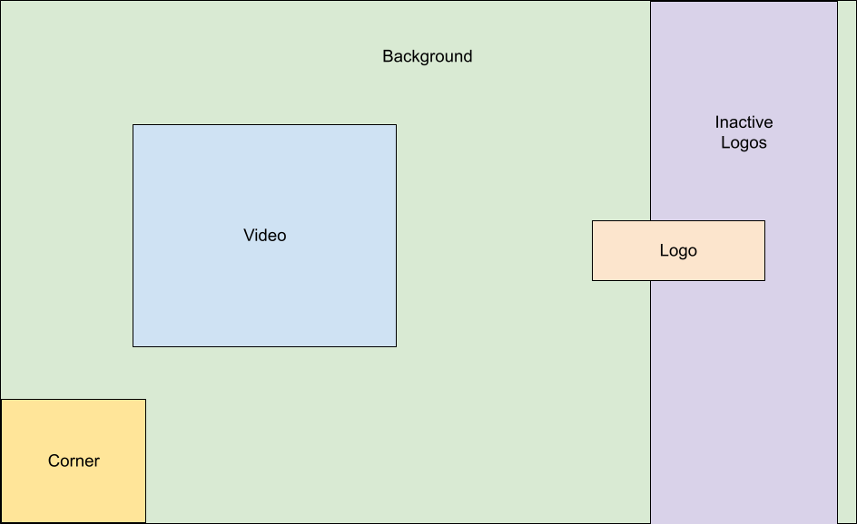

Modern web browsers have become powerful cross platform tools for running applications. Recently my interest in running retro emulators in a web browser was fueled by the current and last generation of Xbox consoles getting an update to their Edge browser to be chromium based which opens up the ability to play retro games with no modifications to the system itself. The problem is that in order to do this all of the current solutions are mostly dark places on the internet riddled with ads, not to mention you need to download huge files from remote servers every time you want to play a single game. No real encompassing solution existed to self host your own retro collection without downloading external pages and hacking around with their code. 

### Enter emulatorjs

<iframe  width="560" height="315" src="https://www.youtube.com/embed/aZD8n5R6-W4" frameborder="0"></iframe>

EmulatorJS is new container which allows users to scan in their retro game collection and generate a web frontend for browsing/launching/playing games:

[https://github.com/linuxserver/docker-emulatorjs/](https://github.com/linuxserver/docker-emulatorjs/)

It is comprised of two parts: 
* NodeJS Backend- For uploading/scanning roms, generating/managing the configuration files needed to point the frontend to them, and downloading the art assets needed. 
* Static web based Frontend- A mix of JSON files for metadata, png images for logos/backgrounds, videos for game previews, and the core logic for launching/running games.

Everything runs in any modern web browser leveraging a mix of emscripten builds of libretro cores and [semi de-obfuscated](https://github.com/ethanaobrien/emulatorjs) code from https://www.emulatorjs.com/ . We are working to transition everything over to completely open source emulator cores, but as of now for some systems the best functioning code is closed source blobs. 

The currently integrated emulators are: 

* 3DO- [https://www.emulatorjs.com/3do.html](https://www.emulatorjs.com/3do.html)
* Arcade- [https://github.com/libretro/mame2003-plus-libretro](https://github.com/libretro/mame2003-plus-libretro)
* Atari 2600- [https://github.com/libretro/stella2014-libretro](https://github.com/libretro/stella2014-libretro)
* Atari 7800- [https://github.com/libretro/prosystem-libretro](https://github.com/libretro/prosystem-libretro)
* Colecovision- [https://github.com/libretro/blueMSX-libretro](https://github.com/libretro/blueMSX-libretro)
* Doom- [https://github.com/libretro/libretro-prboom](https://github.com/libretro/libretro-prboom)
* Game Boy Advance- [https://github.com/libretro/vba-next](https://github.com/libretro/vba-next)
* Game Boy Color- [https://github.com/libretro/Gearboy](https://github.com/libretro/Gearboy)
* Game Boy- [https://github.com/libretro/Gearboy](https://github.com/libretro/Gearboy)
* Jaguar- [https://github.com/libretro/virtualjaguar-libretro](https://github.com/libretro/virtualjaguar-libretro)
* Atari LYNX- [https://github.com/libretro/libretro-handy](https://github.com/libretro/libretro-handy)
* MSX- [https://github.com/libretro/blueMSX-libretro](https://github.com/libretro/blueMSX-libretro)
* Nintendo 64- [https://www.emulatorjs.com/n64.html](https://www.emulatorjs.com/n64.html)
* Nintendo DS- [https://github.com/libretro/melonDS](https://github.com/libretro/melonDS)
* Nintendo Entertainment System- [https://github.com/libretro/libretro-fceumm](https://github.com/libretro/libretro-fceumm)
* Neo Geo Pocket (color)- [https://github.com/libretro/beetle-ngp-libretro](https://github.com/libretro/beetle-ngp-libretro)
* Odyssey2- [https://github.com/libretro/libretro-o2em](https://github.com/libretro/libretro-o2em)
* PC Engine (TurboGrafx-16)- [https://github.com/libretro/beetle-pce-fast-libretro](https://github.com/libretro/beetle-pce-fast-libretro)
* Playstation- [https://github.com/libretro/beetle-psx-libretro](https://github.com/libretro/beetle-psx-libretro)
* Sega 32x- [https://www.emulatorjs.com/sega32x.html](https://www.emulatorjs.com/sega32x.html)
* Sega CD- [https://github.com/libretro/Genesis-Plus-GX](https://github.com/libretro/Genesis-Plus-GX)
* Sega Game Gear- [https://github.com/libretro/Genesis-Plus-GX](https://github.com/libretro/Genesis-Plus-GX)
* Sega Mega Drive- [https://github.com/libretro/Genesis-Plus-GX](https://github.com/libretro/Genesis-Plus-GX)
* Sega Master System- [https://github.com/libretro/Genesis-Plus-GX](https://github.com/libretro/Genesis-Plus-GX)
* Sega Saturn- [https://github.com/libretro/yabause](https://github.com/libretro/yabause)
* Sega SG-1000- [https://github.com/libretro/Genesis-Plus-GX]( https://github.com/libretro/Genesis-Plus-GX)
* Super Nintendo- [https://github.com/libretro/snes9x](https://github.com/libretro/snes9x)
* Vectrex- [https://github.com/libretro/libretro-vecx](https://github.com/libretro/libretro-vecx)
* Virtual Boy- [https://github.com/libretro/beetle-vb-libretro](https://github.com/libretro/beetle-vb-libretro)
* Wonderswan (color)- [https://github.com/libretro/beetle-wswan-libretro](https://github.com/libretro/beetle-wswan-libretro)

### Playing on an Xbox

The frontend uses art assets and copies it's style from other popular frontends like Hyperspin or CoinOPS because the core navigation is based around me testing this on my Xbox with a controller using only up/down/left/right. For the libretro based cores you can pull up a libretro menu using the controller combination in game of start+select+L+R. For emulatorJS based cores settings in general you are SOL, the embedded emulator prevents browser default actions and re-entering the game with your controller after you exit gamepad controls seems impossible with the current code. 
After you have launched a game press the select button to lock in the controller and ensure the b button does not trigger a fullscreen exit or back action. When you want to leave the current game hold down start for 3 seconds to exit gamepad controls and press B to go back, to hop back in to gamepad controls just press start with your virtual mouse cursor over the running game and select "use gamepad controls". It is a little tricky but once you get get the hang of it controller only navigation is pretty easy.
You can also plug in a mouse and keyboard to an Xbox making navigation a bit less cumbersome if you would like. On a keyboard in game menus can be accessed using the F1 key. 

By default the Edge browser on Xbox has overscan baked in and renders the window much smaller than the full screen, to disable this go into Settings > Display & Sound > Video Output > Video Fidelity & Overscan > Overscan border, uncheck the box next to Apps. 

### Art assets and P2P
All of the art assets are hosted out of IPFS and pinned to multiple large providers along with seed servers. I have done what I can to create a decent base set for most emulators/games, but we definitely need community help here.

If you use this container and are able to, please consider forwarding port 4001 of this container to the internet to help with P2P distribution of files. 

If you are a graphics wizard the layout for the screen looks something like this: 

You can read more about creating and adding assets to the project here: 
[https://github.com/linuxserver/emulatorjs/#for-asset-creators](https://github.com/linuxserver/emulatorjs/#for-asset-creators)
