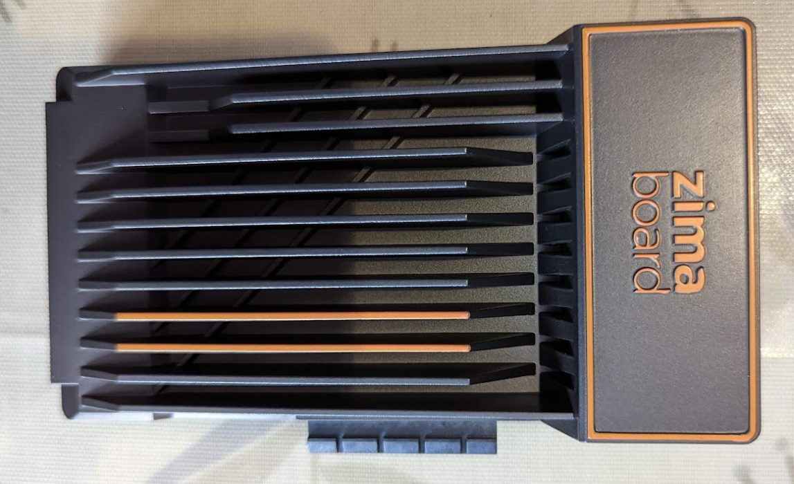
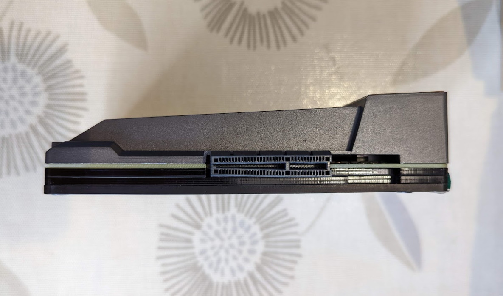
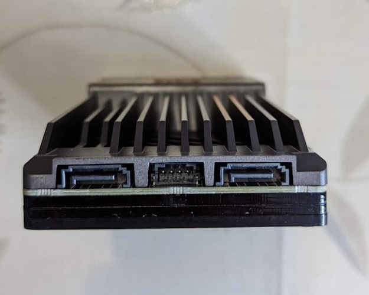
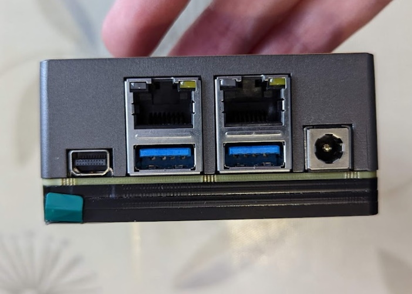
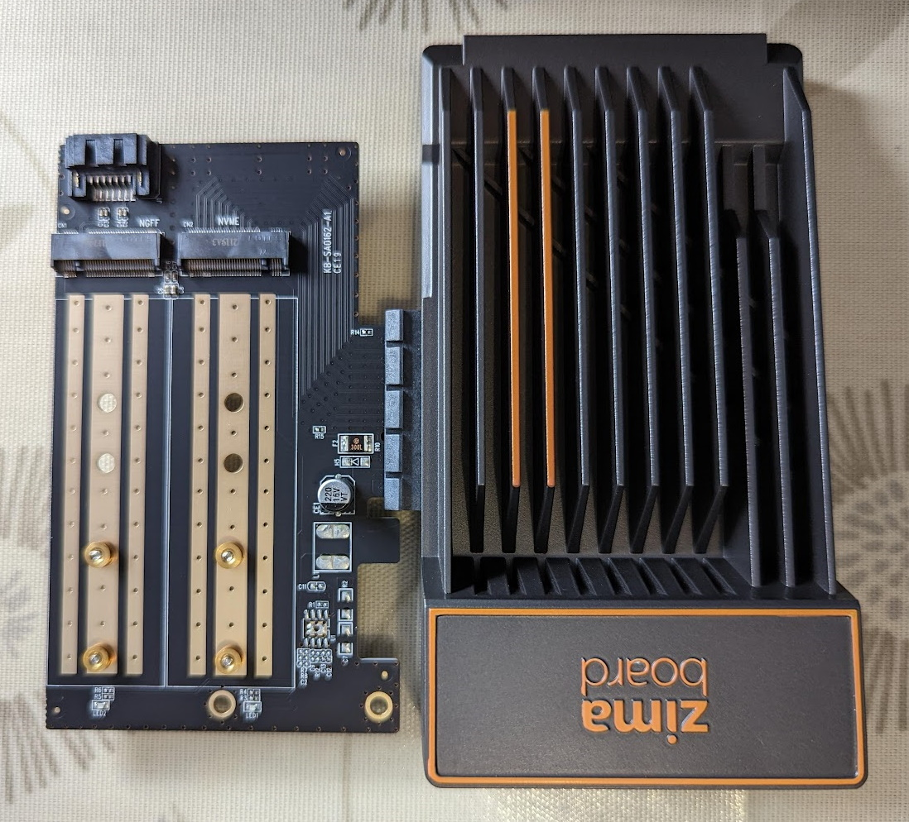
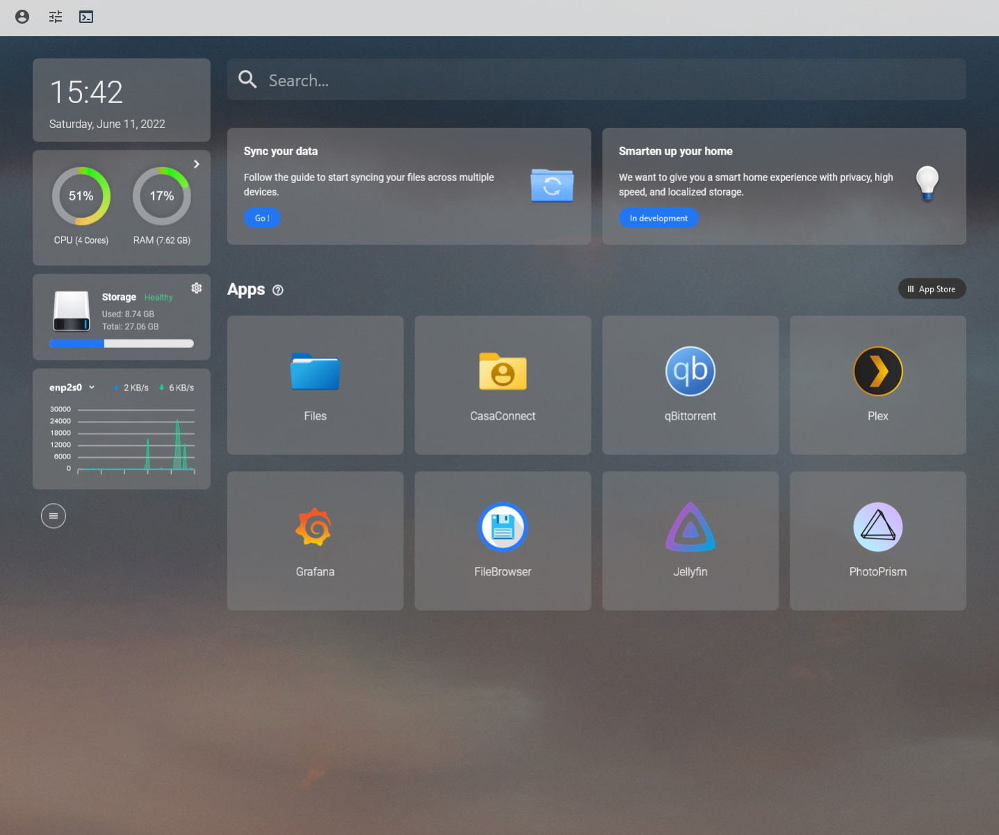
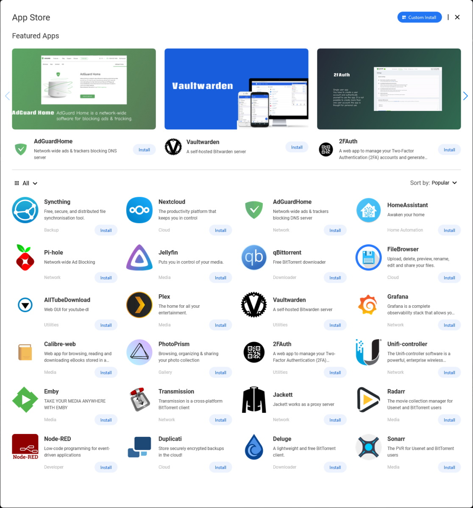
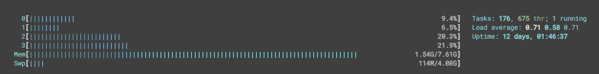
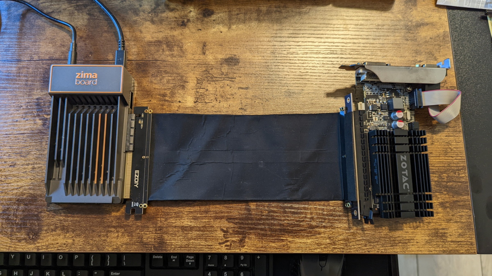
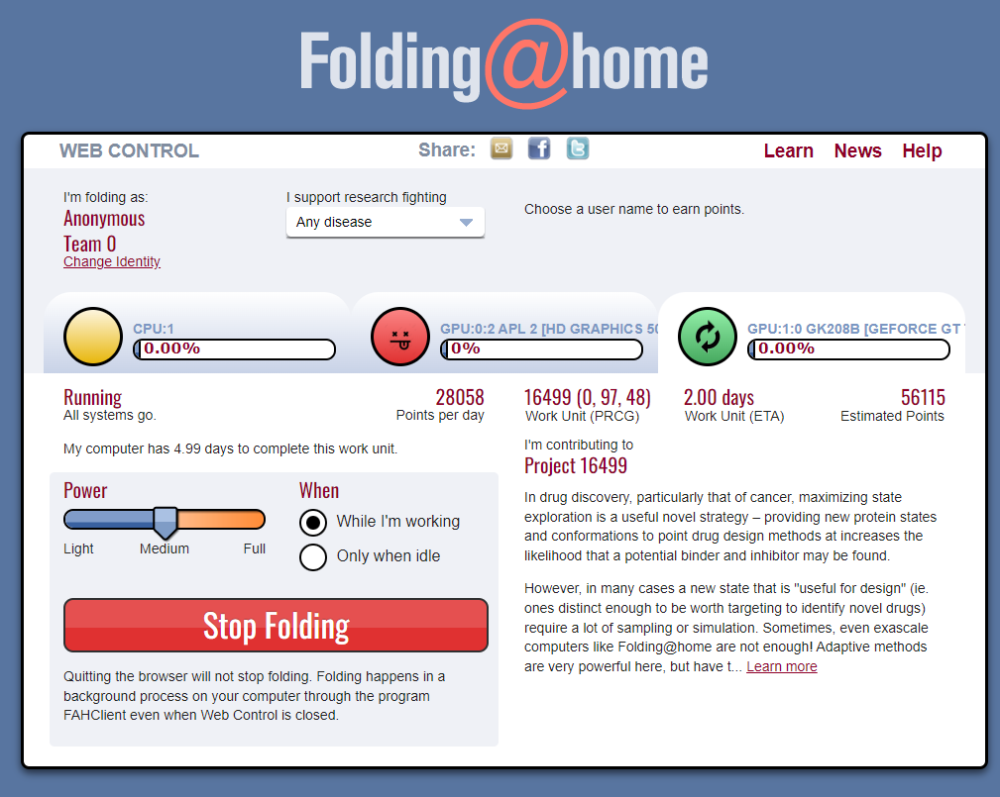

**Full disclosure before we start: Icewhale sent us a number of ZimaBoard units to test out, with a mixture of accessories, without any conditions attached. The following blog post covers our personal opinions of the hardware and software after a couple of weeks of screwing around with various projects.**

## The Hardware

Icewhale's [ZimaBoard](https://www.zimaboard.com/zimaboard/product) bills itself as "The World’s First Hackable Single Board Server", which is a bold claim but certainly sounds promising. Unlike most of the SBCs people will be familiar with, the ZimaBoard runs an x86_64 Intel CPU and has a lot of expansion options not typically seen on devices this small.

The units we were provided with were the ZimaBoard 832, which has an Intel N3450 quad core CPU, 8Gb of RAM, and 32Gb eMMC onboard storage. There are also 4Gb and 2Gb variants available, with the 2Gb having only a dual core CPU and half the storage. The board comes equipped with dual Broadcom gigabit NICs, dual USB 3 ports, mini-DisplayPort, dual SATA connectors, and a 4x PCI 2.0 expansion slot, which certainly gives you a lot to work with.

|   |   |
| - | - |
|  |  |
|  |  |

The PCIe slot does, however, have something of a limitation. Due to its location adding a card basically doubles the device's footprint and there's nothing to support the board underneath, it's just hanging from the slot, which could be an issue with anything heavy unless you've got something to act as "feet". On [ZimaBoard's Discord server](https://discord.com/invite/Gx4BCEtHjx) channel `#zimaboard-makes` you can find community provided 3D print designs for various cases, rack-mounts and other accessories.



## The Software

The ZimaBoard comes bundled with [CasaOS](https://www.casaos.io/), Icewhale's "Home Cloud OS", which is really just a web management layer on top of Debian so you can theoretically install it on almost anything. In its current iteration it's a fairly basic affair, with hardware monitoring information and the ability to spin up Docker containers from an "App Store" as well as with arbitrary images should you wish. It's still being aggressively developed so I won't be too hard on it, but it's currently pretty limited in scope and from a Docker perspective it falls into the same trap as many Docker UI solutions and can't expose enough of the underlying settings to account for weird users like us - of course we're not the target audience for it anyway.

|   |   |
| - | - |
|  |  |

There's definitely a promising core there, and for users who want a nice simple management UI for their otherwise headless docker host it'll probably do the job nicely once it's a little further along.

## Impressions

### Spad

Nobody wants a boring OOTB solution, do they? Let's start from scratch and do something interesting. I don't like eMMC, it's slow and can have limited lifespan if you're doing lots of IO so I hooked up an old 500Gb Samsung 850 EVO SATA SSD and installed Ubuntu Jammy (22.04 LTS). The BIOS easily lets you switch boot devices so I've left the bundled Debian install in place in case I want to play it with later. I also enabled WOL while I was in there because it's always useful when you've got an SBC without a power button, and while it's a low power device sometimes you've got to shut things down.

My first thought was Intel CPU, Quicksync, let's transcode on this thing - and it works, really well, even for 4K video. *But* where I've got it right now, and with it being a passively cooled device in the middle of summer, things started to get a bit melty and I thought it wise not to break my nice new hardware in under a week, so I started casting around for other options.

Inspired by aptalca's recent blog post on [wireguard routing](/blog/routing-docker-host-and-container-traffic-through-wireguard/) I decided to build out my ZimaBoard as a VPN bubble device. A little bit of testing, some fiddling with routing rules, and setting up [Gatus](https://github.com/TwinProduction/gatus) to monitor things like the VPN connectivity, and I was able to transplant a bunch of existing containers from my primary Docker host onto the ZimaBoard. One quick custom [Traefik](https://traefik.io/traefik/) implementation later (don't tell anyone I'm not using [SWAG](https://github.com/linuxserver/docker-swag)) and the whole change was completely transparent to anyone accessing any of the services despite them being on a brand new host behind a VPN.

Performance-wise it's flying. Plenty of memory headroom, and even if I was using the 2Gb model it would be just about coping. It does struggle a little bit heat-wise when the CPU spikes for extended periods but part of that is that I haven't got the best airflow to it right now.



I'm tempted to get a pair of NVME drives and mirror them just for an extra bit of resilience and performance but honestly it's not necessary, I just want to play with it.

Overall it's really nice kit; I wish it didn't use a barrel power connector because it's non-standard and I don't like mini-DP because it never feels like it's properly connected, but that's personal preference rather than a fundamental flaw with the hardware. It's not super cheap ($119 to $199 depending on the model) but you're getting something substantially more powerful than a Pi for your money and I think it's well worth it if you're in the market for a mini server.

### j0nnymoe

My Home Assistant instance - along with ESPHome and a few other automation bits - has been running on an old QNAP NAS for a while now, and it's not ideal for a number of reasons, so the ZimaBoard seemed like an ideal candidate to replace it. I'm running DietPi on it which, despite its name and origins does support x86_64, primarily because I've been running it for years on other hardware and so I'm familiar with its ins and outs.

While the ZimaBoard doesn't have quite the capability for attaching weird arbitrary hardware as a Raspberry Pi it's got plenty of room for a couple of USB dongles and maybe a [Wifi & Bluetooth](https://shop.zimaboard.com/collections/diyyourrouter/products/wifi-6e-ax210-pcie-wifi-card-for-zimaboard-with-8dbi-antenna-archer-tx50e-bluetooth-5-2-802-11ax-wireless-adapter-ultra-low-latency) PCIe card if that's your bag.

On the whole the hardware is great, but the lack of physical support for the PCIe slot can be an issue if you've got anything big or heavy to mount. I know there are designs for 3D printed options provided by the community but that's rather dependent on you having a 3D printer, which is a very big assumption to make even amongst the typical SBC audience.

### aptalca

At first the idea of ZimaBoard really intrigued me due to its footprint comparable to a Raspberry Pi, but having an x86_64 processor with SATA ports AND a PCIe slot, AND dual gigabit ethernet ports. That combination allows for so many possibilities including an opnsense router, NAS, media server as well as a full fledged desktop computer. I couldn't make up my mind so I decided to test some of the different options.

#### Option 1: Desktop with some server capabilities (VM & Docker)

One OS is *fine* but why stop there? The ZimaBoard is chunky enough to run VMs so lets make it run VMs. And then let's make a VM run Docker. And then make Docker run Docker. Why? Because we can, that's why.

```text
Zima
|__ Pop OS Desktop
   |__ Docker
      |__ Some containers
   |__ Qemu/kvm Ubuntu Server 22.04
      |__ Docker
         |__ Openvscode-server in a container
            |__ Docker-in-docker mod
               |__ Bunch of docker containers
```

I used Pop OS as the main OS, with a full desktop environment. On there, I installed the Docker service (docker daemon \#1) and created some containers. All good. Then I created a Virtual Machine via QEMU/KVM and opted for a headless Ubuntu server (this step required turning on the virtualization options in the bios as they are off by default). Inside this headless VM, I installed the Docker service (docker daemon \#2) and created some containers, because, why not? One of those containers was [openvscode-server](https://github.com/linuxserver/docker-openvscode-server), a headless VS Code solution, an IDE with a terminal built-in. I enabled our [docker-in-docker mod](https://github.com/linuxserver/docker-mods/tree/universal-docker-in-docker) to install the Docker service inside this container and created docker daemon \#3. That's how I ended up with a KVM virtual machine and 3 docker daemons on this little board and all was well.

#### Option 2: Headless server with a discrete GPU

As the next step, I wanted to try out the PCIe port and rummaged in my basement for compatible cards. I'll admit, I knew that I could connect an x4 card into an x16 PCIe port, but I was not aware I could plug an x16 card into an x4 port. I found a spare GT 710 graphics card lying around and to my surprise it's still supported by Nvidia. The next challenge was plugging the card in as the bracket was in the way. I didn't want to permanently mod the graphics card and luckily, I was able to find a PCIe extender cable in my "hoarding area". So naturally, I hooked it up, loaded up the Nvidia drivers along with nvidia-docker2 and started running [Folding@home in Docker](https://github.com/linuxserver/docker-foldingathome) and folding on the GT 710. 

|   |   |
| - | - |
|  |  |

I turned off folding on the CPU to prevent overheating and although I could have folded on the iGPU, support for Intel is considered alpha for Folding@home so I turned that off as well. Keep in mind that the GT 710 is running with a much lower communication bandwidth with the motherboard due to fewer PCIe lanes available than what's recommended, but that's fine for the folding operation.

#### Option 3: NAS

Currently I have two SSD drives attached to the ZimaBoard via their [official SATA Y-cable](https://shop.zimaboard.com/collections/diy-nas-media-server-bt-client/products/sata-y-cable-for-zimaboard-2-5-inch-hdd-3-5-inch-hdd-raid-free-nas-unraid) so combined with the onboard eMMC, there are three drives available. As the next step in testing the ZimaBoard, I'm planning on adding more drives via a PCIe SATA expansion card, but first I need to find a reliable picoPSU to support the extra drives. ZimaBoard can power up to two 2.5" drives like the two SSDs I already have in there, but for any additional drives or 3.5" drives, I need external power. Once that's procured, I'll most likely test different NAS solutions, some pre-packaged like unRAID or OMV and some DIY like a combination of ZFS, MergerFS and snapRAID.

## And Finally

So, as you can see there's no shortage of possibilities for what you can do with the ZimaBoard hardware - we've hardly scratched the surface. I think the most significant thing that sets it apart from other SBCs (apart from being x86_64) is the PCIe slot; that alone gives you huge scope for expanding the capabilities of the hardware. The downsides are the passive cooling combined with the lack of any sensible way to mount and power an active solution, a lack of (physical) support for the PCIe slot which is an issue with any large or heavy cards, and the non-standard barrel power connector which makes it tricky to replace or to rack mount if you don't have 13A sockets (or whatever they use in the colonies) on your PDUs.

The ZimaBoard is available for pre-order now; they've recently finished fulfilling all of their backer shipments so it shouldn't be long before the units are generally available.
