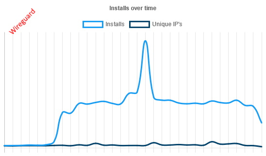
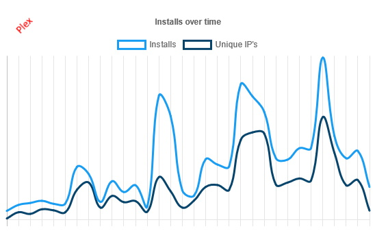

We've now been [working with Scarf](/blog/wrap-up-warm-for-the-winter/) for a little over a month and so I thought it would be fun to dig through the stats we've gathered so far and see if I can pull anything interesting out them. Now obviously a lot of our pulls are still via Docker Hub and GHCR, so this isn't in any way comprehensive, but it gives some insight into who our users are and what they're up to with our images.

### Top Line Numbers
This is all based on a total of 298,403 pulls over 30 days, or around 10,000 a day, which covers approximately 40,000 unique users at an average of 7.5 pulls per user. That said, the *median* number of pulls is just 1. As is usually the case with these things that's driven by a few massive outliers, which we'll get onto later. Be aware that "unique user" in this case is intentionally a little woolly; if you've got a Windows client and a Raspberry Pi and a VPS and they're all running our images, you'll probably get counted as 2 or 3 users, but the alternative was sending someone to your house to quiz you about how you use docker and that was going to be *really* expensive.

So, which are our most popular images? Well, it turns out to be a harder question to answer than you'd expect. Based purely on raw pulls `wireguard` and `code-server` are by far the most popular.
```
Count Name
----- ----
48667 linuxserver/wireguard
41803 linuxserver/code-server
18675 linuxserver/heimdall
13750 linuxserver/qbittorrent
11529 linuxserver/jackett
```
But if you look at *unique users* then it's a slightly different picture, with `plex` leading the way and `code-server` nowhere to be seen.
```
Count Name
----- ----
 2638 linuxserver/plex
 2012 linuxserver/wireguard
 1981 linuxserver/heimdall
 1751 linuxserver/unifi-controller
 1617 linuxserver/qbittorrent
 ```
The problem is this doesn't account for how frequently we release new images; `jackett` for example often gets multiple releases a day, whereas `unifi-controller` is much less frequent, and I don't have the will to marry those numbers up by hand. We're currently investigating ways to automate the process which would give us a much clearer picture, but until then the truth eludes us. So, aside from release frequency, why the disparity?
 
 ### Excessive Pulls
Turns out some of you *really* love our images. So much so in fact that you're doing a pull every 30 seconds, 24/7, to make sure you never miss an update. Two users are responsible for **73,000** pulls between them, with the next 10 being responsible for 55,000 between them. Almost half of our pulls through Scarf can be attributed to 20 users with misconfigured or overly aggressive deployment/update services. As you can see this doesn't apply across the board, with most images closely tracking pulls with unique users.


 
 #### A Side Note on Pulls
Scarf counts a pull as a GET request for the image manifest. Most properly written update checking tools like diun, or newer versions of Watchtower, do a HEAD request when checking for updates and only perform a full GET when there's actually a new image available and so don't contribute very much to the pull stats. That said, if you're running old versions of Watchtower, or some other tool that's not been written to a sufficient standard, you may find you're making thousands of unnecessary pulls for images, so it's worth double-checking your setup. Also, please don't set your update checking to run every 5 minutes, even hourly is excessive for most containers; consider making it 6-hourly, daily, or even weekly depending on what best suits your needs.
 
 ### Going Deeper
Who uses our images? The answers may (not) surprise you. Of the ~40,000 unique users we have stats for, 7826 are running Unraid, 1020 are running on Windows, and 196 are running on Mac OS, leaving the remaining ~30,000 on other flavours of Linux, BSD, or platforms like Synology and QNAP NAS devices. Unsurprisingly, amd64 is by far the most common architecture with 30,258 of you using it. On the ARM front, driven primarily by Raspbian/Raspberry Pi OS still not having a stable 64-bit release, armv7/armhf leads the way with 4,307 users compared to aarch64 on a mere 2,418. 
 
Every time you request a pull from a registry, your client sends a User Agent string along with it. The exact information in this string varies from client to client: for example diun sends a very simple UA like `diun/4.20.1 go/1.17 Linux`, WSL2 sends a much more detailed UA like `docker/20.10.8 go/go1.16.6 git-commit/75249d8 kernel/5.10.16.3-microsoft-standard-WSL2 os/linux arch/amd64 UpstreamClient(docker-compose/1.29.2 docker-py/5.0.0 Linux/5.10.16.3-microsoft-standard-WSL2)` and Unraid sends a UA like `docker/20.10.9 go/go1.16.8 git-commit/79ea9d3 kernel/5.14.15-Unraid os/linux arch/amd64`. Using this information we can see how up to date people are with their clients, and the good news is that most of you are on the ball. More than three quarters of users are running docker 20.10.0 or above, although 73 of you are still running docker 1.13.1 which was released in 2017. The picture is similar when we look at docker-compose: around a quarter of you are using docker-compose, of which nearly half are running the current version 1.29.x. One person is running version 1.30.0 which doesn't exist yet, so well done you. Somehow 20 of you are still running docker-compose 1.8.0, which came out in 2016. Annoyingly docker compose 2.x doesn't seem to send a proper user agent, instead giving us the unhelpful `Docker-Client/unknown-version` which also includes other clients, so we don't have any good numbers on that front.

### What's Next?
We're going to keep working with Scarf to improve the information available to us, and obviously as users switch from Docker Hub and GHCR to LSCR we'll get a more representative picture. Hopefully at some point Watchtower will actually publish a new release, which would include their updated User Agent code, making it simple to identify and filter update checks from the stats. Once we've reached a point where we have enough new information to say something useful, we'll update you again. In the meantime thanks to everyone who's been using `lscr.io` for their image pulls, it really helps us better understand how our images are used, which in turn means we can better direct our engineering efforts to where they're most valuable.
