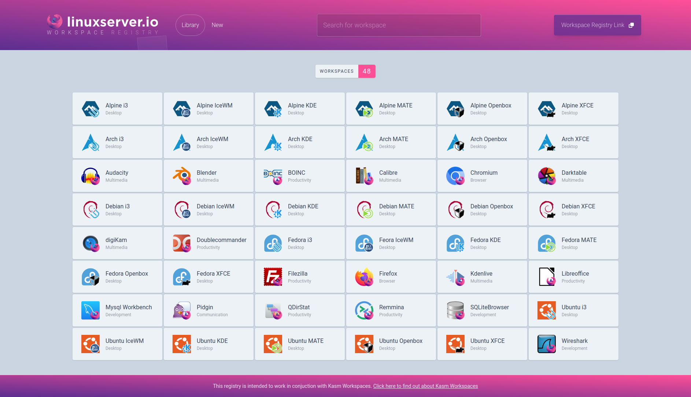

It has been two years since [Webtop](https://github.com/linuxserver/docker-webtop) and our accompanying base images were released with the goal of delivering a full Linux Desktop to your Web Browser. 
If you were not aware the backend technology enabling this was a combination of [xrdp](https://github.com/neutrinolabs/xrdp), [Guacamole](https://guacamole.apache.org/), and an in house client [Gclient](https://github.com/linuxserver/gclient). Guacamole and xrdp are amazing pieces of software, but are held back by forcing a square peg into a round hole. Most remote desktop software is built for a native desktop client and requires a significant amount of overhead to convert it into a format a modern Web browser understands, because of that fidelity and performance is not great. The folks at [noVNC](https://novnc.com/info.html) have done a great job of creating an RFB compliant native VNC client for the browser, but again they are bound by that protocol and can only do so much to optimize for web. 

This led me (TheLamer) down a rabbit hole of trying to find an open source project with the singular goal of delivering Linux to Web Browsers. I am happy to announce, after more than a year of work in the background, that not only have I found it but have joined the [KasmVNC](https://www.kasmweb.com/kasmvnc) team to see this through. This is the fundamental technology driving the new containers that just went live. Some important notes before we get started: 
* **Armhf is being deprecated, it has simply become too difficult to continue to support the porting of everything that makes up desktop environments and the accompanying applications. Almost every single board computer supports aarch64 at this point, so please take the time to install an arm64 OS, it will be worth it.**
* **For best results use a Chromium based browser. Firefox works, but their rendering engine and WebAssembly integration is simply not as fast.**

## We are approaching reality

Here is a quick comparison of our previous version vs now: (1080p capture)

<video controls playsinline preload="metadata" src="/media/webtop-2-0-the-year-of-the-linux-desktop/fidelity.mp4" aria-label="fidelity"></video>

On top of a drastic improvement in responsiveness and FPS there is also fidelity with fine grain control over compression, format, and frame-rate to suit your needs.  
The real question though is how high can you go?  
  
Lossless, not fake lossless, or semi lossless, but actual true 24 bit RGB leveraging the [Quite OK Image Format](https://qoiformat.org/) decoded client-side with threaded webassembly, more info [here](https://www.kasmweb.com/docs/latest/how_to/lossless.html). Even better this mode is capable of going over a  gigabit at high FPS so if you have been eyeballing that 10gb switch you just found your excuse.  
When you pair this with the 32-bit float audio and a fullscreen browser window you get that local feel all from the comfort of your browser. 

It is difficult to show a demo of what lossless is like so why not try it yourself? 

```
sudo docker run --rm -it --security-opt seccomp=unconfined --shm-size="1gb" -p 3001:3001 lscr.io/linuxserver/webtop:latest bash
```

Hop into https://yourhost:3001 and swap **Settings > Stream Quality > Preset Modes > Lossless**. Check **Render Native Resolution** if you use UI scaling.

## New base images and welcoming Debian to the family

With every new version of Ubuntu it is increasingly obvious they are going all in on [snaps](https://snapcraft.io/), which I genuinely do not have a problem with. As a developer I get it, building for the plethora of distros is a pain. What does become a problem is when you rip those packages out of your repositories despite Debian still actively maintaining them. If you are not aware, snaps and flatpack do not work inside of Docker. As an organization we try to use Alpine where we can, but when it comes to the desktop space, and especially the closed source desktop space, often only a deb will be available to install. So moving forward, particularly with desktop applications, we will try to use Debian where it makes sense.
The new base images can be found [here](https://github.com/linuxserver/docker-baseimage-kasmvnc) at the endpoint `lscr.io/linuxserver/baseimage-kasmvnc` with support for the following distributions:  

<table style="width:500px">
<thead>
  <tr>
    <th>Distro</th>
    <th>Current Tag</th>
  </tr>
</thead>
<tbody>
  <tr>
    <td>Alpine</td>
    <td>alpine317</td>
  </tr>
  <tr>
    <td>Arch</td>
    <td>arch</td>
  </tr>
  <tr>
    <td>Debian</td>
    <td>debianbullseye</td>
  </tr>
  <tr>
    <td>Fedora</td>
    <td>fedora37</td>
  </tr>
  <tr>
    <td>Ubuntu</td>
    <td>ubuntujammy</td>
  </tr>
</tbody>
</table>

These images are built for aarch64/x86_64 across all distros and include the following functionality:  
* PulseAudio and init baked in.
* [Openbox](http://openbox.org/wiki/Main_Page) desktop environment with logic for launching single applications. 
* When run in `--privileged` mode they will start a DinD (Docker in Docker) daemon to run an isolated Docker session inside the desktop container.
* Support for GPU accelerated apps via [DRI3](https://en.wikipedia.org/wiki/Direct_Rendering_Infrastructure#DRI3).
* Basic auth via environment variables.
* A simple file manager supporting uploads and downloads up to 200MB.
* Compatibility with [Kasm Workspaces](https://www.kasmweb.com/)

#### Porting desktop to web, let's build an image

To build a single application container let's look at a minimal example of [Firefox](https://www.mozilla.org/en-US/firefox/new/). There are two basic parts required here, a Dockerfile to install the software and a startup script to run it in userspace.  
In this example we will use Alpine version 3.17 for the baseimage.

Dockerfile:  
```
FROM ghcr.io/linuxserver/baseimage-kasmvnc:alpine317
RUN apk add --no-cache firefox
COPY /root /
```
Startup script: 
```
mkdir -p root/defaults
echo "firefox" > root/defaults/autostart
```
Resulting in: 
```
├── Dockerfile
└── root
  └── defaults
    └── autostart
```
Now simply build and run:
```
sudo docker build -t firefox .
sudo docker run --rm -it -p 3000:3000 firefox bash
```
Hop into [http://localhost:3000](http://localhost:3000) and you will be presented with a Firefox window.

## Kasm Workspaces integration

Outside of being able to be run in stand-alone mode, our entire fleet of GUI containers and any image that is built from these base images will have full compatibility with the Kasm Workspaces application. We maintain a DinD style image [here](https://github.com/linuxserver/docker-kasm) that can be used to spin this up, or there are native installation methods [here](https://www.kasmweb.com/community-edition). All of our GUI containers are published to a registry that can be used to install an up-to-date list of applications from us at [https://kasmregistry.linuxserver.io/](https://kasmregistry.linuxserver.io/) source code [here](https://github.com/linuxserver/kasm_workspaces_registry):



This allows any individual or organization that maintains a list of GUI containers to follow the steps outlined [here](https://github.com/kasmtech/workspaces_registry_template) and publish their own list of containers to this platform.  
In general with Webtop we will only ever install the base desktop environment and try our best to integrate any distribution specific tweaks/theming. It is my hope that people that like to rice out Linux desktops step up and publish some lists with more stylized variants including bundling software for specific use cases. 

## 30 Webtops available now


Currently we maintain 6 different desktop environments across the 5 distros mentioned previously. (Alpine 3.17, Ubuntu Jammy, Arch, Fedora 37, Debian Bullseye)

<table>
<thead>
  <tr>
    <th>Desktop Environment</th>
    <th>Description</th>
  </tr>
</thead>
<tbody>
  <tr>
    <td>XFCE</td>
    <td>Xfce is a lightweight desktop environment for UNIX-like operating systems. It aims to be fast and low on system resources, while still being visually appealing and user-friendly.</td>
  </tr>
  <tr>
    <td>KDE</td>
    <td>KDE Plasma, a graphical desktop environment with customizable layouts and panels, supporting virtual desktops and widgets. Written with Qt 5 and KDE Frameworks 5.</td>
  </tr>
  <tr>
    <td>MATE</td>
    <td>The MATE Desktop Environment is the continuation of GNOME 2. It provides an intuitive and attractive desktop environment using traditional metaphors for Linux and other Unix-like operating systems.</td>
  </tr>
  <tr>
    <td>i3</td>
    <td>i3 is a tiling window manager, completely written from scratch.</td>
  </tr>
  <tr>
    <td>IceWM</td>
    <td>The goal of IceWM is speed, simplicity, and not getting in the user’s way. It comes with a taskbar with pager, global and per-window keybindings and a dynamic menu system.</td>
  </tr>
  <tr>
    <td>Openbox</td>
    <td>Openbox is a highly configurable, next generation window manager with extensive standards support.</td>
  </tr>
</tbody>
</table>

The current tags will always be listed [here](https://github.com/linuxserver/docker-webtop#version-tags) for ingestion. These will bundle the basic apps like the default terminal emulator, text editor, and a web browser. Installing anything else will be on the user as all of these images include passwordless sudo.  
As far as compatibility with running a desktop application inside a Docker container sometimes that can be a bit of a crapshoot. The run flag `--security-opt seccomp=unconfined` normally bypasses most of these, so that is a good initial test. Some things might even require the container to be run as privileged like [Steam](https://store.steampowered.com/). 

**Where is GNOME??** Basically, GNOME does not play nice with being inside a Docker container environment. It expects things like [systemd](https://systemd.io/) and [dbus](https://www.freedesktop.org/wiki/Software/dbus/) along with a hard requirement for [desktop compositing](https://en.wikipedia.org/wiki/Compositing_window_manager) which is currently not supported. While there are ways to hack around this it is not something that we have the bandwidth to support at this time. 

## GPU support

<video controls playsinline preload="metadata" src="/media/webtop-2-0-the-year-of-the-linux-desktop/steam.mp4" aria-label="steam"></video>

We do our best to install all the backend stuff like [vaapi](https://en.wikipedia.org/wiki/Video_Acceleration_API) in the containers for hardware support along with all open source drivers to support [DRI3](https://en.wikipedia.org/wiki/Direct_Rendering_Infrastructure#DRI3) this means you can leverage your GPU for 3D accelerated applications by simply mounting it in with `--device /dev/dri:/dev/dri` on a Linux system with the following:

<table style="width:500px">
<thead>
  <tr>
    <th>Driver</th>
    <th>Description</th>
  </tr>
</thead>
<tbody>
  <tr>
    <td>Intel</td>
    <td>i965 and i915 drivers for Intel iGPU chipsets</td>
  </tr>
  <tr>
    <td>AMD</td>
    <td>AMDGPU, Radeon, and ATI drivers for AMD dedicated or APU chipsets</td>
  </tr>
  <tr>
    <td>NVIDIA</td>
    <td>nouveau2 drivers only, closed source NVIDIA drivers lack DRI3 support</td>
  </tr>
</tbody>
</table>

The [NVIDIA container runtime](https://github.com/NVIDIA/nvidia-container-runtime) can be used in conjunction with these images, but you will be limited to backend stuff like [CUDA](https://developer.nvidia.com/cuda-toolkit) and transcoding as their proprietary driver lacks support for DRI3. 

As far as actually gaming this is a different story, mouse pointer lock in a web browser is tough, which rules out a lot of first-person shooters. But for productivity applications like [Blender](https://github.com/linuxserver/docker-blender) this can make a world of difference.

If you are a performance nut the rendering can be shifted off the primary thread using the runtime environment variable `-e GOMP_CPU_AFFINITY="1-$(($(nproc) - 1))"` also just in general with the KasmVNC rendering being threaded server side it can be tied to specific resources using libgomp environment variables [here](https://gcc.gnu.org/onlinedocs/libgomp/Environment-Variables.html#Environment-Variables)

## So what's next?

* Images, images, and more images. Using this new base the following images have already been added with more planned: 
  * [https://github.com/linuxserver/docker-mullvad-browser](https://github.com/linuxserver/docker-mullvad-browser)
  * [https://github.com/linuxserver/docker-chromium](https://github.com/linuxserver/docker-chromium)
  * [https://github.com/linuxserver/docker-github-desktop](https://github.com/linuxserver/docker-github-desktop)
  * [https://github.com/linuxserver/docker-vscodium](https://github.com/linuxserver/docker-vscodium)
  * [https://github.com/linuxserver/docker-gitqlient](https://github.com/linuxserver/docker-gitqlient)
* Continuing to improve fidelity and latency. 
* Compositor support for DRI3.
* More features baked into the core KasmVNC open source protocol like Audio, Microphone, etc.
* Polished Mobile support.
* Bug bashing as the reports come it.

## Closing

The Linux Desktop is a powerful tool, one that does not get the porting work from developers it really deserves due to its low market share. One day we will free ourselves of Windows dependence, hopefully bringing this stack into any web browser on any device is a small step in that direction. As remote work continues to increase in popularity, the demand for secure disposable desktops increases with it. Wouldn't it be nice to ditch those Enterprise Agreements, Select Contracts, Client Access Licenses, restrictive app marketplaces, and just get back to using great software where and how we want to?
