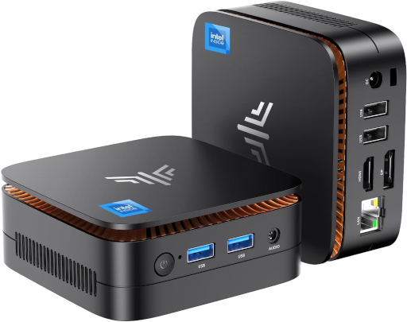

Let me just start with the TLDR as I have a tendency to write too much, all of our Selkies based images can now be launched into a Wayland mode using the env var `-e PIXELFLUX_WAYLAND=true` or checking a box in [Sealskin](https://github.com/linuxserver/docker-sealskin). This Wayland mode is an entire ground up stack leveraging a virtual framebuffer in userspace that can live on a GPU or CPU. The net result on any hardware with a GPU is a remote monitor in your web browser. I am not talking about a compromise or half baked "this is kinda cool cause it is in my web browser and it can run in Docker" I am talking about turning your web browser into a true virtual display for the remote session. There are two major wins out of this mode: 

## Zero Copy Encoding


This is the headline here and would not be possible without one very important piece of core software and one very ambitious project. 

## [Smithay](https://github.com/Smithay/smithay)


Smithay provides the building blocks for anyone to make a custom Wayland Compositor. In our case in Wayland mode this handles all of the heavy lifting that Xvfb used to do in our legacy stack while giving us complete control over the actual framebuffer display. It is a socket that runs in userspace that any Wayland compatible application can launch into while we control the resolution, pacing, and rendering. 

The core display we generate can live as an EGL display with its rendering context directly as a DMABUF on the Intel/AMD/NVIDIA gpu or if no GPU is available as a memory pointer leveraging [Pixman](https://www.pixman.org/) and using LLVMpipe in mesa to fill in the blanks. 

When the framebuffer lives on the GPU this unlocks what is known as [Zero Copy](https://en.wikipedia.org/wiki/Zero-copy) encoding, meaning we make a series of API calls to the GPU to manipulate the pixels into a video frame and the only data we ever read back is the encoded frame. We leverage libav for Zero Copy VAAPI support and directly make Cuda and NVENC calls to facilitate it on the NVIDIA side. 

This brings me to the second part of this puzzle, the reference project that did all the work on the NVIDIA Zero Copy Pipeline cracking the code on using CUDA to get the framebuffer into a format that could be color converted and encoded [Games on Whales](https://games-on-whales.github.io/) and [ABeltramo](https://github.com/ABeltramo). With their project [gst-wayland-display](https://github.com/games-on-whales/gst-wayland-display) the whole process is laid out. This showed me that you could (in userspace) without any special privileges outside of a render node mounted into a Docker container, render a true Wayland session just like you would if you were outputting to a monitor. 

I just wanted to give a huge shout out to both of these projects and if you are a developer looking to get into the Linux Desktop stack specifically in niche applications definetly look into Smithay. 
If you are a user that wants to play Video games through Moonlight on the most lean and optimized Docker based stack in existence than definitely check out [Games on Whales](https://games-on-whales.github.io/) and [Wolf](https://games-on-whales.github.io/wolf/stable/user/quickstart.html). 

Now why is this Zero Copy encoding so important? Well it is because we had a major bug in our DRI3 implementation to provide 3d support and our Nvidia support just came from Zink while suffering from a similar issue when extracting pixmaps from the GPU: 


XVFB lacks any kind of API for resizing and how we were leveraging it and supporting dual monitors we needed to work with a 16k pixel plane so widescreen users and dual monitors still get a stream while using xrandr to chop virtual displays into it. After that Pixelflux would readback the Virtual framebuffer on the CPU while in the background X11 using glamor was "flipping" the entire 16k pixmap 60 times a second to extract and merge the cpu framebuffer with the GPU pixmaps. 

This was the result of me porting an almost 10 year old patch to enable DRI3/Glamor in the X11 stack with [docker-xvfb](https://github.com/linuxserver/docker-xvfb), this worked but as seen above had many issues. We found that clamping this virtual display to something like 4k would greatly improve performance and stability with the `MAX_RES` environment variable. 

This was a chain of hacks, a chain of hacks we were forced to implement to fulfill the need of running a containerized full desktop session. A chain of hacks we no longer need to deal with and this brings us to our second most important feature . 

## 3D App Support Baked In and Native

When you use Selkies with a GPU in Wayland mode there are some oddities that just come along with doing this in Docker, but the core rendering works identical to a normal Linux Desktop being rendered on a GPU connected to a monitor. There is no feature strip or wonky workarounds when it comes to 3d acceleration it is just how it is expected to work and desktop applications needing to use a GPU will not know the difference. 

What does "Native" mean ? Well to answer that question lets first establish what our test bed server is going to be: 



This is an N97 mini PC I got off ebay a while back for $80, it has 16GB of DDR4 Ram at 2667 MT/s. [N97 Specs](https://www.intel.com/content/www/us/en/products/sku/233090/intel-processor-n97-6m-cache-up-to-3-60-ghz/specifications.html)

So what can you do with this new pipeline on this tiny $80 block of Chinesium ? (all videos captured at 1080p running on this mini PC)

**How about 8 Firefox containers running Youtube?** [docker-firefox](https://github.com/linuxserver/docker-firefox)

<video controls playsinline preload="metadata" src="/media/webtop-4-0-wayland-is-here-engage-the-reality-engine/8firefox.mp4" aria-label="8firefox"></video>

**3D Modelling ?** [docker-blender](https://github.com/linuxserver/docker-blender)

<video controls playsinline preload="metadata" src="/media/webtop-4-0-wayland-is-here-engage-the-reality-engine/blend1.mp4" aria-label="blend1"></video>

**More modeling?** [docker-freecad](https://github.com/linuxserver/docker-freecad)

<video controls playsinline preload="metadata" src="/media/webtop-4-0-wayland-is-here-engage-the-reality-engine/freecad.mp4" aria-label="freecad"></video>

**Got a 3D printer?** [docker-orcaslicer](https://github.com/linuxserver/docker-orcaslicer)

<video controls playsinline preload="metadata" src="/media/webtop-4-0-wayland-is-here-engage-the-reality-engine/orcaslicer.mp4" aria-label="orcaslicer"></video>

**How about some old school emulation ?** [docker-citron](https://github.com/linuxserver/docker-citron/)

<video controls playsinline preload="metadata" src="/media/webtop-4-0-wayland-is-here-engage-the-reality-engine/oldschool-1.mp4" aria-label="oldschool-1"></video>

**Older School?** [docker-pcsx2](https://github.com/linuxserver/docker-pcsx2/)

<video controls playsinline preload="metadata" src="/media/webtop-4-0-wayland-is-here-engage-the-reality-engine/gta2.mp4" aria-label="gta2"></video>

**First person shooters? No problem with gaming mode.** [docker-gzdoom](https://github.com/linuxserver/docker-gzdoom)

<video controls playsinline preload="metadata" src="/media/webtop-4-0-wayland-is-here-engage-the-reality-engine/doom2.mp4" aria-label="doom2"></video>

**Speaking of first person shooters anyone like Minecraft?** [docker-modrinth](https://github.com/linuxserver/docker-modrinth)

<video controls playsinline preload="metadata" src="/media/webtop-4-0-wayland-is-here-engage-the-reality-engine/minecraft.mp4" aria-label="minecraft"></video>

**Yes it runs Crysis if you are wondering** [docker-steam](https://github.com/linuxserver/docker-steam)

<video controls playsinline preload="metadata" src="/media/webtop-4-0-wayland-is-here-engage-the-reality-engine/crysis2.mp4" aria-label="crysis2"></video>

**Finish the fight**  [docker-steam](https://github.com/linuxserver/docker-steam)

<video controls playsinline preload="metadata" src="/media/webtop-4-0-wayland-is-here-engage-the-reality-engine/reach2.mp4" aria-label="Reach2"></video>

**Modern Gaming with GOG DRM Free Titles?** [docker-baseimage-selkies](https://github.com/linuxserver/docker-baseimage-selkies/)

<video controls playsinline preload="metadata" src="/media/webtop-4-0-wayland-is-here-engage-the-reality-engine/silk.mp4" aria-label="silk"></video>

**How about a fully accelerated KDE plasma_wayland desktop?** [docker-webtop](https://github.com/linuxserver/docker-webtop) `alpine-kde` tag

<video controls playsinline preload="metadata" src="/media/webtop-4-0-wayland-is-here-engage-the-reality-engine/kde1.mp4" aria-label="kde1"></video>


I hope you are starting to get the idea. We have entered the Tock phase of software development, the hardware is regressing and it is on us to make a viable solution for all this "obsolete" gear and show Microsoft that we will not take their shit anymore. You cannot just fire every competent developer in a country and expect them to sit on their hands, we will beat you and your new business model which puts customers last and training data collection first.

### Notes on NVIDIA

While AMD/Intel support is fully flushed out, NVIDIA support depends on host, driver, and card setup. In testing the most reliable setup is the current proprietary drivers with the proprietary kernel headers. The underlying host should be a current operating system like Debian Trixie or above. 

For Wayland mode you will need to enable the nvidia-drm kernel flag `nvidia-drm.modeset=1` this can be achieved by editing `/etc/default/grub` with `GRUB_CMDLINE_LINUX_DEFAULT="quiet nvidia-drm.modeset=1"` and running `sudo update-grub`. This is a Wayland requirement and is not related to running in Docker.

If you have multiple GPUs in your system and want to use NVIDIA, you will need to define the render node for both the encoder and EGL device IE if it is renderD129: 

```
-e DRINODE=/dev/dri/renderD129
-e DRI_NODE=/dev/dri/renderD129
```

Please use the latest container toolkit as well from NVIDIA's [repositories](https://docs.nvidia.com/datacenter/cloud-native/container-toolkit/latest/install-guide.html).

## Pepsi Challange

I am going to say something and I might regret it, but I would like anyone to show me a more dense or lean solution for sending a Desktop application to a web browser. Show me your stack running 8 separate 60 fps full motion Firefox sessions to a web browser on an $80 mini PC and knock me down a peg. As anyone that actually works remote in a web based enclave can tell you most over the counter solutions are based on some Guacamole or noVNC fork. Every once and a while you get something WebRTC based but those are rare while also geared to gaming without any kind of screen cleanup for text legibility. The experience is not great it is mostly EC2 instances with 2014 xeons and a bunch of jpegs splashed to your browser. If you work in one of those environments show them what you have unlocked on your home server, show them what they could have for free. 

I have done nothing but obsess over this problem statement for the past 5 years of my life and now that I am seeing it with my own eyes I truly think this is a world first in this niche realm. 

Just from an angle of RBI (Remote Browser Isolation) why would you use anything else ? It's MPL licensed money companies go ahead and take it I am begging for corporate help between the 100+ apps available and writing the stack from pixel creation to painting in the browser one man can only do so much. 


## Apps and more apps


### The Library

**WebTop Flavors with native Wayland support (i3 tags run Sway in Wayland mode)**

**lscr.io/linuxserver/webtop:TAGNAME**

| Tag | Desktop | Distro |
| :--- | :--- | :--- |
| `alpine-i3` | sway | Alpine |
| `alpine-kde` | KDE | Alpine |
| `arch-i3` | sway | Arch |
| `arch-kde` | KDE | Arch |
| `debian-i3` | sway | Debian |
| `fedora-i3` | sway | Fedora |
| `fedora-kde` | KDE | Fedora |
| `ubuntu-i3` | sway | Ubuntu |

All containers outside of the `alpine-kde` tag of Webtop need the `-e PIXELFLUX_WAYLAND=true` environment variable to activate this mode. We will be migrating it to be default gradually where it makes sense like the gaming focused containers first. 

[docker-kali-linux](https://github.com/linuxserver/docker-kali-linux) also supports this new mode for you pen testers out there. 

<video controls playsinline preload="metadata" src="/media/webtop-4-0-wayland-is-here-engage-the-reality-engine/kali.mp4" aria-label="kali"></video>

**Application Containers with Wayland support**

<div style="display: grid; grid-template-columns: repeat(auto-fill, minmax(160px, 1fr)); gap: 1rem; list-style: none; padding: 0; margin: 0; font-family: sans-serif;">
    <a href="https://github.com/linuxserver/docker-altus" target="_blank" rel="noopener noreferrer" style="display: flex; flex-direction: column; align-items: center; padding: 1rem; border: 1px solid #ddd; border-radius: 8px; text-decoration: none; color: #333; background-color: #f9f9f9; transition: box-shadow 0.2s ease-in-out;" onmouseover="this.style.boxShadow='0 4px 12px rgba(0,0,0,0.1)';" onmouseout="this.style.boxShadow='none';">
        
        <span style="text-align: center; word-break: break-word;">altus</span>
    </a>
    <a href="https://github.com/linuxserver/docker-ardour" target="_blank" rel="noopener noreferrer" style="display: flex; flex-direction: column; align-items: center; padding: 1rem; border: 1px solid #ddd; border-radius: 8px; text-decoration: none; color: #333; background-color: #f9f9f9; transition: box-shadow 0.2s ease-in-out;" onmouseover="this.style.boxShadow='0 4px 12px rgba(0,0,0,0.1)';" onmouseout="this.style.boxShadow='none';">
        
        <span style="text-align: center; word-break: break-word;">ardour</span>
    </a>
    <a href="https://github.com/linuxserver/docker-audacity" target="_blank" rel="noopener noreferrer" style="display: flex; flex-direction: column; align-items: center; padding: 1rem; border: 1px solid #ddd; border-radius: 8px; text-decoration: none; color: #333; background-color: #f9f9f9; transition: box-shadow 0.2s ease-in-out;" onmouseover="this.style.boxShadow='0 4px 12px rgba(0,0,0,0.1)';" onmouseout="this.style.boxShadow='none';">
        
        <span style="text-align: center; word-break: break-word;">audacity</span>
    </a>
    <a href="https://github.com/linuxserver/docker-azahar" target="_blank" rel="noopener noreferrer" style="display: flex; flex-direction: column; align-items: center; padding: 1rem; border: 1px solid #ddd; border-radius: 8px; text-decoration: none; color: #333; background-color: #f9f9f9; transition: box-shadow 0.2s ease-in-out;" onmouseover="this.style.boxShadow='0 4px 12px rgba(0,0,0,0.1)';" onmouseout="this.style.boxShadow='none';">
        
        <span style="text-align: center; word-break: break-word;">azahar</span>
    </a>
    <a href="https://github.com/linuxserver/docker-bambustudio" target="_blank" rel="noopener noreferrer" style="display: flex; flex-direction: column; align-items: center; padding: 1rem; border: 1px solid #ddd; border-radius: 8px; text-decoration: none; color: #333; background-color: #f9f9f9; transition: box-shadow 0.2s ease-in-out;" onmouseover="this.style.boxShadow='0 4px 12px rgba(0,0,0,0.1)';" onmouseout="this.style.boxShadow='none';">
        
        <span style="text-align: center; word-break: break-word;">bambustudio</span>
    </a>
    <a href="https://github.com/linuxserver/docker-blender" target="_blank" rel="noopener noreferrer" style="display: flex; flex-direction: column; align-items: center; padding: 1rem; border: 1px solid #ddd; border-radius: 8px; text-decoration: none; color: #333; background-color: #f9f9f9; transition: box-shadow 0.2s ease-in-out;" onmouseover="this.style.boxShadow='0 4px 12px rgba(0,0,0,0.1)';" onmouseout="this.style.boxShadow='none';">
        
        <span style="text-align: center; word-break: break-word;">blender</span>
    </a>
    <a href="https://github.com/linuxserver/docker-boinc" target="_blank" rel="noopener noreferrer" style="display: flex; flex-direction: column; align-items: center; padding: 1rem; border: 1px solid #ddd; border-radius: 8px; text-decoration: none; color: #333; background-color: #f9f9f9; transition: box-shadow 0.2s ease-in-out;" onmouseover="this.style.boxShadow='0 4px 12px rgba(0,0,0,0.1)';" onmouseout="this.style.boxShadow='none';">
        
        <span style="text-align: center; word-break: break-word;">boinc</span>
    </a>
    <a href="https://github.com/linuxserver/docker-brave" target="_blank" rel="noopener noreferrer" style="display: flex; flex-direction: column; align-items: center; padding: 1rem; border: 1px solid #ddd; border-radius: 8px; text-decoration: none; color: #333; background-color: #f9f9f9; transition: box-shadow 0.2s ease-in-out;" onmouseover="this.style.boxShadow='0 4px 12px rgba(0,0,0,0.1)';" onmouseout="this.style.boxShadow='none';">
        
        <span style="text-align: center; word-break: break-word;">brave</span>
    </a>
    <a href="https://github.com/linuxserver/docker-calibre" target="_blank" rel="noopener noreferrer" style="display: flex; flex-direction: column; align-items: center; padding: 1rem; border: 1px solid #ddd; border-radius: 8px; text-decoration: none; color: #333; background-color: #f9f9f9; transition: box-shadow 0.2s ease-in-out;" onmouseover="this.style.boxShadow='0 4px 12px rgba(0,0,0,0.1)';" onmouseout="this.style.boxShadow='none';">
        
        <span style="text-align: center; word-break: break-word;">calibre</span>
    </a>
    <a href="https://github.com/linuxserver/docker-calligra" target="_blank" rel="noopener noreferrer" style="display: flex; flex-direction: column; align-items: center; padding: 1rem; border: 1px solid #ddd; border-radius: 8px; text-decoration: none; color: #333; background-color: #f9f9f9; transition: box-shadow 0.2s ease-in-out;" onmouseover="this.style.boxShadow='0 4px 12px rgba(0,0,0,0.1)';" onmouseout="this.style.boxShadow='none';">
        
        <span style="text-align: center; word-break: break-word;">calligra</span>
    </a>
    <a href="https://github.com/linuxserver/docker-chrome" target="_blank" rel="noopener noreferrer" style="display: flex; flex-direction: column; align-items: center; padding: 1rem; border: 1px solid #ddd; border-radius: 8px; text-decoration: none; color: #333; background-color: #f9f9f9; transition: box-shadow 0.2s ease-in-out;" onmouseover="this.style.boxShadow='0 4px 12px rgba(0,0,0,0.1)';" onmouseout="this.style.boxShadow='none';">
        
        <span style="text-align: center; word-break: break-word;">chrome</span>
    </a>
    <a href="https://github.com/linuxserver/docker-chromium" target="_blank" rel="noopener noreferrer" style="display: flex; flex-direction: column; align-items: center; padding: 1rem; border: 1px solid #ddd; border-radius: 8px; text-decoration: none; color: #333; background-color: #f9f9f9; transition: box-shadow 0.2s ease-in-out;" onmouseover="this.style.boxShadow='0 4px 12px rgba(0,0,0,0.1)';" onmouseout="this.style.boxShadow='none';">
        
        <span style="text-align: center; word-break: break-word;">chromium</span>
    </a>
    <a href="https://github.com/linuxserver/docker-citron" target="_blank" rel="noopener noreferrer" style="display: flex; flex-direction: column; align-items: center; padding: 1rem; border: 1px solid #ddd; border-radius: 8px; text-decoration: none; color: #333; background-color: #f9f9f9; transition: box-shadow 0.2s ease-in-out;" onmouseover="this.style.boxShadow='0 4px 12px rgba(0,0,0,0.1)';" onmouseout="this.style.boxShadow='none';">
        
        <span style="text-align: center; word-break: break-word;">citron</span>
    </a>
    <a href="https://github.com/linuxserver/docker-cura" target="_blank" rel="noopener noreferrer" style="display: flex; flex-direction: column; align-items: center; padding: 1rem; border: 1px solid #ddd; border-radius: 8px; text-decoration: none; color: #333; background-color: #f9f9f9; transition: box-shadow 0.2s ease-in-out;" onmouseover="this.style.boxShadow='0 4px 12px rgba(0,0,0,0.1)';" onmouseout="this.style.boxShadow='none';">
        
        <span style="text-align: center; word-break: break-word;">cura</span>
    </a>
    <a href="https://github.com/linuxserver/docker-darktable" target="_blank" rel="noopener noreferrer" style="display: flex; flex-direction: column; align-items: center; padding: 1rem; border: 1px solid #ddd; border-radius: 8px; text-decoration: none; color: #333; background-color: #f9f9f9; transition: box-shadow 0.2s ease-in-out;" onmouseover="this.style.boxShadow='0 4px 12px rgba(0,0,0,0.1)';" onmouseout="this.style.boxShadow='none';">
        
        <span style="text-align: center; word-break: break-word;">darktable</span>
    </a>
    <a href="https://github.com/linuxserver/docker-digikam" target="_blank" rel="noopener noreferrer" style="display: flex; flex-direction: column; align-items: center; padding: 1rem; border: 1px solid #ddd; border-radius: 8px; text-decoration: none; color: #333; background-color: #f9f9f9; transition: box-shadow 0.2s ease-in-out;" onmouseover="this.style.boxShadow='0 4px 12px rgba(0,0,0,0.1)';" onmouseout="this.style.boxShadow='none';">
        
        <span style="text-align: center; word-break: break-word;">digikam</span>
    </a>
    <a href="https://github.com/linuxserver/docker-dogwalk" target="_blank" rel="noopener noreferrer" style="display: flex; flex-direction: column; align-items: center; padding: 1rem; border: 1px solid #ddd; border-radius: 8px; text-decoration: none; color: #333; background-color: #f9f9f9; transition: box-shadow 0.2s ease-in-out;" onmouseover="this.style.boxShadow='0 4px 12px rgba(0,0,0,0.1)';" onmouseout="this.style.boxShadow='none';">
        
        <span style="text-align: center; word-break: break-word;">dogwalk</span>
    </a>
    <a href="https://github.com/linuxserver/docker-dolphin" target="_blank" rel="noopener noreferrer" style="display: flex; flex-direction: column; align-items: center; padding: 1rem; border: 1px solid #ddd; border-radius: 8px; text-decoration: none; color: #333; background-color: #f9f9f9; transition: box-shadow 0.2s ease-in-out;" onmouseover="this.style.boxShadow='0 4px 12px rgba(0,0,0,0.1)';" onmouseout="this.style.boxShadow='none';">
        
        <span style="text-align: center; word-break: break-word;">dolphin</span>
    </a>
    <a href="https://github.com/linuxserver/docker-dosbox-stating" target="_blank" rel="noopener noreferrer" style="display: flex; flex-direction: column; align-items: center; padding: 1rem; border: 1px solid #ddd; border-radius: 8px; text-decoration: none; color: #333; background-color: #f9f9f9; transition: box-shadow 0.2s ease-in-out;" onmouseover="this.style.boxShadow='0 4px 12px rgba(0,0,0,0.1)';" onmouseout="this.style.boxShadow='none';">
        
        <span style="text-align: center; word-break: break-word;">dosbox staging</span>
    </a>
    <a href="https://github.com/linuxserver/docker-doublecommander" target="_blank" rel="noopener noreferrer" style="display: flex; flex-direction: column; align-items: center; padding: 1rem; border: 1px solid #ddd; border-radius: 8px; text-decoration: none; color: #333; background-color: #f9f9f9; transition: box-shadow 0.2s ease-in-out;" onmouseover="this.style.boxShadow='0 4px 12px rgba(0,0,0,0.1)';" onmouseout="this.style.boxShadow='none';">
        
        <span style="text-align: center; word-break: break-word;">doublecommander</span>
    </a>
    <a href="https://github.com/linuxserver/docker-duckstation" target="_blank" rel="noopener noreferrer" style="display: flex; flex-direction: column; align-items: center; padding: 1rem; border: 1px solid #ddd; border-radius: 8px; text-decoration: none; color: #333; background-color: #f9f9f9; transition: box-shadow 0.2s ease-in-out;" onmouseover="this.style.boxShadow='0 4px 12px rgba(0,0,0,0.1)';" onmouseout="this.style.boxShadow='none';">
        
        <span style="text-align: center; word-break: break-word;">duckstation</span>
    </a>
    <a href="https://github.com/linuxserver/docker-ferdium" target="_blank" rel="noopener noreferrer" style="display: flex; flex-direction: column; align-items: center; padding: 1rem; border: 1px solid #ddd; border-radius: 8px; text-decoration: none; color: #333; background-color: #f9f9f9; transition: box-shadow 0.2s ease-in-out;" onmouseover="this.style.boxShadow='0 4px 12px rgba(0,0,0,0.1)';" onmouseout="this.style.boxShadow='none';">
        
        <span style="text-align: center; word-break: break-word;">ferdium</span>
    </a>
    <a href="https://github.com/linuxserver/docker-filezilla" target="_blank" rel="noopener noreferrer" style="display: flex; flex-direction: column; align-items: center; padding: 1rem; border: 1px solid #ddd; border-radius: 8px; text-decoration: none; color: #333; background-color: #f9f9f9; transition: box-shadow 0.2s ease-in-out;" onmouseover="this.style.boxShadow='0 4px 12px rgba(0,0,0,0.1)';" onmouseout="this.style.boxShadow='none';">
        
        <span style="text-align: center; word-break: break-word;">filezilla</span>
    </a>
    <a href="https://github.com/linuxserver/docker-firefox" target="_blank" rel="noopener noreferrer" style="display: flex; flex-direction: column; align-items: center; padding: 1rem; border: 1px solid #ddd; border-radius: 8px; text-decoration: none; color: #333; background-color: #f9f9f9; transition: box-shadow 0.2s ease-in-out;" onmouseover="this.style.boxShadow='0 4px 12px rgba(0,0,0,0.1)';" onmouseout="this.style.boxShadow='none';">
        
        <span style="text-align: center; word-break: break-word;">firefox</span>
    </a>
    <a href="https://github.com/linuxserver/docker-flycast" target="_blank" rel="noopener noreferrer" style="display: flex; flex-direction: column; align-items: center; padding: 1rem; border: 1px solid #ddd; border-radius: 8px; text-decoration: none; color: #333; background-color: #f9f9f9; transition: box-shadow 0.2s ease-in-out;" onmouseover="this.style.boxShadow='0 4px 12px rgba(0,0,0,0.1)';" onmouseout="this.style.boxShadow='none';">
        
        <span style="text-align: center; word-break: break-word;">flycast</span>
    </a>
    <a href="https://github.com/linuxserver/docker-freecad" target="_blank" rel="noopener noreferrer" style="display: flex; flex-direction: column; align-items: center; padding: 1rem; border: 1px solid #ddd; border-radius: 8px; text-decoration: none; color: #333; background-color: #f9f9f9; transition: box-shadow 0.2s ease-in-out;" onmouseover="this.style.boxShadow='0 4px 12px rgba(0,0,0,0.1)';" onmouseout="this.style.boxShadow='none';">
        
        <span style="text-align: center; word-break: break-word;">freecad</span>
    </a>
    <a href="https://github.com/linuxserver/docker-gimp" target="_blank" rel="noopener noreferrer" style="display: flex; flex-direction: column; align-items: center; padding: 1rem; border: 1px solid #ddd; border-radius: 8px; text-decoration: none; color: #333; background-color: #f9f9f9; transition: box-shadow 0.2s ease-in-out;" onmouseover="this.style.boxShadow='0 4px 12px rgba(0,0,0,0.1)';" onmouseout="this.style.boxShadow='none';">
        
        <span style="text-align: center; word-break: break-word;">gimp</span>
    </a>
    <a href="https://github.com/linuxserver/docker-github-desktop" target="_blank" rel="noopener noreferrer" style="display: flex; flex-direction: column; align-items: center; padding: 1rem; border: 1px solid #ddd; border-radius: 8px; text-decoration: none; color: #333; background-color: #f9f9f9; transition: box-shadow 0.2s ease-in-out;" onmouseover="this.style.boxShadow='0 4px 12px rgba(0,0,0,0.1)';" onmouseout="this.style.boxShadow='none';">
        
        <span style="text-align: center; word-break: break-word;">github-desktop</span>
    </a>
    <a href="https://github.com/linuxserver/docker-gitqlient" target="_blank" rel="noopener noreferrer" style="display: flex; flex-direction: column; align-items: center; padding: 1rem; border: 1px solid #ddd; border-radius: 8px; text-decoration: none; color: #333; background-color: #f9f9f9; transition: box-shadow 0.2s ease-in-out;" onmouseover="this.style.boxShadow='0 4px 12px rgba(0,0,0,0.1)';" onmouseout="this.style.boxShadow='none';">
        
        <span style="text-align: center; word-break: break-word;">gitqlient</span>
    </a>
    <a href="https://github.com/linuxserver/docker-gzdoom" target="_blank" rel="noopener noreferrer" style="display: flex; flex-direction: column; align-items: center; padding: 1rem; border: 1px solid #ddd; border-radius: 8px; text-decoration: none; color: #333; background-color: #f9f9f9; transition: box-shadow 0.2s ease-in-out;" onmouseover="this.style.boxShadow='0 4px 12px rgba(0,0,0,0.1)';" onmouseout="this.style.boxShadow='none';">
        
        <span style="text-align: center; word-break: break-word;">gzdoom</span>
    </a>
    <a href="https://github.com/linuxserver/docker-handbrake" target="_blank" rel="noopener noreferrer" style="display: flex; flex-direction: column; align-items: center; padding: 1rem; border: 1px solid #ddd; border-radius: 8px; text-decoration: none; color: #333; background-color: #f9f9f9; transition: box-shadow 0.2s ease-in-out;" onmouseover="this.style.boxShadow='0 4px 12px rgba(0,0,0,0.1)';" onmouseout="this.style.boxShadow='none';">
        
        <span style="text-align: center; word-break: break-word;">handbrake</span>
    </a>
    <a href="https://github.com/linuxserver/docker-inkscape" target="_blank" rel="noopener noreferrer" style="display: flex; flex-direction: column; align-items: center; padding: 1rem; border: 1px solid #ddd; border-radius: 8px; text-decoration: none; color: #333; background-color: #f9f9f9; transition: box-shadow 0.2s ease-in-out;" onmouseover="this.style.boxShadow='0 4px 12px rgba(0,0,0,0.1)';" onmouseout="this.style.boxShadow='none';">
        
        <span style="text-align: center; word-break: break-word;">inkscape</span>
    </a>
    <a href="https://github.com/linuxserver/docker-intellij-idea" target="_blank" rel="noopener noreferrer" style="display: flex; flex-direction: column; align-items: center; padding: 1rem; border: 1px solid #ddd; border-radius: 8px; text-decoration: none; color: #333; background-color: #f9f9f9; transition: box-shadow 0.2s ease-in-out;" onmouseover="this.style.boxShadow='0 4px 12px rgba(0,0,0,0.1)';" onmouseout="this.style.boxShadow='none';">
        
        <span style="text-align: center; word-break: break-word;">intellij-idea</span>
    </a>
    <a href="https://github.com/linuxserver/docker-joplin" target="_blank" rel="noopener noreferrer" style="display: flex; flex-direction: column; align-items: center; padding: 1rem; border: 1px solid #ddd; border-radius: 8px; text-decoration: none; color: #333; background-color: #f9f9f9; transition: box-shadow 0.2s ease-in-out;" onmouseover="this.style.boxShadow='0 4px 12px rgba(0,0,0,0.1)';" onmouseout="this.style.boxShadow='none';">
        
        <span style="text-align: center; word-break: break-word;">joplin</span>
    </a>
    <a href="https://github.com/linuxserver/docker-kali-linux" target="_blank" rel="noopener noreferrer" style="display: flex; flex-direction: column; align-items: center; padding: 1rem; border: 1px solid #ddd; border-radius: 8px; text-decoration: none; color: #333; background-color: #f9f9f9; transition: box-shadow 0.2s ease-in-out;" onmouseover="this.style.boxShadow='0 4px 12px rgba(0,0,0,0.1)';" onmouseout="this.style.boxShadow='none';">
        
        <span style="text-align: center; word-break: break-word;">kali-linux</span>
    </a>
    <a href="https://github.com/linuxserver/docker-kdenlive" target="_blank" rel="noopener noreferrer" style="display: flex; flex-direction: column; align-items: center; padding: 1rem; border: 1px solid #ddd; border-radius: 8px; text-decoration: none; color: #333; background-color: #f9f9f9; transition: box-shadow 0.2s ease-in-out;" onmouseover="this.style.boxShadow='0 4px 12px rgba(0,0,0,0.1)';" onmouseout="this.style.boxShadow='none';">
        
        <span style="text-align: center; word-break: break-word;">kdenlive</span>
    </a>
    <a href="https://github.com/linuxserver/docker-keepassxc" target="_blank" rel="noopener noreferrer" style="display: flex; flex-direction: column; align-items: center; padding: 1rem; border: 1px solid #ddd; border-radius: 8px; text-decoration: none; color: #333; background-color: #f9f9f9; transition: box-shadow 0.2s ease-in-out;" onmouseover="this.style.boxShadow='0 4px 12px rgba(0,0,0,0.1)';" onmouseout="this.style.boxShadow='none';">
        
        <span style="text-align: center; word-break: break-word;">keepassxc</span>
    </a>
    <a href="https://github.com/linuxserver/docker-kicad" target="_blank" rel="noopener noreferrer" style="display: flex; flex-direction: column; align-items: center; padding: 1rem; border: 1px solid #ddd; border-radius: 8px; text-decoration: none; color: #333; background-color: #f9f9f9; transition: box-shadow 0.2s ease-in-out;" onmouseover="this.style.boxShadow='0 4px 12px rgba(0,0,0,0.1)';" onmouseout="this.style.boxShadow='none';">
        
        <span style="text-align: center; word-break: break-word;">kicad</span>
    </a>
    <a href="https://github.com/linuxserver/docker-krita" target="_blank" rel="noopener noreferrer" style="display: flex; flex-direction: column; align-items: center; padding: 1rem; border: 1px solid #ddd; border-radius: 8px; text-decoration: none; color: #333; background-color: #f9f9f9; transition: box-shadow 0.2s ease-in-out;" onmouseover="this.style.boxShadow='0 4px 12px rgba(0,0,0,0.1)';" onmouseout="this.style.boxShadow='none';">
        
        <span style="text-align: center; word-break: break-word;">krita</span>
    </a>
    <a href="https://github.com/linuxserver/docker-libreoffice" target="_blank" rel="noopener noreferrer" style="display: flex; flex-direction: column; align-items: center; padding: 1rem; border: 1px solid #ddd; border-radius: 8px; text-decoration: none; color: #333; background-color: #f9f9f9; transition: box-shadow 0.2s ease-in-out;" onmouseover="this.style.boxShadow='0 4px 12px rgba(0,0,0,0.1)';" onmouseout="this.style.boxShadow='none';">
        
        <span style="text-align: center; word-break: break-word;">libreoffice</span>
    </a>
    <a href="https://github.com/linuxserver/docker-librewolf" target="_blank" rel="noopener noreferrer" style="display: flex; flex-direction: column; align-items: center; padding: 1rem; border: 1px solid #ddd; border-radius: 8px; text-decoration: none; color: #333; background-color: #f9f9f9; transition: box-shadow 0.2s ease-in-out;" onmouseover="this.style.boxShadow='0 4px 12px rgba(0,0,0,0.1)';" onmouseout="this.style.boxShadow='none';">
        
        <span style="text-align: center; word-break: break-word;">librewolf</span>
    </a>
    <a href="https://github.com/linuxserver/docker-lollypop" target="_blank" rel="noopener noreferrer" style="display: flex; flex-direction: column; align-items: center; padding: 1rem; border: 1px solid #ddd; border-radius: 8px; text-decoration: none; color: #333; background-color: #f9f9f9; transition: box-shadow 0.2s ease-in-out;" onmouseover="this.style.boxShadow='0 4px 12px rgba(0,0,0,0.1)';" onmouseout="this.style.boxShadow='none';">
        
        <span style="text-align: center; word-break: break-word;">lollypop</span>
    </a>
    <a href="https://github.com/linuxserver/docker-mame" target="_blank" rel="noopener noreferrer" style="display: flex; flex-direction: column; align-items: center; padding: 1rem; border: 1px solid #ddd; border-radius: 8px; text-decoration: none; color: #333; background-color: #f9f9f9; transition: box-shadow 0.2s ease-in-out;" onmouseover="this.style.boxShadow='0 4px 12px rgba(0,0,0,0.1)';" onmouseout="this.style.boxShadow='none';">
        
        <span style="text-align: center; word-break: break-word;">mame</span>
    </a>
    <a href="https://github.com/linuxserver/docker-mediaelch" target="_blank" rel="noopener noreferrer" style="display: flex; flex-direction: column; align-items: center; padding: 1rem; border: 1px solid #ddd; border-radius: 8px; text-decoration: none; color: #333; background-color: #f9f9f9; transition: box-shadow 0.2s ease-in-out;" onmouseover="this.style.boxShadow='0 4px 12px rgba(0,0,0,0.1)';" onmouseout="this.style.boxShadow='none';">
        
        <span style="text-align: center; word-break: break-word;">mediaelch</span>
    </a>
    <a href="https://github.com/linuxserver/docker-melonds" target="_blank" rel="noopener noreferrer" style="display: flex; flex-direction: column; align-items: center; padding: 1rem; border: 1px solid #ddd; border-radius: 8px; text-decoration: none; color: #333; background-color: #f9f9f9; transition: box-shadow 0.2s ease-in-out;" onmouseover="this.style.boxShadow='0 4px 12px rgba(0,0,0,0.1)';" onmouseout="this.style.boxShadow='none';">
        
        <span style="text-align: center; word-break: break-word;">melonds</span>
    </a>
    <a href="https://github.com/linuxserver/docker-modrinth" target="_blank" rel="noopener noreferrer" style="display: flex; flex-direction: column; align-items: center; padding: 1rem; border: 1px solid #ddd; border-radius: 8px; text-decoration: none; color: #333; background-color: #f9f9f9; transition: box-shadow 0.2s ease-in-out;" onmouseover="this.style.boxShadow='0 4px 12px rgba(0,0,0,0.1)';" onmouseout="this.style.boxShadow='none';">
        
        <span style="text-align: center; word-break: break-word;">modrinth</span>
    </a>
    <a href="https://github.com/linuxserver/docker-msedge" target="_blank" rel="noopener noreferrer" style="display: flex; flex-direction: column; align-items: center; padding: 1rem; border: 1px solid #ddd; border-radius: 8px; text-decoration: none; color: #333; background-color: #f9f9f9; transition: box-shadow 0.2s ease-in-out;" onmouseover="this.style.boxShadow='0 4px 12px rgba(0,0,0,0.1)';" onmouseout="this.style.boxShadow='none';">
        
        <span style="text-align: center; word-break: break-word;">msedge</span>
    </a>
    <a href="https://github.com/linuxserver/docker-mullvad-browser" target="_blank" rel="noopener noreferrer" style="display: flex; flex-direction: column; align-items: center; padding: 1rem; border: 1px solid #ddd; border-radius: 8px; text-decoration: none; color: #333; background-color: #f9f9f9; transition: box-shadow 0.2s ease-in-out;" onmouseover="this.style.boxShadow='0 4px 12px rgba(0,0,0,0.1)';" onmouseout="this.style.boxShadow='none';">
        
        <span style="text-align: center; word-break: break-word;">mullvad-browser</span>
    </a>
    <a href="https://github.com/linuxserver/docker-mysql-workbench" target="_blank" rel="noopener noreferrer" style="display: flex; flex-direction: column; align-items: center; padding: 1rem; border: 1px solid #ddd; border-radius: 8px; text-decoration: none; color: #333; background-color: #f9f9f9; transition: box-shadow 0.2s ease-in-out;" onmouseover="this.style.boxShadow='0 4px 12px rgba(0,0,0,0.1)';" onmouseout="this.style.boxShadow='none';">
        
        <span style="text-align: center; word-break: break-word;">mysql-workbench</span>
    </a>
    <a href="https://github.com/linuxserver/docker-obsidian" target="_blank" rel="noopener noreferrer" style="display: flex; flex-direction: column; align-items: center; padding: 1rem; border: 1px solid #ddd; border-radius: 8px; text-decoration: none; color: #333; background-color: #f9f9f9; transition: box-shadow 0.2s ease-in-out;" onmouseover="this.style.boxShadow='0 4px 12px rgba(0,0,0,0.1)';" onmouseout="this.style.boxShadow='none';">
        
        <span style="text-align: center; word-break: break-word;">obsidian</span>
    </a>
    <a href="https://github.com/linuxserver/docker-onlyoffice" target="_blank" rel="noopener noreferrer" style="display: flex; flex-direction: column; align-items: center; padding: 1rem; border: 1px solid #ddd; border-radius: 8px; text-decoration: none; color: #333; background-color: #f9f9f9; transition: box-shadow 0.2s ease-in-out;" onmouseover="this.style.boxShadow='0 4px 12px rgba(0,0,0,0.1)';" onmouseout="this.style.boxShadow='none';">
        
        <span style="text-align: center; word-break: break-word;">onlyoffice</span>
    </a>
    <a href="https://github.com/linuxserver/docker-opera" target="_blank" rel="noopener noreferrer" style="display: flex; flex-direction: column; align-items: center; padding: 1rem; border: 1px solid #ddd; border-radius: 8px; text-decoration: none; color: #333; background-color: #f9f9f9; transition: box-shadow 0.2s ease-in-out;" onmouseover="this.style.boxShadow='0 4px 12px rgba(0,0,0,0.1)';" onmouseout="this.style.boxShadow='none';">
        
        <span style="text-align: center; word-break: break-word;">opera</span>
    </a>
    <a href="https://github.com/linuxserver/docker-orcaslicer" target="_blank" rel="noopener noreferrer" style="display: flex; flex-direction: column; align-items: center; padding: 1rem; border: 1px solid #ddd; border-radius: 8px; text-decoration: none; color: #333; background-color: #f9f9f9; transition: box-shadow 0.2s ease-in-out;" onmouseover="this.style.boxShadow='0 4px 12px rgba(0,0,0,0.1)';" onmouseout="this.style.boxShadow='none';">
        
        <span style="text-align: center; word-break: break-word;">orcaslicer</span>
    </a>
    <a href="https://github.com/linuxserver/docker-pcsx2" target="_blank" rel="noopener noreferrer" style="display: flex; flex-direction: column; align-items: center; padding: 1rem; border: 1px solid #ddd; border-radius: 8px; text-decoration: none; color: #333; background-color: #f9f9f9; transition: box-shadow 0.2s ease-in-out;" onmouseover="this.style.boxShadow='0 4px 12px rgba(0,0,0,0.1)';" onmouseout="this.style.boxShadow='none';">
        
        <span style="text-align: center; word-break: break-word;">pcsx2</span>
    </a>
    <a href="https://github.com/linuxserver/docker-pidgin" target="_blank" rel="noopener noreferrer" style="display: flex; flex-direction: column; align-items: center; padding: 1rem; border: 1px solid #ddd; border-radius: 8px; text-decoration: none; color: #333; background-color: #f9f9f9; transition: box-shadow 0.2s ease-in-out;" onmouseover="this.style.boxShadow='0 4px 12px rgba(0,0,0,0.1)';" onmouseout="this.style.boxShadow='none';">
        
        <span style="text-align: center; word-break: break-word;">pidgin</span>
    </a>
        <a href="https://github.com/linuxserver/docker-ppsspp" target="_blank" rel="noopener noreferrer" style="display: flex; flex-direction: column; align-items: center; padding: 1rem; border: 1px solid #ddd; border-radius: 8px; text-decoration: none; color: #333; background-color: #f9f9f9; transition: box-shadow 0.2s ease-in-out;" onmouseover="this.style.boxShadow='0 4px 12px rgba(0,0,0,0.1)';" onmouseout="this.style.boxShadow='none';">
        
        <span style="text-align: center; word-break: break-word;">ppsspp</span>
    </a>
    <a href="https://github.com/linuxserver/docker-pycharm" target="_blank" rel="noopener noreferrer" style="display: flex; flex-direction: column; align-items: center; padding: 1rem; border: 1px solid #ddd; border-radius: 8px; text-decoration: none; color: #333; background-color: #f9f9f9; transition: box-shadow 0.2s ease-in-out;" onmouseover="this.style.boxShadow='0 4px 12px rgba(0,0,0,0.1)';" onmouseout="this.style.boxShadow='none';">
        
        <span style="text-align: center; word-break: break-word;">pycharm</span>
    </a>
    <a href="https://github.com/linuxserver/docker-qdirstat" target="_blank" rel="noopener noreferrer" style="display: flex; flex-direction: column; align-items: center; padding: 1rem; border: 1px solid #ddd; border-radius: 8px; text-decoration: none; color: #333; background-color: #f9f9f9; transition: box-shadow 0.2s ease-in-out;" onmouseover="this.style.boxShadow='0 4px 12px rgba(0,0,0,0.1)';" onmouseout="this.style.boxShadow='none';">
        
        <span style="text-align: center; word-break: break-word;">qdirstat</span>
    </a>
    <a href="https://github.com/linuxserver/docker-rawtherapee" target="_blank" rel="noopener noreferrer" style="display: flex; flex-direction: column; align-items: center; padding: 1rem; border: 1px solid #ddd; border-radius: 8px; text-decoration: none; color: #333; background-color: #f9f9f9; transition: box-shadow 0.2s ease-in-out;" onmouseover="this.style.boxShadow='0 4px 12px rgba(0,0,0,0.1)';" onmouseout="this.style.boxShadow='none';">
        
        <span style="text-align: center; word-break: break-word;">rawtherapee</span>
    </a>
    <a href="https://github.com/linuxserver/docker-remmina" target="_blank" rel="noopener noreferrer" style="display: flex; flex-direction: column; align-items: center; padding: 1rem; border: 1px solid #ddd; border-radius: 8px; text-decoration: none; color: #333; background-color: #f9f9f9; transition: box-shadow 0.2s ease-in-out;" onmouseover="this.style.boxShadow='0 4px 12px rgba(0,0,0,0.1)';" onmouseout="this.style.boxShadow='none';">
        
        <span style="text-align: center; word-break: break-word;">remmina</span>
    </a>
    <a href="https://github.com/linuxserver/docker-retroarch" target="_blank" rel="noopener noreferrer" style="display: flex; flex-direction: column; align-items: center; padding: 1rem; border: 1px solid #ddd; border-radius: 8px; text-decoration: none; color: #333; background-color: #f9f9f9; transition: box-shadow 0.2s ease-in-out;" onmouseover="this.style.boxShadow='0 4px 12px rgba(0,0,0,0.1)';" onmouseout="this.style.boxShadow='none';">
        
        <span style="text-align: center; word-break: break-word;">retroarch</span>
    </a>
    <a href="https://github.com/linuxserver/docker-rpcs3" target="_blank" rel="noopener noreferrer" style="display: flex; flex-direction: column; align-items: center; padding: 1rem; border: 1px solid #ddd; border-radius: 8px; text-decoration: none; color: #333; background-color: #f9f9f9; transition: box-shadow 0.2s ease-in-out;" onmouseover="this.style.boxShadow='0 4px 12px rgba(0,0,0,0.1)';" onmouseout="this.style.boxShadow='none';">
        
        <span style="text-align: center; word-break: break-word;">rpcs3</span>
    </a>
    <a href="https://github.com/linuxserver/docker-rustdesk" target="_blank" rel="noopener noreferrer" style="display: flex; flex-direction: column; align-items: center; padding: 1rem; border: 1px solid #ddd; border-radius: 8px; text-decoration: none; color: #333; background-color: #f9f9f9; transition: box-shadow 0.2s ease-in-out;" onmouseover="this.style.boxShadow='0 4px 12px rgba(0,0,0,0.1)';" onmouseout="this.style.boxShadow='none';">
        
        <span style="text-align: center; word-break: break-word;">rustdesk</span>
    </a>
    <a href="https://github.com/linuxserver/docker-shotcut" target="_blank" rel="noopener noreferrer" style="display: flex; flex-direction: column; align-items: center; padding: 1rem; border: 1px solid #ddd; border-radius: 8px; text-decoration: none; color: #333; background-color: #f9f9f9; transition: box-shadow 0.2s ease-in-out;" onmouseover="this.style.boxShadow='0 4px 12px rgba(0,0,0,0.1)';" onmouseout="this.style.boxShadow='none';">
        
        <span style="text-align: center; word-break: break-word;">shotcut</span>
    </a>
    <a href="https://github.com/linuxserver/docker-signal" target="_blank" rel="noopener noreferrer" style="display: flex; flex-direction: column; align-items: center; padding: 1rem; border: 1px solid #ddd; border-radius: 8px; text-decoration: none; color: #333; background-color: #f9f9f9; transition: box-shadow 0.2s ease-in-out;" onmouseover="this.style.boxShadow='0 4px 12px rgba(0,0,0,0.1)';" onmouseout="this.style.boxShadow='none';">
        
        <span style="text-align: center; word-break: break-word;">signal</span>
    </a>
    <a href="https://github.com/linuxserver/docker-spotube" target="_blank" rel="noopener noreferrer" style="display: flex; flex-direction: column; align-items: center; padding: 1rem; border: 1px solid #ddd; border-radius: 8px; text-decoration: none; color: #333; background-color: #f9f9f9; transition: box-shadow 0.2s ease-in-out;" onmouseover="this.style.boxShadow='0 4px 12px rgba(0,0,0,0.1)';" onmouseout="this.style.boxShadow='none';">
        
        <span style="text-align: center; word-break: break-word;">spotube</span>
    </a>
    <a href="https://github.com/linuxserver/docker-sqlitebrowser" target="_blank" rel="noopener noreferrer" style="display: flex; flex-direction: column; align-items: center; padding: 1rem; border: 1px solid #ddd; border-radius: 8px; text-decoration: none; color: #333; background-color: #f9f9f9; transition: box-shadow 0.2s ease-in-out;" onmouseover="this.style.boxShadow='0 4px 12px rgba(0,0,0,0.1)';" onmouseout="this.style.boxShadow='none';">
        
        <span style="text-align: center; word-break: break-word;">sqlitebrowser</span>
    </a>
    <a href="https://github.com/linuxserver/docker-steam" target="_blank" rel="noopener noreferrer" style="display: flex; flex-direction: column; align-items: center; padding: 1rem; border: 1px solid #ddd; border-radius: 8px; text-decoration: none; color: #333; background-color: #f9f9f9; transition: box-shadow 0.2s ease-in-out;" onmouseover="this.style.boxShadow='0 4px 12px rgba(0,0,0,0.1)';" onmouseout="this.style.boxShadow='none';">
        
        <span style="text-align: center; word-break: break-word;">steam</span>
    </a>
    <a href="https://github.com/linuxserver/docker-telegram" target="_blank" rel="noopener noreferrer" style="display: flex; flex-direction: column; align-items: center; padding: 1rem; border: 1px solid #ddd; border-radius: 8px; text-decoration: none; color: #333; background-color: #f9f9f9; transition: box-shadow 0.2s ease-in-out;" onmouseover="this.style.boxShadow='0 4px 12px rgba(0,0,0,0.1)';" onmouseout="this.style.boxShadow='none';">
        
        <span style="text-align: center; word-break: break-word;">telegram</span>
    </a>
    <a href="https://github.com/linuxserver/docker-thunderbird" target="_blank" rel="noopener noreferrer" style="display: flex; flex-direction: column; align-items: center; padding: 1rem; border: 1px solid #ddd; border-radius: 8px; text-decoration: none; color: #333; background-color: #f9f9f9; transition: box-shadow 0.2s ease-in-out;" onmouseover="this.style.boxShadow='0 4px 12px rgba(0,0,0,0.1)';" onmouseout="this.style.boxShadow='none';">
        
        <span style="text-align: center; word-break: break-word;">thunderbird</span>
    </a>
    <a href="https://github.com/linuxserver/docker-ungoogled-chromium" target="_blank" rel="noopener noreferrer" style="display: flex; flex-direction: column; align-items: center; padding: 1rem; border: 1px solid #ddd; border-radius: 8px; text-decoration: none; color: #333; background-color: #f9f9f9; transition: box-shadow 0.2s ease-in-out;" onmouseover="this.style.boxShadow='0 4px 12px rgba(0,0,0,0.1)';" onmouseout="this.style.boxShadow='none';">
        
        <span style="text-align: center; word-break: break-word;">ungoogled-chromium</span>
    </a>
    <a href="https://github.com/linuxserver/docker-vivaldi" target="_blank" rel="noopener noreferrer" style="display: flex; flex-direction: column; align-items: center; padding: 1rem; border: 1px solid #ddd; border-radius: 8px; text-decoration: none; color: #333; background-color: #f9f9f9; transition: box-shadow 0.2s ease-in-out;" onmouseover="this.style.boxShadow='0 4px 12px rgba(0,0,0,0.1)';" onmouseout="this.style.boxShadow='none';">
        
        <span style="text-align: center; word-break: break-word;">vivaldi</span>
    </a>
    <a href="https://github.com/linuxserver/docker-vlc" target="_blank" rel="noopener noreferrer" style="display: flex; flex-direction: column; align-items: center; padding: 1rem; border: 1px solid #ddd; border-radius: 8px; text-decoration: none; color: #333; background-color: #f9f9f9; transition: box-shadow 0.2s ease-in-out;" onmouseover="this.style.boxShadow='0 4px 12px rgba(0,0,0,0.1)';" onmouseout="this.style.boxShadow='none';">
        
        <span style="text-align: center; word-break: break-word;">vlc</span>
    </a>
    <a href="https://github.com/linuxserver/docker-vscodium" target="_blank" rel="noopener noreferrer" style="display: flex; flex-direction: column; align-items: center; padding: 1rem; border: 1px solid #ddd; border-radius: 8px; text-decoration: none; color: #333; background-color: #f9f9f9; transition: box-shadow 0.2s ease-in-out;" onmouseover="this.style.boxShadow='0 4px 12px rgba(0,0,0,0.1)';" onmouseout="this.style.boxShadow='none';">
        
        <span style="text-align: center; word-break: break-word;">vscodium</span>
    </a>
    <a href="https://github.com/linuxserver/docker-webcord" target="_blank" rel="noopener noreferrer" style="display: flex; flex-direction: column; align-items: center; padding: 1rem; border: 1px solid #ddd; border-radius: 8px; text-decoration: none; color: #333; background-color: #f9f9f9; transition: box-shadow 0.2s ease-in-out;" onmouseover="this.style.boxShadow='0 4px 12px rgba(0,0,0,0.1)';" onmouseout="this.style.boxShadow='none';">
        
        <span style="text-align: center; word-break: break-word;">webcord</span>
    </a>
    <a href="https://github.com/linuxserver/docker-weixin" target="_blank" rel="noopener noreferrer" style="display: flex; flex-direction: column; align-items: center; padding: 1rem; border: 1px solid #ddd; border-radius: 8px; text-decoration: none; color: #333; background-color: #f9f9f9; transition: box-shadow 0.2s ease-in-out;" onmouseover="this.style.boxShadow='0 4px 12px rgba(0,0,0,0.1)';" onmouseout="this.style.boxShadow='none';">
        
        <span style="text-align: center; word-break: break-word;">weixin</span>
    </a>
    <a href="https://github.com/linuxserver/docker-wireshark" target="_blank" rel="noopener noreferrer" style="display: flex; flex-direction: column; align-items: center; padding: 1rem; border: 1px solid #ddd; border-radius: 8px; text-decoration: none; color: #333; background-color: #f9f9f9; transition: box-shadow 0.2s ease-in-out;" onmouseover="this.style.boxShadow='0 4px 12px rgba(0,0,0,0.1)';" onmouseout="this.style.boxShadow='none';">
        
        <span style="text-align: center; word-break: break-word;">wireshark</span>
    </a>
    <a href="https://github.com/linuxserver/docker-wps-office" target="_blank" rel="noopener noreferrer" style="display: flex; flex-direction: column; align-items: center; padding: 1rem; border: 1px solid #ddd; border-radius: 8px; text-decoration: none; color: #333; background-color: #f9f9f9; transition: box-shadow 0.2s ease-in-out;" onmouseover="this.style.boxShadow='0 4px 12px rgba(0,0,0,0.1)';" onmouseout="this.style.boxShadow='none';">
        
        <span style="text-align: center; word-break: break-word;">wps-office</span>
    </a>
    <a href="https://github.com/linuxserver/docker-xemu" target="_blank" rel="noopener noreferrer" style="display: flex; flex-direction: column; align-items: center; padding: 1rem; border: 1px solid #ddd; border-radius: 8px; text-decoration: none; color: #333; background-color: #f9f9f9; transition: box-shadow 0.2s ease-in-out;" onmouseover="this.style.boxShadow='0 4px 12px rgba(0,0,0,0.1)';" onmouseout="this.style.boxShadow='none';">
        
        <span style="text-align: center; word-break: break-word;">xemu</span>
    </a>
    <a href="https://github.com/linuxserver/docker-yaak" target="_blank" rel="noopener noreferrer" style="display: flex; flex-direction: column; align-items: center; padding: 1rem; border: 1px solid #ddd; border-radius: 8px; text-decoration: none; color: #333; background-color: #f9f9f9; transition: box-shadow 0.2s ease-in-out;" onmouseover="this.style.boxShadow='0 4px 12px rgba(0,0,0,0.1)';" onmouseout="this.style.boxShadow='none';">
        
        <span style="text-align: center; word-break: break-word;">yaak</span>
    </a>
    <a href="https://github.com/linuxserver/docker-zen" target="_blank" rel="noopener noreferrer" style="display: flex; flex-direction: column; align-items: center; padding: 1rem; border: 1px solid #ddd; border-radius: 8px; text-decoration: none; color: #333; background-color: #f9f9f9; transition: box-shadow 0.2s ease-in-out;" onmouseover="this.style.boxShadow='0 4px 12px rgba(0,0,0,0.1)';" onmouseout="this.style.boxShadow='none';">
        
        <span style="text-align: center; word-break: break-word;">zen</span>
    </a>
    <a href="https://github.com/linuxserver/docker-zotero" target="_blank" rel="noopener noreferrer" style="display: flex; flex-direction: column; align-items: center; padding: 1rem; border: 1px solid #ddd; border-radius: 8px; text-decoration: none; color: #333; background-color: #f9f9f9; transition: box-shadow 0.2s ease-in-out;" onmouseover="this.style.boxShadow='0 4px 12px rgba(0,0,0,0.1)';" onmouseout="this.style.boxShadow='none';">
        
        <span style="text-align: center; word-break: break-word;">zotero</span>
    </a>
</div>

<br>

## But I'm a developer not a user

Great the baseimages are ready [docker-baseimage-selkies](https://github.com/linuxserver/docker-baseimage-selkies/) and a good example of custom DE init can be seen with the [alpine-kde build logic](https://github.com/linuxserver/docker-webtop/tree/alpine-kde). 

Are you an expert at managing dotfiles for some wlroots based DE? Fire up Wayfire or COSMIC into this socket `WAYLAND_DISPLAY=wayland-1` and rice it out, show this old dog some new tricks. 

Do you maintain an open source desktop application? Just reference any of our many single app containers and bake an image. 

[Sealskin](https://github.com/linuxserver/docker-sealskin) is here for the tinkerers with flaggable Wayland support, hop into the Application laboratory and customize some home directories for any of our base applications. Add all the plugins you need or files you need to load on init and share that knowledge. 

Review the new stack [pixelflux_wayland](https://github.com/linuxserver/pixelflux/tree/master/pixelflux_wayland) or hop in the [Selkies Discord](https://discord.com/invite/wDNGDeSW5F) and get involved with the core application [Selkies](https://github.com/selkies-project/selkies). 

Checkout how auth and collaboration work in [Sealskin](https://github.com/linuxserver/docker-sealskin) these base images can run in secure enclaves with the token based authentication model and control plane for collaboration. 


