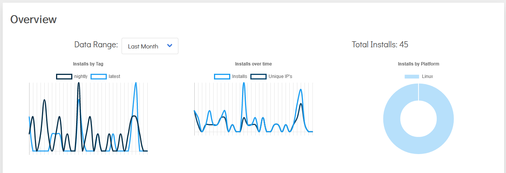

It has somehow been over a year since we switched to promoting the Github Container Registry (GHCR) as our primary repository for docker images after Docker Hub introduced pull limits (which we were subsquently able to obtain an exemption from), so we figured it was about time for something new.

## Introducing lscr.io

We are partnering with [Scarf](https://scarf.sh) to create our own pseudo-registry, lscr.io. This isn't a true docker registry, we're not hosting the images ourselves, it's more of a load-balancer/stats platform/vanity URL. Scarf will front all image pulls via lscr.io and transparently redirect it to the appropriate backend registry (currently GHCR), which means that if we have to change the registry we're using due to an extended outage, change of policy, etc. you don't have to do anything. Additionally, our stats are currently all over the place; Docker Hub and GHCR both count pulls but they don't do it very well, or present it in a helpful fashion, or do it in a way that we can be sure is comparable between platforms. Scarf will give us a centralised stats dashboard so we can better identify which of our images are popular, which image *tags* are popular, and which get one pull a month, and that means we can better focus our engineering efforts rather than having to guess.

We want to be very clear: this isn't any kind of "analytics" setup and we're not gathering any individualised data, just aggregated pulls by tag, count of unique IPs, and what platform docker is running on, so we can see how many people are using our images.

Over the next few weeks, as we release new builds of images, our documentation will update to reflect the new registry name and our Unraid templates will follow suit. We recommend that you switch your existing images to use lscr.io to help future-proof your setup but it's not mandatory and the existing Docker Hub and GHCR image links will continue to work going forward if you can't, or prefer not to, use lscr.io. Switching is as simple as prepending `lscr.io/` to the start of the image name if you currently use a Docker Hub image, or replacing `ghcr.io` with `lscr.io` if you currently use a GHCR image, e.g. `lscr.io/linuxserver/syslog-ng:latest`.
