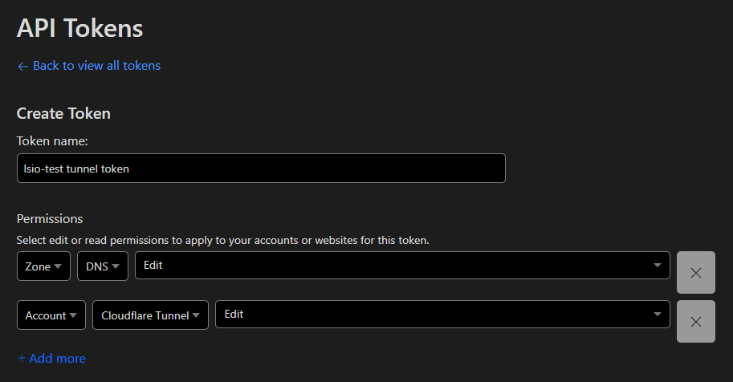
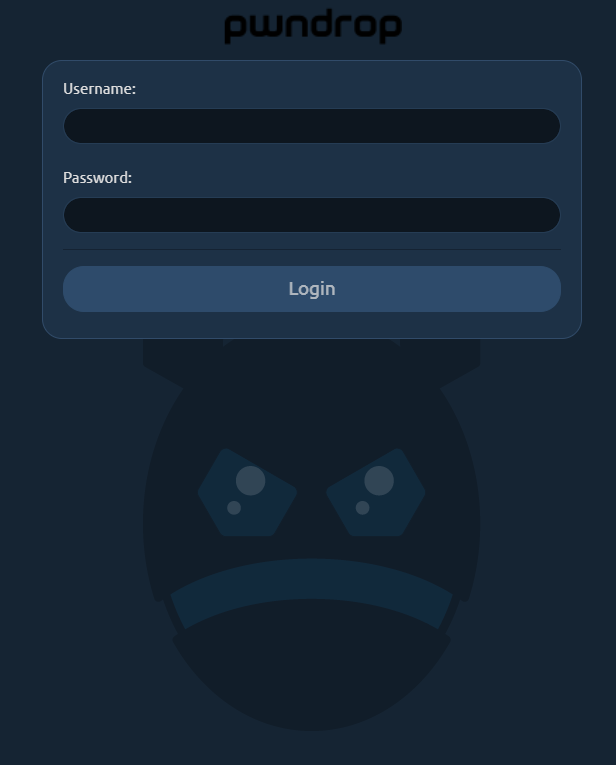
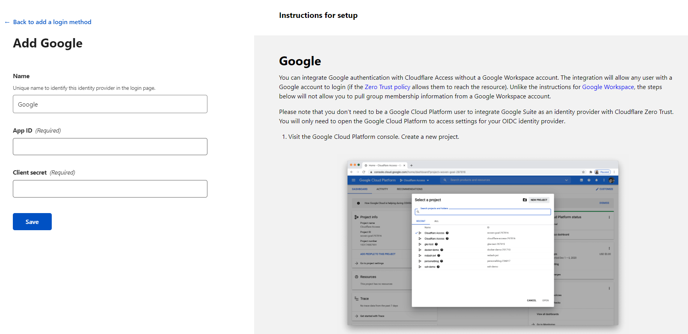
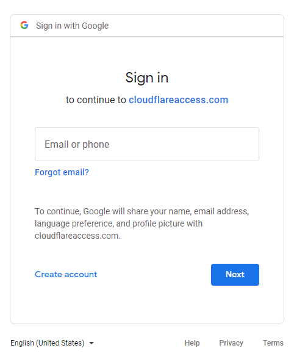
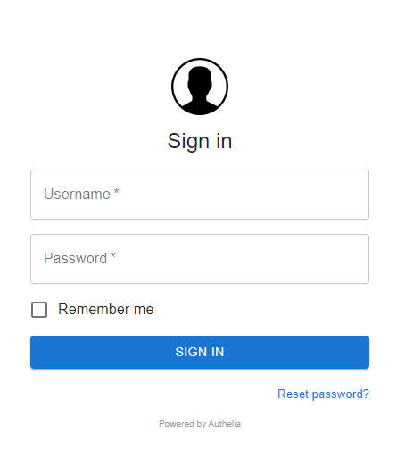

## Introduction<a id="introduction"></a>

Zero Trust Architecture is the practice of designing systems based on the principle of `never trust, always verify`, as opposed to the traditional `trust, but verify` principle . It has become quite a popular buzz word of late, in light of all the recent successful cyber attacks, compromising vast amounts of user data. As it is a broad concept, there are many aspects and applications, but in this article we will focus on applying Zero Trust to the web based services we host.

[Cloudflare Tunnels](https://blog.cloudflare.com/ridiculously-easy-to-use-tunnels/) provide an easy way to achieve Zero Trust by pairing them with either Cloudflare Access, or other authentication solutions like Authelia.

In this article, we will provide 3 examples. The first one involves setting up a single service in a docker container with the cloudflared mod, which will route all incoming connections through Cloudflare, with all the protections they provide. This is meant to be a publicly accessible service, so there will be no authentication. The second example involves setting up multiple services, reverse proxied via SWAG, and the authentication handled via Cloudflare Access's Google SSO integration. The final example involves setting up multiple services reverse proxied via SWAG, and with authentication handled via a local instance of Authelia integrated with SWAG, and 2fa via Duo. You'll notice that with all 3 examples, there will be no ports mapped on the host so none of these services will be available on the local network. All connections will go through Cloudflare directly into the containers.

Keep in mind that this article is not meant to be a step by step guide. It is only meant to showcase some of what you can achieve with Cloudflare Tunnels and Access, SWAG and Authelia. There are many different possible combinations for implementation.

## Initial Cloudflare setup<a id="cloudflare-setup"></a>

Before we start, we need to create a new api token for Cloudflare with the correct scope, and retrieve our zone and account ids. On Cloudflare's dashboard, in the overview page of our domain, we can see the `zone` and `account` ids at the bottom right of the screen. Right below them, there is a link titled `Get your API token`. Let's copy those ids and then click on that link. The scope we need for the token should include `Zone:DNS:Edit` and `Account:Cloudflare Tunnel:Edit`. Make sure that your token creation page looks as shown in the screenshot below. Once we save, our token will be displayed once. We'll copy that, too, as we will not be able to view it again after closing.



We also need to sign up for Cloudflare Teams to be able to access their Zero Trust dashboard through which the tunnels and access policies are managed. It is technically a premium service, but they offer a free plan for up to 50 users, which should be plenty for a home lab setting. Keep in mind that since it is a premium feature, they do ask for a valid credit card during sign up, but with the free plan, there should not be any charges. Sign up through [this link](https://dash.teams.cloudflare.com/).

## Single service published without authentication<a id="single-service"></a>

As the first scenario, let's set up very basic service for file sharing. It's meant to be publicly accessible by anyone with a link so there will be no authentication. Our [pwndrop](https://github.com/linuxserver/docker-pwndrop) image is perfect for this task. Pwndrop is a self-deployable file hosting service for sending out red teaming payloads or securely sharing your private files over HTTP and WebDAV. In this case we have no use for the red teaming features, but it works great for just sharing files.

Here's the compose yaml we can use to create the `pwndrop` container:
```yaml
---
version: "2.1"
services:
  pwndrop:
    image: lscr.io/linuxserver/pwndrop
    container_name: pwndrop
    environment:
      - PUID=1000
      - PGID=1000
      - TZ=America/New_York
      - SECRET_PATH=/mysupersecretpath
      - DOCKER_MODS=linuxserver/mods:universal-cloudflared
      - CF_ZONE_ID=kujg35k2j4vg5k2hjv34g5jv23kj325
      - CF_ACCOUNT_ID=kh1gv35khgv34k5v3g5hkgcv4k34jv5k
      - CF_API_TOKEN=kh5vk135v4k1j3gv54k1v3g5k354gjv
      - CF_TUNNEL_NAME=lsio-test.com
      - CF_TUNNEL_PASSWORD=iugv1k5guvf4kgh15vk4ghc5ku3o6gu3y4vg1o4uy159
      - FILE__CF_TUNNEL_CONFIG=/config/tunnelconfig.yml
  volumes:
      - /home/aptalca/pwndrop:/config
    restart: unless-stopped
```
### ENV variables defined:<a id="single-service-env-vars"></a>
- `SECRET_PATH` defines the subfolder address where the admin portal should be accessed at. Attempting to browse to other nonexistent subfolders of pwndrop, or the base url `/` will lead to a rather unexpected redirect.
- `DOCKER_MODS=linuxserver/mods:universal-cloudflared` will make sure that the Cloudflared mod gets loaded when the `pwndrop` container starts.
- `CF_ZONE_ID`, `CF_ACCOUNT_ID` and `CF_API_TOKEN` should contain the values we copied in the previous step above.
- `CF_TUNNEL_NAME` can be set to anything and the newly created tunnel will be displayed with this name on the Cloudflare dashboard.
- `CF_TUNNEL_PASSWORD` should be a long string we make up (or randomly generate) and should be longer than 32 characters.
- `FILE__CF_TUNNEL_CONFIG` points to a file within the container that will contain the tunnel configuration.
- Notice that there are no ports mapped here so the container will not be accessible directly.
- `/home/aptalca/pwndrop` will be mapped to `/config` inside the container and will contain all persistent data.

In the variable `FILE__CF_TUNNEL_CONFIG`, instead of entering the tunnel config into the environment variable, we are telling the container to load the configuration from a file inside the container. That is because we need that config to be in yaml format with the correct indentation.

Since our `/config` folder is mapped to `/home/aptalca/pwndrop` on the host, let's create that folder structure and save the following tunnel config into the file `/home/aptalca/pwndrop/tunnelconfig.yml`:
```yaml
ingress:
  - hostname: share.lsio-test.com
    service: http://localhost:8080
  - service: http_status:404
```
This tunnel configuration tells cloudflared to access our app at the address `http://localhost:8080` from inside the container (8080 is the port pwndrop listens at), and publicly expose it (or reverse proxy) at the address `share.lsio-test.com`.

Once the container is created, we'll see the relevant log entries about the tunnel being created and once it's done, we should see the dns CNAME entry for `share.lsio-test.com` on the Cloudflare dashboard with Cloudflare proxy turned on.

Browsing to `https://share.lsio-test.com/mysupersecretpath` should load the wizard for `pwndrop` and allow us to create the admin user. From this point on, all connections to `share.lsio-test.com` will go through Cloudflare to the container directly, without any ports exposed on our docker host.



## Multiple services published via SWAG, with Google SSO<a id="multiple-services-swag-google"></a>

In this example, we will use SWAG to locally discover and reverse proxy services, which will be accessible through a Cloudflare tunnel and with Google SSO. For discovery of local services, we will use the `auto-proxy` mod for SWAG.

```yaml
version: "2.1"
services:
  swag:
    image: lscr.io/linuxserver/swag
    container_name: swag
    cap_add:
      - NET_ADMIN
    environment:
      - PUID=1000
      - PGID=1000
      - TZ=America/New_York
      - URL=lsio-test.com
      - VALIDATION=dns
      - SUBDOMAINS=wildcard
      - DNSPLUGIN=cloudflare
      - DOCKER_MODS=linuxserver/mods:swag-auto-proxy|linuxserver/mods:universal-docker|linuxserver/mods:universal-cloudflared
      - DOCKER_HOST=dockerproxy
      - CF_ZONE_ID=kujg35k2j4vg5k2hjv34g5jv23kj325
      - CF_ACCOUNT_ID=kh1gv35khgv34k5v3g5hkgcv4k34jv5k
      - CF_API_TOKEN=kh5vk135v4k1j3gv54k1v3g5k354gjv
      - CF_TUNNEL_NAME=lsio-test.com
      - CF_TUNNEL_PASSWORD=iugv1k5guvf4kgh15vk4ghc5ku3o6gu3y4vg1o4uy159
      - FILE__CF_TUNNEL_CONFIG=/config/tunnelconfig.yml
    extra_hosts:
      - lsio-test.com:127.0.0.1
    volumes:
      - /home/aptalca/appdata/swag:/config
    restart: unless-stopped
  dockerproxy:
    image: lscr.io/linuxserver/socket-proxy
    container_name: dockerproxy
    volumes:
      - /var/run/docker.sock:/var/run/docker.sock:ro
    environment:
      - CONTAINERS=1
      - POST=0
    restart: unless-stopped
  overseerr:
    image: lscr.io/linuxserver/overseerr
    container_name: overseerr
    environment:
      - PUID=1000
      - PGID=1000
      - TZ=America/New_York
    volumes:
      -  /home/aptalca/appdata/overseerr:/config
    labels:
      - swag=enable
    restart: unless-stopped
  tautulli:
    image: lscr.io/linuxserver/tautulli
    container_name: tautulli
    environment:
      - PUID=1000
      - PGID=1000
      - TZ=Europe/London
    volumes:
      - /home/aptalca/appdata/tautulli:/config
    labels:
      - swag=enable
    restart: unless-stopped
```

Let's break down some of these arguments:
### SWAG arguments:<a id="multiple-services-swag-google-swag-args"></a>
- `extra_hosts: lsio-test.com:127.0.0.1`: sets a dns hosts entry inside the container for our domain so that inside the container our domain resolves to `127.0.0.1` and the ssl cert remains valid
- `DOCKER_MODS=linuxserver/mods:swag-auto-proxy|linuxserver/mods:universal-docker|linuxserver/mods:universal-cloudflared` will enable 3 mods:
  - `swag-auto-proxy`: automatically discover local services and enable reverse proxies
  - `universal-docker`: installs docker-cli that is needed for `auto-proxy`'s service discovery
  - `universal-cloudflared`: installs the cloudflared service within SWAG
- `CF_ZONE_ID`, `CF_ACCOUNT_ID` and `CF_API_TOKEN` should contain the values we copied in the previous step above.
- `CF_TUNNEL_NAME` can be set to anything and the newly created tunnel will be displayed with this name on the Cloudflare dashboard.
- `CF_TUNNEL_PASSWORD` should be a long string we make up (or randomly generate) and should be longer than 32 characters.
- `FILE__CF_TUNNEL_CONFIG` points to a file within the container that will contain the tunnel configuration.
- Notice that there are no ports mapped here so the container will not be accessible directly.
- `/home/aptalca/swag` will be mapped to `/config` inside the container and will contain all persistent data.

In the variable `FILE__CF_TUNNEL_CONFIG`, instead of entering the tunnel config into the environment variable, we are telling the container to load the configuration from a file inside the container. That is because we need that config to be in yaml format with the correct indentation.

Since our `/config` folder is mapped to `/home/aptalca/swag` on the host, let's create that folder structure and save the following tunnel config into the file `/home/aptalca/swag/tunnelconfig.yml`:
```yaml
ingress:
  - hostname: lsio-test.com
    service: https://lsio-test.com
  - hostname: "*.lsio-test.com"
    service: https://lsio-test.com
  - service: http_status:404
```
In this tunnel config, we will set 2 hostnames for ingress, one for the naked domain and one for the wildcard subdomains. Cloudflared service will connect to SWAG over https with a valid cert (thanks to the `extra_hosts` entry in SEAG arguments for our domain). The connection between the container and the Cloudflare servers will be encrypted by the local cloudflared service. Any public connection to the domains would be made to Cloudflare servers with the Cloudflare provided certs.

### Socket-proxy arguments:<a id="multiple-services-swag-google-dockerproxy-args"></a>
Mapping the `docker.sock`, especially in a publicly accessible container is a security liability. Since this mod only needs read-only access to the docker api, the recommended method is to proxy the `docker.sock` via a solution like [linuxserver/socket-proxy](https://github.com/linuxserver/docker-socket-proxy), limit the access, and set DOCKER_HOST= to point to the proxy address in SWAG.
- `/var/run/docker.sock:/var/run/docker.sock:ro` allows the `dockerproxy` container full access to the `docker.sock`
- `CONTAINERS=1` allows SWAG to read info on other containers
- `POST=0` prevents SWAG from write access to the api
- SWAG's env var `DOCKER_HOST=dockerproxy` tells SWAG to connect to the `dockerproxy` container for docker api access so it is bound by the limits set above


### Overseerr and Tautulli arguments:<a id="multiple-services-swag-google-other-args"></a>
- `swag=enable`: This label will be read by the `auto-proxy` mod in SWAG and the reverse proxy will be set up automatically. Since there are preset proxy confs for both of those apps and that we are using the recommended container names for them, we don't have to set the other labels the mod supports. If you want to reverse proxy apps where we don't provide a preset proxy conf, or that you are using custom settings for them, you may have to set the other labels [listed here](https://github.com/linuxserver/docker-mods/tree/swag-auto-proxy#labels)
- Notice that there are no ports mapped here so the containers will not be accessible directly

Once we issue `docker compose up -d`, all the containers will be created and started, swag will download the necessary mods, set up the reverse proxies and cloudflared will create the tunnel. When we access our Cloudflare dashboard, under dns, we will see 2 `CNAME`s set, one for the naked domain `lsio-test.com` and one for its subdomains `*.lsio-test.com`. Both will have proxy turned on. When we access Cloudflare's `Zero Trust` dashboard, we will see the tunnel listed. At this point, the containers should be accessible via the addresses `https://tautulli.lsio-test.com` and `https://overseerr.lsio-test.com`. However there will be no authentication yet. We'll set that up in the next step.

We can add any other containers into the same compose yaml, without mapping ports. Once we add the `swag=enable` label, it should be auto detected within a minute and the reverse proxy will be set up. No changes will be necessary on Cloudflare's end as all requests going to Cloudflare will be forwarded to SWAG, which will do the reverse proxying on the backend.

### Setting up Google SSO on Cloudflare:<a id="multiple-services-swag-google-sso-setup"></a>

To set up Google SSO for our services, we need to first create a Google app and set it up with Cloudflare. Let's navigate to https://dash.teams.cloudflare.com/, click on `Settings` and then `Authentication`. In the box for `Login methods`, we'll click on `Add new` and we'll see a list of available auth providers. For a personal Google account, we'll select the option `Google`.



The instructions on the right hand side will guide us through process of creating a Google project and app on https://console.cloud.google.com. At the end, we'll retrieve the client id and the client secret and plug them into the Cloudflare interface. Once saved, Google SSO will be available as a login method in the Zero Trust dashboard.

Now we need to set up the policies for our domains, enable Google auth and define who has access to them. The policies are controlled by `Applications`, which can be managed via the Zero Trust dashboard, under the `Access` menu on the left.

Since each application has to be associated with a single domain, we'll have to create two applications, one for `lsio-test.com` and another for `*.lsio-test.com`. Let's create our first one:
- Click on `Add Application` and select `Self-hosted`. 
- We can name the app `lsio-test.com`, and select the domain for `lsio-test.com`. 
- Under `Identity Providers`, we'll select the `Google` login method we just created.
- We can enable `Instant Auth` so that we skip the identity provider selection page, which is useless when enabling only one provider.
- On the next page, we'll create a policy for access. Let's name the policy `Google` and set the `rule action` to allow.
- Under `Create rules`/`Include`, we'll select `Emails` and enter our e-mail address `aptalca@lsio-test.com` (you can add multiple emails if needed).
- Feel free to edit any of the other advanced settings (you don't have to) and we'll click on `Add application` to create it.
This app will be activated on any connection made to the address `https://lsio-test.com`, will require Google login and will only allow our email address entered. All others will be denied access. If your Google account has 2fa set up, it will be enforced here as well.



The app we just created is only active for the address `https://lsio-test.com` and it doesn't cover any of the subdomains. Therefore, we'll have to create a second app just like the above, but we'll name it `*.lsio-test.com` and set the `Application domain` to `*.lsio-test.com`. All else will be the same, so that the naked domain as well as all the subdomains will enforce Google login and will only allow our email address.

Now we have Google SSO enabled for our domain and all of its subdomains. However, if we want to bypass auth for one of the subdomains, `Overseerr` perhaps, so anyone can access it publicly, we can create a third application on Cloudflare's Zero Trust dashboard, set the domain to `overseerr.lsio-test.com`, set its policy action to `bypass` instead of `allow`, and create the rule below to `Include` `Everyone`. That application will take precedence over the application we created for `*.lsio-test.com` because it is for a specific domain and the other a wildcard, and will let anyone access the `overseerr` subdomain without auth.

## Multiple services published via SWAG, with Authelia SSO and Duo 2fa<a id="multiple-services-swag-authelia"></a>

In this example we will use SWAG to locally discover and reverse proxy services, which will be accessible through a Cloudflare tunnel, similar to the previous example. However, instead of using Google SSO implemented on Cloudflare, we'll use Authelia SSO implemented on our local server. For discovery of local services, we will use the `auto-proxy` mod for SWAG.

```yaml
version: "2.1"
services:
  swag:
    image: lscr.io/linuxserver/swag
    container_name: swag
    cap_add:
      - NET_ADMIN
    environment:
      - PUID=1000
      - PGID=1000
      - TZ=America/New_York
      - URL=lsio-test.com
      - VALIDATION=dns
      - SUBDOMAINS=wildcard
      - DNSPLUGIN=cloudflare
      - DOCKER_MODS=linuxserver/mods:swag-auto-proxy|linuxserver/mods:universal-docker|linuxserver/mods:universal-cloudflared
      - DOCKER_HOST=dockerproxy
      - CF_ZONE_ID=kujg35k2j4vg5k2hjv34g5jv23kj325
      - CF_ACCOUNT_ID=kh1gv35khgv34k5v3g5hkgcv4k34jv5k
      - CF_API_TOKEN=kh5vk135v4k1j3gv54k1v3g5k354gjv
      - CF_TUNNEL_NAME=lsio-test.com
      - CF_TUNNEL_PASSWORD=iugv1k5guvf4kgh15vk4ghc5ku3o6gu3y4vg1o4uy159
      - FILE__CF_TUNNEL_CONFIG=/config/tunnelconfig.yml
    extra_hosts:
      - lsio-test.com:127.0.0.1
    volumes:
      - /home/aptalca/appdata/swag:/config
    restart: unless-stopped
  dockerproxy:
    image: lscr.io/linuxserver/socket-proxy
    container_name: dockerproxy
    volumes:
      - /var/run/docker.sock:/var/run/docker.sock:ro
    environment:
      - CONTAINERS=1
      - POST=0
    restart: unless-stopped
  authelia:
    image: ghcr.io/authelia/authelia:4.34.6
    container_name: authelia
    user: "1000:1000"
    environment:
      - TZ=America/New_York
    volumes:
      - /home/aptalca/appdata/authelia:/config
    restart: unless-stopped
  overseerr:
    image: lscr.io/linuxserver/overseerr
    container_name: overseerr
    environment:
      - PUID=1000
      - PGID=1000
      - TZ=America/New_York
    volumes:
      -  /home/aptalca/appdata/overseerr:/config
    labels:
      - swag=enable
    restart: unless-stopped
  tautulli:
    image: lscr.io/linuxserver/tautulli
    container_name: tautulli
    environment:
      - PUID=1000
      - PGID=1000
      - TZ=Europe/London
    volumes:
      - /home/aptalca/appdata/tautulli:/config
    labels:
      - swag=enable
      - swag_auth=authelia
    restart: unless-stopped
```
For explanation on some of these arguments, see the linked sections:
- [SWAG arguments](#multiple-services-swag-google-swag-args)
  - Don't forget to create the tunnel config as described in that section
- [linuxserver/socket-proxy arguments](#multiple-services-swag-google-dockerproxy-args)
- [Overseerr and Tautulli arguments](#multiple-services-swag-google-other-args)

New arguments:
- We added the label `swag_auth=authelia` to Tautulli so the `auto-proxy` mod enables Authelia in the Tautulli reverse proxy config (Overseerr is still served without auth)
- Authelia container is locked to image tag `4.34.6` since there may be breaking changes between versions and one must always check for them before manually updating to a newer version
- Authelia config is set to be stored in `/home/aptalca/appdata/authelia`

Before we bring up the containers via `docker compose up -d`, let's configure Authelia first, so when the containers are created and started, the whole stack is fully functional.

Let's first create the Authelia folders with our user because Authelia does not do chown on its config folder like linuxserver containers do, and we are running it with `user: "1000:1000"`. A simple `mkdir -p /home/aptalca/appdata/authelia/logs` with our linux user (in this case uid 1000) should suffice, and both the config folder and the logs folder will be created.

Then we'll create the Authelia configuration in the config folder, named `configuration.yml` with the following contents:
```yaml
server:
  host: 0.0.0.0
  port: 9091
  read_buffer_size: 4096
  write_buffer_size: 4096
  path: "authelia"
log:
  level: info
  file_path: /config/logs/authelia.log
jwt_secret: somethingsomethingrandomsecret
default_redirection_url: https://domain.url
duo_api:
  hostname: api-somenumber.duosecurity.com
  integration_key: SOMESECRETKEY
  secret_key: somelongersecretkey
authentication_backend:
  disable_reset_password: false
  file:
    path: /config/users_database.yml
    password:
      algorithm: argon2id
      iterations: 1
      key_length: 32
      salt_length: 16
      memory: 512
      parallelism: 8
access_control:
  default_policy: deny
  rules:
    - domain:
      - lsio-test.com
      - "*.lsio-test.com"
      policy: two_factor
session:
  name: authelia_session
  secret: somerandomsecret
  expiration: 1h
  inactivity: 5m
  remember_me_duration: 1M
  domain: lsio-test.com
regulation:
  max_retries: 3
  find_time: 2m
  ban_time: 5m
storage:
  encryption_key: somethingsomethingreallylongandsecret
  local:
    path: /config/db.sqlite3
notifier:
  disable_startup_check: false
  smtp:
    username: myemail@gmail.com
    password: longpassword
    host: smtp.gmail.com
    port: 587
    sender: myemail@gmail.com
    subject: "[Authelia] {title}"
    startup_check_address: test@authelia.com
    disable_require_tls: false
    tls:
      skip_verify: false
      minimum_version: TLS1.2
```
We will not go into the details of all these options here because you can refer to our blog article [Setting up Authelia with SWAG](/blog/2020-08-26-setting-up-authelia/).

Then we'll create the `users_database.yml` with the following contents:

```yaml
users:
  aptalca:
    displayname: "aptalca"
    password: "$argon2id$v=19$m=524288,t=1,p=longrandompasswordhashgenerated"
    email: myemail@gmail.com
    groups: []
```
Specific instructions on how to generate these password hashes can be found in the article linked above.

Now when we issue `docker compose up -d`, all the containers will be created and started, SWAG will download the mods and activate the Cloudflare tunnel, and the `auto-proxy` mod will discover and reverse proxy the two containers (Tautulli with Authelia SSO). At this point, `https://overseerr.lsio-test.com` and `https://lsio-test.com` will not be behind auth. To put the naked domain behind Authelia, we can modify the default site config of SWAG to enable [this line](https://github.com/linuxserver/docker-swag/blob/f8e4eca8d083f6a4fb7036e769c7406d1520cb13/root/defaults/default#L33) and [this line](https://github.com/linuxserver/docker-swag/blob/f8e4eca8d083f6a4fb7036e769c7406d1520cb13/root/defaults/default#L47). With this configuration, Cloudflare will not have any authentication implemented and will pass all requests to SWAG. SWAG will redirect to Authelia as needed for Authentication. All users and access groups will be defined in the Authelia configuration. When we now browse to `https://tautulli.lsio-test.com`, we should see the following Authelia log in page:



After log in, we can select the second factor authentication method out of several options, which include duo push.

## Further Reading<a id="further-reading"></a>

- [Cloudflare-real-ip mod](https://github.com/linuxserver/docker-mods/tree/swag-cloudflare-real-ip): This mod adds a startup script that gets the IP's from Cloudflares edge servers, and formats them in a format Nginx can use with `set_real_ip_from` so the IPs in nginx logs reflect the real IPs accessing through Cloudflare.
- [SWAG fail2ban](https://github.com/linuxserver/docker-swag#using-fail2ban): Fail2ban is integrated into SWAG and can be used to block malicious IPs via customizable filters and actions.
- [F2B Discord Notification mod](https://github.com/linuxserver/docker-mods/tree/swag-f2bdiscord): This mod allows SWAG container to send Fail2Ban notifications to Discord.
- [CrowdSec mod](https://github.com/linuxserver/docker-mods/tree/swag-crowdsec): This mods adds a CrowdSec nginx bouncer to SWAG, as an alternative to Fail2ban.
